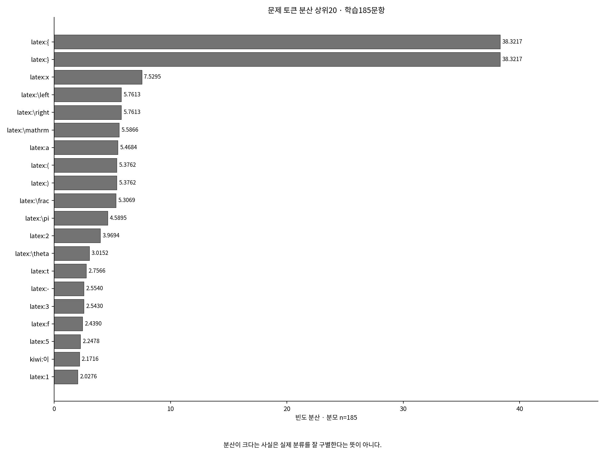
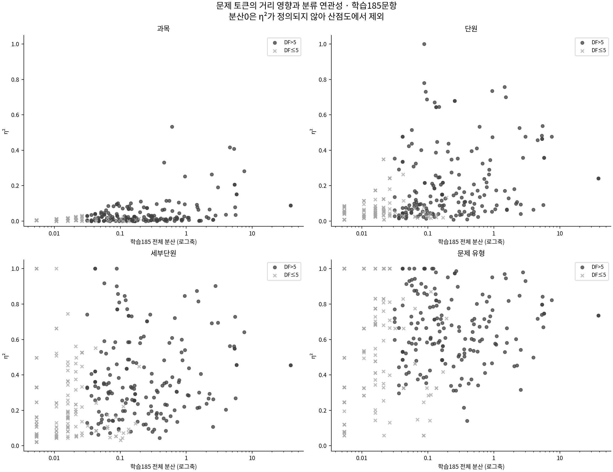
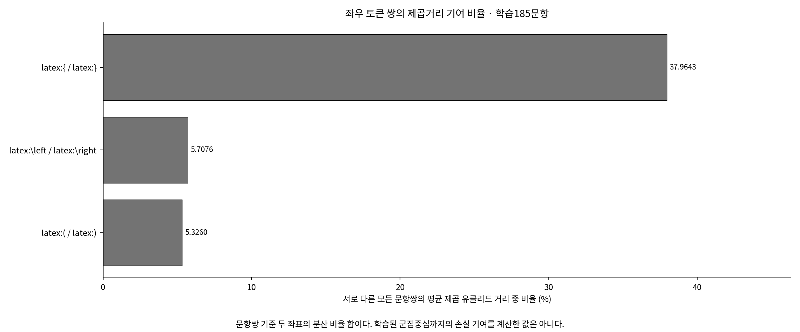
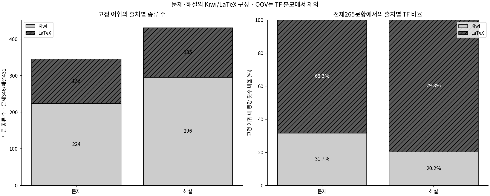

# 문제 토큰 · 학습185문항의 분산과 분류 연관성

먼저 분산 상위 토큰과 아래 표를 본다. 통계는 사용자가 토큰을 검토할 근거이며 제거/유지 결정을 내리지 않았다.

- [전체346토큰과 학습/테스트 TF·DF](all_tokens.csv)
- [4분류 수준×346토큰 분산 분해](variance_by_classification.csv) · [분류별 토큰 평균·DF](class_token_means.csv) · [집단 크기](class_labels.csv)
- [같거나 유사한 빈도 좌표](redundancy_analysis.csv) · [통계적 관찰 패턴](highlight_patterns.csv)

## 분산과 거리 영향

이 그림과 η²는 학습185문항 기준이다. all_tokens.csv의 mean/variance/std는 전체265문항의 라벨을 사용하지 않는 빈도 통계이고, train_mean/train_variance/train_std가 학습 기준이다.

## 주요 토큰을 같은 표에서 비교

|토큰|학습185 전체 분산|과목 η²|단원 η²|세부단원 η²|유형 η²|의미|
|---|---:|---:|---:|---:|---:|---|
|`latex:{`|38.3217|0.0885|0.2416|0.4542|0.7354|LaTeX 명령어 인수·부분식의 묶음을 여는 기호|
|`latex:}`|38.3217|0.0885|0.2416|0.4542|0.7354|LaTeX 명령어 인수·부분식의 묶음을 닫는 기호|
|`latex:\left`|5.7613|0.1520|0.3579|0.4564|0.7472|왼쪽 구분 기호의 크기 조절|
|`latex:\right`|5.7613|0.1520|0.3579|0.4564|0.7472|오른쪽 구분 기호의 크기 조절|
|`latex:(`|5.3762|0.2064|0.4643|0.5494|0.7971|소괄호·함수 인수·순서쌍 등의 시작|
|`latex:)`|5.3762|0.2064|0.4643|0.5494|0.7971|소괄호·함수 인수·순서쌍 등의 끝|
|`latex:\lim`|0.2544|0.0743|0.6794|0.7031|0.9734|극한을 나타내는 명령어|
|`latex:\sin`|0.6055|0.5327|0.5328|0.6085|0.6728|사인 함수|
|`latex:\cos`|0.4595|0.3312|0.3962|0.4825|0.6038|코사인 함수|
|`latex:\tan`|0.1439|0.1009|0.2475|0.3325|0.5824|탄젠트 함수|
|`latex:\pi`|4.5895|0.4165|0.4575|0.5622|0.7167|원주율 기호|
|`latex:\theta`|3.0152|0.1902|0.4772|0.6943|0.9301|그리스 문자 이름|
|`latex:x`|7.5295|0.2822|0.4775|0.6418|0.8219|단일 영문자 이름|
|`latex:2`|3.9694|0.0367|0.0639|0.2037|0.4983|분리된 수치 리터럴|
|`latex:\mathrm`|5.5866|0.0352|0.0918|0.2685|0.6695|인수의 로마체 글꼴 지정|
|`latex:a`|5.4684|0.0783|0.5380|0.7288|0.8418|단일 영문자 이름|

## 분류별 η²

|분류 수준|학습 집단 수|1문항 집단 수|η² 상위3 토큰|
|---|---:|---:|---|
|과목|2|0|`latex:\sin` (0.5327, DF=73), `latex:\pi` (0.4165, DF=76), `latex:\frac` (0.4085, DF=110)|
|단원|8|0|`kiwi:연속` (1.0000, DF=18), `latex:.` (0.7805, DF=18), `latex:&` (0.7572, DF=18)|
|세부단원|25|6|`kiwi:연속` (1.0000, DF=18), `kiwi:수직선` (1.0000, DF=8), `kiwi:움직이` (1.0000, DF=8)|
|문제 유형|70|43|`kiwi:연속` (1.0000, DF=18), `latex:.` (1.0000, DF=18), `kiwi:방향` (1.0000, DF=9)|

### 큰 분산·낮은 η²의 관찰 예

|분류 수준|큰 분산·낮은 η²인 관찰 예 (η²)|
|---|---|
|과목|`latex:-` (0.0084), `latex:3` (0.0074), `kiwi:의` (0.0027), `kiwi:,` (0.0024), `latex:k` (0.0010)|
|단원|`latex:2` (0.0639), `latex:3` (0.0409), `kiwi:,` (0.0662), `latex:k` (0.0636), `latex:=` (0.0680)|
|세부단원|`latex:2` (0.2037), `latex:3` (0.1074), `latex:1` (0.2376), `kiwi:,` (0.2160), `latex:\sqrt` (0.2131)|
|문제 유형|`latex:2` (0.4983), `latex:-` (0.5420), `latex:3` (0.3157), `latex:5` (0.4534), `kiwi:이` (0.6021)|

이 표는 각 수준에서 분산≥75백분위수·η²≤중앙값인 교집합을 요약한다. 삭제 후보나 최종 선택 목록이 아니다.

- [과목 η² 상위20](figures/eta_top20_curriculum.png)
- [단원 η² 상위20](figures/eta_top20_unit.png)
- [세부단원 η² 상위20](figures/eta_top20_subunit.png)
- [문제 유형 η² 상위20](figures/eta_top20_type.png)

η²가 높은 희귀 토큰은 해당 소집단에만 우연히 나타난 결과일 수 있다. 특히 유형70개에는 표본1개인 집단이 많다. 토큰별 train_df·집단 크기·adjusted_eta_squared를 함께 보되 이것으로 불용어를 자동 선정하지 않는다.

## 중복 좌표

명시적으로 비교한 중괄호·좌우 표시·소괄호의 6좌표가 학습 제곱거리에서 차지하는 합은 49.00%다. 같은 빈도 패턴을 여러 좌표로 표현하면 그 패턴의 거리 가중치가 반복된다. 괄호 개수는 수식 복잡도의 흔적도 담을 수 있으므로 통계적 중복을 제거의 근거 하나로만 읽는다.

|학습185문항의 좌표 쌍|빈도가 같은 문항 수|상관계수|쌍의 제곱거리 기여 비율|
|---|---:|---:|---:|
|`latex:{` / `latex:}`|185/185|1.0000|37.96%|
|`latex:\left` / `latex:\right`|185/185|1.0000|5.71%|
|`latex:(` / `latex:)`|185/185|1.0000|5.33%|

다른 토큰의 빈도 벡터가 같더라도 수학적 의미가 같다는 뜻은 아니다. 특히 희귀 토큰이 같은 소수 문항에만 나타나면 서로 다른 개념도 동일 패턴이 될 수 있다.

## Kiwi·LaTeX 분포와 문제/해설의 차이

[정의·분모·토큰화 한계의 전체 보고서](../token_analysis_report.md) · [처음으로](../README.md)
