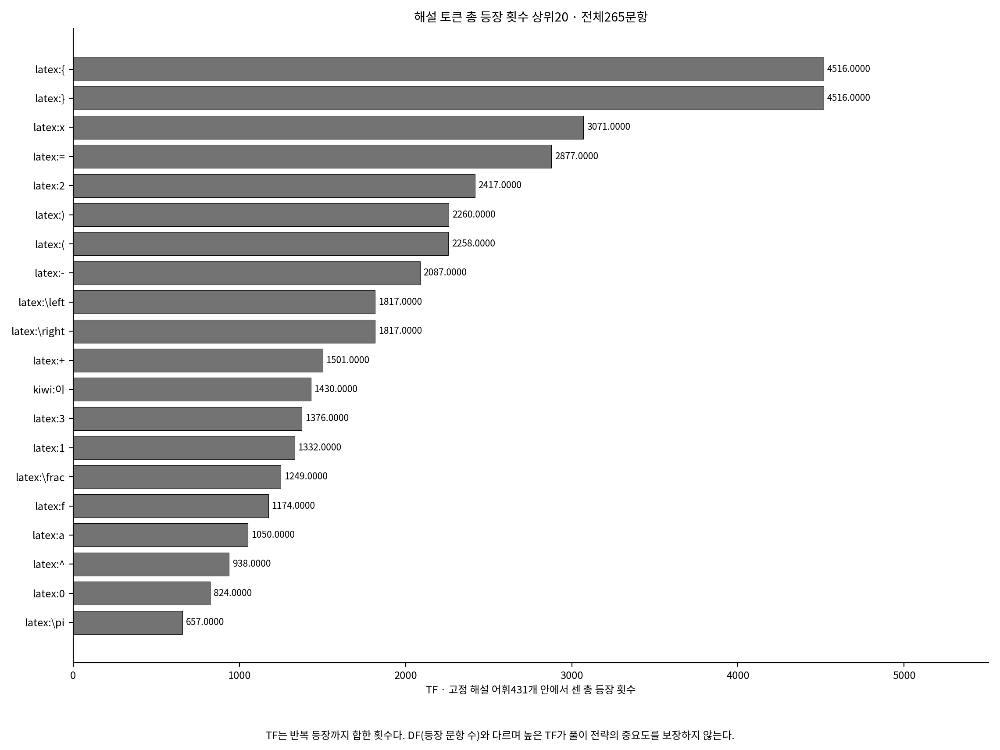
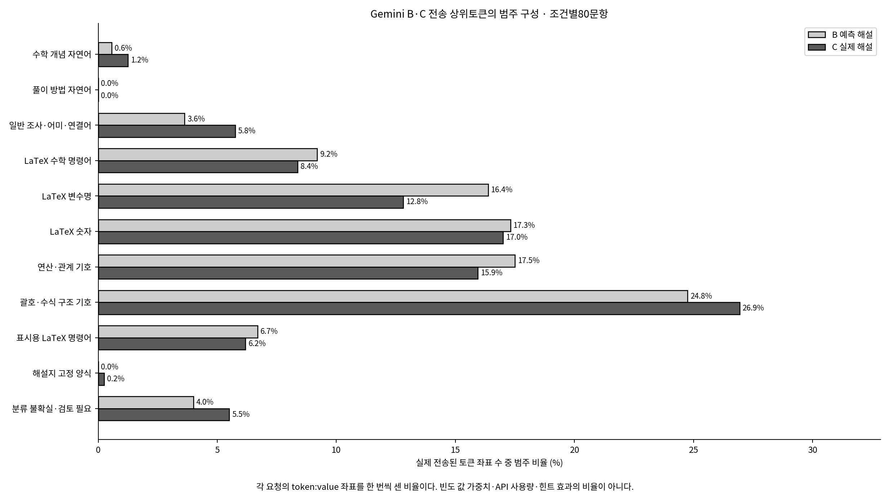
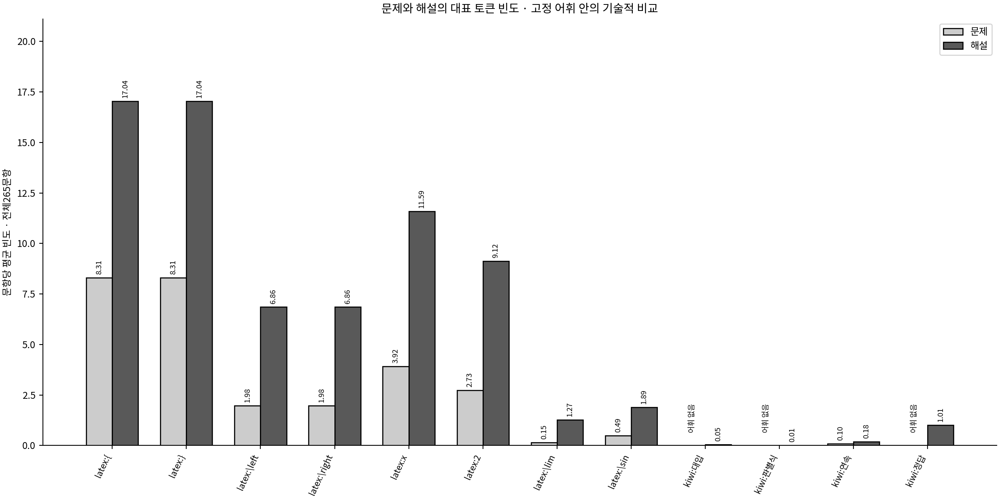

# 해설 토큰과 기존 Gemini의 실제 상위토큰

해설431차원의 기술 통계와 기존 B·C 요청 기록을 읽었다. 회귀 모델을 로드하거나 새 토큰으로 Gemini를 호출하지 않았다.

- [전체431토큰 TF·DF·분산](all_tokens.csv)
- [160요청별 전송/전체벡터 상위20 비교](top20_analysis.csv)
- [실제 전송 token:value 좌표](transmitted_tokens.csv) · [토큰별 등장 문항 수](top20_token_frequency.csv) · [11범주 구성](top20_category_composition.csv)

## 해설 자체에서 자주 나타나는 토큰

## B·C 실제 전송 구성

|실제 전송 좌표의 설명용 범주|B 예측 해설|C 실제 해설|
|---|---:|---:|
|서식·구조·고정 양식|503/1600 (31.44%)|534/1600 (33.38%)|
|숫자·변수|539/1600 (33.69%)|477/1600 (29.81%)|
|수학 개념·명령·연산|436/1600 (27.25%)|409/1600 (25.56%)|
|풀이 방법 자연어|0/1600 (0.00%)|0/1600 (0.00%)|
|그 밖의 일반·불확실 토큰|122/1600 (7.62%)|180/1600 (11.25%)|

표의 분모는 각 조건80개 요청의 실제 전송된 token:value 좌표 수다. 한 요청에서 한 토큰을 한 번 센다. 토큰의 예측 빈도 값으로 가중하지 않았으며 API 토큰 사용량도 아니다.

|조건|실제 전송 상위토큰에 자주 포함된 토큰 (문항 수)|
|---|---|
|B|`latex:=` (80/80), `latex:{` (75/80), `latex:}` (75/80), `latex:x` (70/80), `latex:)` (67/80), `latex:+` (67/80), `latex:2` (66/80), `latex:(` (65/80), `latex:-` (62/80), `kiwi:이` (58/80), `latex:3` (56/80), `latex:1` (52/80)|
|C|`latex:=` (80/80), `latex:{` (74/80), `latex:}` (74/80), `latex:2` (69/80), `latex:(` (64/80), `latex:)` (63/80), `kiwi:이` (61/80), `latex:+` (61/80), `latex:-` (61/80), `latex:x` (61/80), `latex:1` (52/80), `latex:\left` (47/80)|

### 관심 토큰이 실제로 포함된 문항 수

|관심 토큰|고정 해설 어휘에 포함|B 실제 전송 문항 수|C 실제 전송 문항 수|설명용 역할|
|---|---|---:|---:|---|
|`kiwi:정답`|예 (인덱스242)|0/80|2/80|해설지 고정 양식 · 해설의 정답 표기|
|`kiwi:해설`|예 (인덱스293)|0/80|2/80|해설지 고정 양식 · 해설 제목·구간 표시|
|`kiwi:대입`|예 (인덱스96)|0/80|0/80|풀이 방법 자연어 · 값이나 식을 다른 식에 넣는 풀이 절차|
|`kiwi:판별식`|예 (인덱스276)|0/80|0/80|수학 개념 자연어 · 방정식의 근을 판단하는 데 쓰는 식|
|`kiwi:연속`|예 (인덱스191)|0/80|2/80|수학 개념 자연어 · 함수의 연속성|
|`latex:\left`|예 (인덱스381)|48/80|47/80|표시용 LaTeX 명령어 · 왼쪽 구분 기호의 크기 조절|
|`latex:\right`|예 (인덱스392)|48/80|45/80|표시용 LaTeX 명령어 · 오른쪽 구분 기호의 크기 조절|
|`latex:\lim`|예 (인덱스383)|12/80|17/80|LaTeX 수학 명령어 · 극한을 나타내는 명령어|

어휘에 있으나 전송되지 않은 토큰은0/80이다. 어휘 자체에 없는 표현은 ‘해당 없음’으로 구분한다. 높은 전송 문항 수가 실제 풀이에 유용했다는 뜻은 아니다.

## 전체 벡터 상위20과 실제 전송의 구분

B는 저장된 실수 예측을 음수0보정한 뒤 반올림 전 양수 빈도로 내림차순 정렬하고, 동률은 기존 어휘 인덱스 순서로 처리했다. C도 같은 어휘와 규칙으로 실제 해설 빈도를 사용했다. 최대20개를 고른 다음 소수점3자리 표시에서 0이 된 값은 전송에서 빠질 수 있다. CSV는 선택된 전체 벡터 토큰과 실제 prompt_audit의 hint.mapping을 따로 비교한다.

B의 기존 요청 파일은 과거 성공 응답의 입력을 바탕으로 복원하고 원본 입력·힌트와 정확히 대조한 감사 자료다. C는 실제 SDK 호출 직전 기록도 대조했다. 복원 기록을 과거 시점의 실시간 SDK 캡처로 표현하지 않는다.

예측·실제 해설의 전체 벡터 상위20 공통 수는 문항당 평균 14.0625개, Precision@20은 0.703125다(분모20). 실제 전송된 B·C 집합의 공통 수 평균은 14.0625개다. 이번160요청에서 표시 반올림 후 0이 되어 생략된 좌표는 0개다. 이 값은 풀이 정답률이 아니다.

상위20 집합의 공통 토큰 수/20은 빈도 표현의 일치도다. 특정 원본 해설과 빈도가 다르더라도 다른 올바른 풀이가 가능하므로 수학적 정오로 해석하지 않는다.

## 문제와 해설의 대표적인 빈도 차이

이 그림에서 고정 어휘에 없는 토큰은 0 막대를 만들지 않고 ‘어휘 없음’으로 표시한다. 정확한 어휘 포함 여부와 TF는 각 all_tokens.csv에서 확인한다. 문제·해설은 목적과 길이가 다르므로 같은 토큰의 높은 빈도만으로 중요도를 판단하지 않는다.

## 해석의 경계

서식·숫자·변수 비중은 입력의 구성에 관한 관찰이다. 이것만으로 힌트가 유용하지 않았다거나, 특정 토큰을 지우면 정답률이 개선된다고 결론내릴 수 없다. 현재 설명용 역할 사전에서 ‘풀이 방법 자연어’로 분류한 토큰은 B·C에서 모두 0좌표다. 이는 명시적인 해당 자연어 범주가 없다는 관찰이며, 수학 명령·연산에 암묵적 단서가 없었다는 뜻이 아니다. 범주에 ‘표시’가 붙어도 인수·단위·조건 정보를 담을 수 있고, ‘불확실’에는 모든·항상·만족 같은 논리 조건도 포함된다. 실제 대안 입력의 효과는 이번에 검증하지 않았다.

[처음으로](../README.md) · [전체 해석](../token_analysis_report.md)
