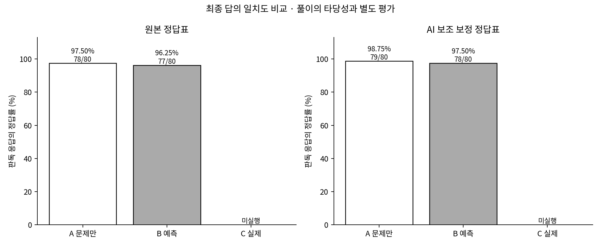
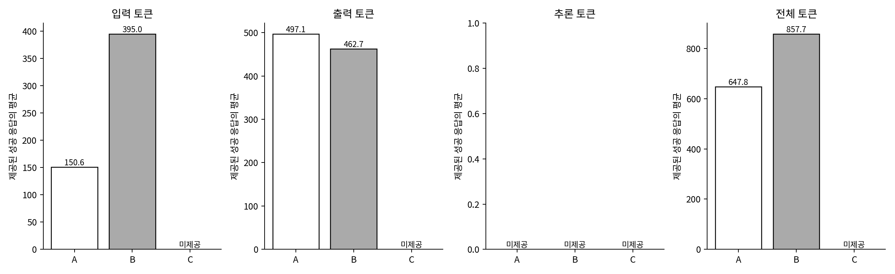
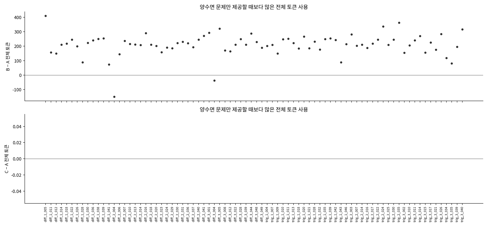

# Gemini 세 조건 비교

성공 응답 **240/240개**. 미완료 응답을 오답이나 0토큰으로 바꾸지 않는다.

요청 모델 `gemini-3.1-flash-lite`, temperature `0.0`, thinking `minimal`, 최대 출력 `8192`.

|조건|원본 정답표|정답률|AI 보조 보정표|보조 정답률|미채점·누락|재사용|
|---|---:|---:|---:|---:|---:|---:|
|A 문제만|78/80|97.50%|79/80|98.75%|0|80|
|B 예측 상위20토큰|77/80|96.25%|78/80|97.50%|0|80|
|C 실제 해설 상위20토큰|75/80|93.75%|76/80|95.00%|0|0|

정답률은 최종 답의 자동 판독 결과다. 소스 정답표 충돌은 `trig_1_010`이며 원본은 ④, 수학 검토가 지지한 값은 ②(9/5)다. 원본을 고치지 않고 AI 보조 점수를 따로 표시했다.

|성공 응답 토큰|A 합계 / 평균|B 합계 / 평균|C 합계 / 평균|
|---|---:|---:|---:|
|입력|12,051 / 150.64|31,600 / 395.00|28,372 / 354.65|
|출력|39,769 / 497.11|37,015 / 462.69|36,423 / 455.29|
|추론|미제공 / 미제공|미제공 / 미제공|미제공 / 미제공|
|전체|51,820 / 647.75|68,615 / 857.69|64,795 / 809.94|

API usage의 입력·출력·추론·전체 필드를 그대로 보존했다. 전체 토큰에는 추론 등을 다시 더하지 않는다. 추론 미제공은 0이 아니다. 합계는 해당 조건 성공 응답 모두에서 값이 제공될 때만 표시한다.

|대응 비교|채점된 쌍|왼쪽만 정답|오른쪽만 정답|오른쪽−왼쪽|McNemar p|
|---|---:|---:|---:|---:|---:|
|A → B|80|2|1|-1.25%|1.0000|
|A → C|80|4|1|-3.75%|0.3750|
|B → C|80|2|0|-2.50%|0.5000|

전체 토큰이 미제공인 전송 시도(누적 보존 이력): A 36회 / B 0회 / C 1회. A/B의 이력은 재사용한 과거 실행이며 현재 추가 C 실행과 구분한다. 따라서 이 표의 성공 응답 합계를 모든 시도의 확정 소비량·청구 비용으로 해석하지 않는다.

실패 후 별도 실행에서 재요청한 문항: `diff_2_020` (누적 2시도). 성공이 이미 저장된 조건은 다시 요청하지 않았다.

신규 실험의 기록된 전송 시도 81회 중 실패 기록 1회, 전체 토큰 미제공 시도 1회다. 성공 응답의 합계는 비교할 수 있지만, 실패 시도의 사용량이 미확인인 경우 전체 청구 비용·소비량은 확정할 수 없다.
- `diff_2_020`: `ReadTimeout` (실행 1, 시도 1). 서버에서 처리가 끝났는지와 사용량은 응답이 없어 미확인이다. 재개 시 성공 응답을 중복 호출하지 않고 실패 문항만 제한적으로 다시 요청했다면 그 이력을 누적 보존한다.

McNemar 검정은 같은 문제의 정오답 차이에 대한 보조 분석이다. 계획된 세 비교에 다중 비교 보정을 적용하지 않았으며 채점된 쌍이 없으면 산출하지 않는다. 작은 정답 수 차이를 일반적인 개선으로 단정하지 않는다.

## 실제 입력과 응답

[입력 감사](prompt_audit/) · [B/C 전송 토큰 나란히 비교](prompt_audit/token_comparison.md) · [80문항 한 행 비교](question_comparison.csv) · [정오답 또는 답이 다른 문항](changed_questions.csv) · [생성 응답](responses.jsonl) · [상세 집계](analysis.json)

B/C의 선택·정렬·표시·기본 지시는 같고 벡터의 출처 설명만 달라진다. B는 기존 입력과 설정이 정확히 같을 때만 재사용했다. A/B는 이전 실행을 재사용하고 C는 추가 실험이다. 저장된 C 응답은 A/B와 호출 시점이 다르다. 요청 모델과 실제 반환 model_version을 별도로 저장했으며 제공되지 않은 내부 모델 정보를 검증했다고 주장하지 않는다.

응답이 보고한 model_version 분포: A={"gemini-3.1-flash-lite": 80} / B={"gemini-3.1-flash-lite": 80} / C={"gemini-3.1-flash-lite": 80}. 이는 반환된 식별자이며 내부 모델 동일성을 증명하지 않는다.

## 풀이 타당성

- A 문제만: 기존 동일 응답의 AI 보조 검토 재사용. 적절 76, 부적절 4, 불확실 0, 미검토 0. 사람의 확정 검토 0건.
- B 예측 상위20토큰: 기존 동일 응답의 AI 보조 검토 재사용. 적절 71, 부적절 7, 불확실 2, 미검토 0. 사람의 확정 검토 0건.
- C 실제 해설 상위20토큰: 신규 AI 보조 검토 적절 71, 부적절 9, 불확실 0, 미검토 0. [실제 인용·수학 근거](solution_review.json)를 확인한다. 사람의 확정 판정이 아니다.

C의 부적절 판정은 최종 답이 맞지만 표기·중간 논리에 문제가 있는 5건과 최종 오답이면서 풀이에도 문제가 있는 4건을 포함한다. 표기 오류·뒤에서 재계산한 오류·근거 부족·최종 오답의 error_kind를 구분해 기록했다. 따라서 9건을 모두 최종 오답이나 같은 심각도의 오류로 해석하지 않는다.

신규 C와 기존 A/B는 검토 시점·검토자가 달라 AI 검토 개수 차이를 엄밀히 통제된 성능 차이로 확정하지 않는다. 공식 교육과정 성취기준 전체와 대조하지 않아 교과 범위는 여전히 미확정이다.

기존 AI 검토는 조건을 알 수 있는 상태에서 작성되었으며 독립적인 블라인드 사람 평가가 아니다. 해시·인용 일치는 대상의 동일성을 확인할 뿐 판단의 수학적 정확성을 보증하지 않는다.

## 해석 범위

- C는 실제 해설의 상위 토큰을 제공하는 진단 조건이며 일반 예측 성능이나 보장된 이론적 상한이 아니다.
- 회귀 평가는 반올림하지 않는다. API에는 음수 보정 후 반올림 전 값으로 선정한 상위20토큰을 소수 셋째 자리까지 표시한다.
- 원본 정답표와 AI 보조 보정 점수는 분리하며 원본 응답을 수정하지 않는다.
- 80문항·각 조건 문항당1회 생성이며, 반복 생성의 변동을 측정하지 않았다.
- 이전 테스트 결과를 본 뒤 후속 비교를 설계했다. 학습에 테스트를 넣지 않았지만 완전히 미관찰한 독립 평가라고 주장하지 않는다.
- 미제공 추론 토큰은 null이며 전체 토큰에 추가 합산하지 않는다.
