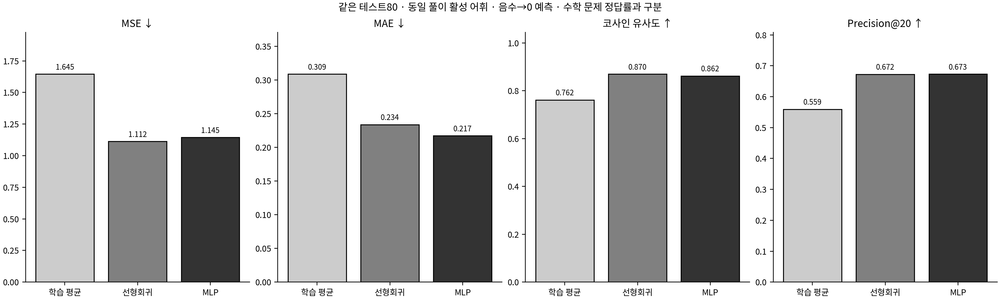

# MathHint Final Experiment 2

## 결과를 읽는 순서

|연구|먼저 열 자료|
|---|---|
|완료된 군집화|[군집화 결과](cluster_improvement/README.md)|
|문제270 → 원본 풀이 공통 데이터|[데이터·분할·어휘·불용어](solution_data/README.md)|
|선형회귀와 개선 기록|[선형 결과](regression/README.md) · [문항별 예측](regression/question_comparison.csv)|
|nn.Sequential 비선형 모델|[MLP 결과](deep_learning/README.md) · [문항별 예측](deep_learning/question_comparison.csv)|
|Gemini A/B/C/D|[정답·사용량](gemini_comparison/README.md) · [네 풀이 비교 HTML](gemini_comparison/report.html)|
|모든 연구 해석과 한계|[종합 보고서](final_report.md) · [전체 검증](validation.json)|

문제 입력은 기존 **270차원**을 그대로 읽었고, 원본 풀이265개는 어휘 462종에서 승인103개를 제외한 **359차원**을 새로 구성했다.

## 같은 기준으로 두 예측 모델 비교

내부 검증37 · 기준선은 fit148 평균

|모델|MSE ↓|MAE ↓|코사인 ↑|Precision@20 ↑|Recall@20 ↑|공통 토큰 수/20|
|---|---|---|---|---|---|---|
|학습 평균 기준선|1.8378|0.3247|0.7294|0.5203|0.5783|10.4054|
|선형회귀|1.3850|0.2689|0.8219|0.6000|0.6672|12.0000|
|nn.Sequential MLP|1.4117|0.2549|0.8147|0.5905|0.6548|11.8108|

MLP 검증 행은 대표 seed42의 값이다. 구성 선택에 사용한3시드 평균과는 구분하며 자세한 값은 딥러닝 README에 있다.

최종 테스트80 · 기준선은 학습185 평균

|모델|MSE ↓|MAE ↓|코사인 ↑|Precision@20 ↑|Recall@20 ↑|공통 토큰 수/20|
|---|---|---|---|---|---|---|
|학습 평균 기준선|1.6454|0.3089|0.7617|0.5594|0.5904|11.1875|
|선형회귀|1.1121|0.2339|0.8699|0.6725|0.7105|13.4500|
|nn.Sequential MLP|1.1446|0.2174|0.8622|0.6731|0.7098|13.4625|

테스트80의 음수 보정 P@20은 선형 0.6725, MLP 0.6731다. MLP−선형 차이는 +0.0006다. 이는 이 고정 테스트의 관찰이며 비선형 모델의 일반적인 우월성을 보장하지 않는다.



## Gemini 네 조건의 실제 풀이

현재 실행 상태: **interrupted**. 완료하지 않은 응답을 오답이나0토큰으로 집계하지 않는다.

|조건|성공/80|채점 가능|원본 기준 정답|정답률|평균 입력|평균 출력|평균 전체|
|---|---|---|---|---|---|---|---|
|A 문제만|80|80|78|97.50%|150.6|497.1|647.8|
|B 선형회귀 예측 토큰|2|2|2|100.00%|403.0|539.0|942.0|
|C 딥러닝 예측 토큰|3|3|3|100.00%|408.0|413.7|821.7|
|D 실제 해설 토큰|3|3|3|100.00%|369.3|390.7|760.0|

평균 토큰은 실제 제공된 성공 응답 값에 대한 평균이며 미제공은 —다. 추론 토큰을 전체 토큰에 다시 더하지 않는다. 원본 정답 기준과 trig_1_010의 AI 보조 기준은 분리한다.

### 실제 풀이 효과와 사용량을 구분해 읽기

- B: 성공 2/80, 원본 정답표 기준 2/2채점 가능. 미완료 76·실패 2·채점 불가 0.
- C: 성공 3/80, 원본 정답표 기준 3/3채점 가능. 미완료 76·실패 1·채점 불가 0.
- D: 성공 3/80, 원본 정답표 기준 3/3채점 가능. 미완료 75·실패 2·채점 불가 0.

|대응 조건|공통 채점 수|앞만 정답|뒤만 정답|정확 McNemar p|Holm 보정 p|
|---|---|---|---|---|---|
|A-B|2|0|0|1.0000|1.0000|
|A-C|3|0|0|1.0000|1.0000|
|A-D|3|0|0|1.0000|1.0000|
|B-C|1|0|0|1.0000|1.0000|
|B-D|1|0|0|1.0000|1.0000|
|C-D|3|0|0|1.0000|1.0000|

정오답 변화가 적으면 검정력이 낮다. 유의하지 않다는 사실은 효과가 없다는 증명이 아니며, 반복 생성하지 않은 작은 표본과 시점이 다른 과거 A 재사용이라는 한계가 있다.

|전체 토큰 차이|사용량 제공 공통 문항|차이 합계|문항당 평균 차이|
|---|---|---|---|
|B−A|2|556|278.00|
|C−A|3|699|233.00|
|D−A|3|514|171.33|
|C−B|1|-90|-90.00|

토큰 차이는 두 응답이 모두 성공하고 실제 total이 제공된 공통 문항만 사용했다. 음수는 뒤 조건보다 적은 토큰, 양수는 많은 토큰이다. 미완료 집합의 서로 다른 합계를 직접 비교하지 않는다.

## 연구 범위와 한계

- 전체265 문제·원본 풀이의 어휘를 사전에 사용했다. 가중치와 모델 선택은 원래 학습185 내부에서만 수행했지만 완전히 독립적인 미관측 일반화 평가가 아니다.
- 검증 P@20을 먼저 고정하고 내부148/37에서 유한 후보를 개선했다. 최종 설정을 확정한 뒤185개로 재학습하고 테스트80 예측을 만들었다. API 정답률을 보고 모델을 다시 바꾸지 않는다.
- 특정 원본 해설의 토큰 빈도는 가능한 여러 올바른 풀이 중 하나의 표현이다. 빈도 오차와 수학적 풀이의 옳고 그름은 다른 평가다.
- 학습185에서 빈도가0인 풀이 토큰25개는 전체 어휘에 있어도 학습 사례가 없다. 문제의 동일 BoW가 train/test에 걸친 diff_1_007·diff_1_011도 원래 분할대로 남겨 해석에 제한이 있다.
- BoW는 수식의 순서·분자/분모·변수 역할·논리 연결을 보존하지 못한다. 층을 늘리는 것만으로 소실된 수식 구조가 복원되지 않는다.
- 원본 답 정오답과 풀이 과정 타당성을 분리했다. 구체적 오류 단계·근거로 충분히 확인하지 못한 생성 풀이는 검토 보류로 남기며 사람의 확정 판정으로 표시하지 않는다.
- API 원문·사용량·미완료 상태·실제 요청을 보존한다. 과거의 정확히 같은 요청 재사용과 새 응답의 실행 시점 차이도 구분한다.
- 예측 모델의 연산 비용을 측정하지 않았으므로 Gemini 토큰 절감만으로 시스템 전체 계산 효율성이 개선됐다고 주장하지 않는다.

학습185 확장은 테스트80 네 조건을 완료·검증한 뒤 확인된 호출 예산이 충분할 때만 실행한다. 현재 예산이 확인되지 않으면 확장하지 않는다. HTML은 GitHub 파일 화면에서 실행되지 않으므로 저장소 ZIP 전체를 압축 해제해 브라우저로 연다. 로컬 수식 자산과 연결된 폴더가 함께 필요하며 인터넷 연결 없이 읽을 수 있다.

## 실행과 재개

각 모델·API README의 명령을 따른다. 저장 결과의 종합 안내만 재생성하려면:

```bash
python -m mathhint_learning.final_experiment_2.report report
python -m mathhint_learning.final_experiment_2.report verify
```

report/verify는 새 모델 학습이나 Gemini 호출을 실행하지 않는다. 실제 API 재개는 gemini_comparison의 generate 명령으로 분리했다.
