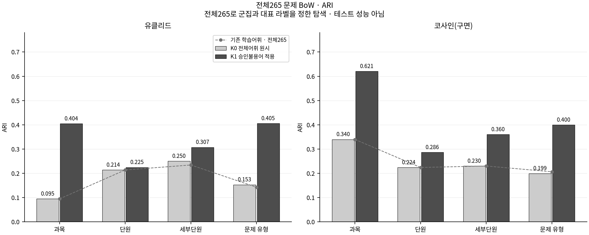
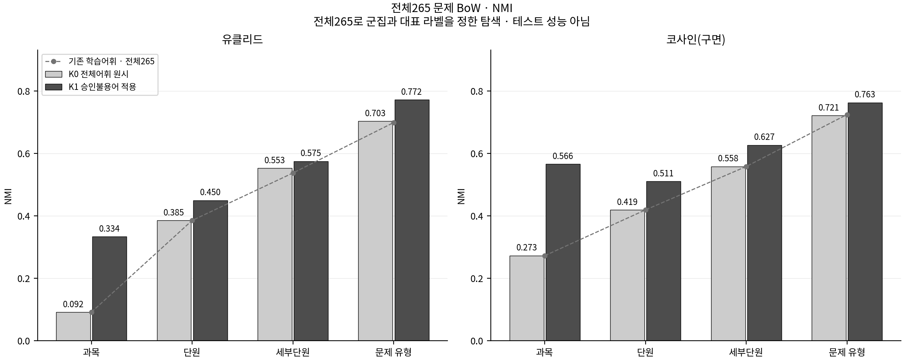

# 같은265문항 군집 구조의 비교

[읽기용 비교표·해석](comparison_with_original.md)에서 기존 전체265 결과와 새 K0/K1을 나란히 읽는다. [전체 수치 CSV](comparison_with_original.csv)는 소수 반올림 전 값을 보존한다.

모두 학습한265문항을 다시 설명하는 결과다. 테스트80문항의 일반화 성능이나 회귀·Gemini 성능을 뜻하지 않는다.
