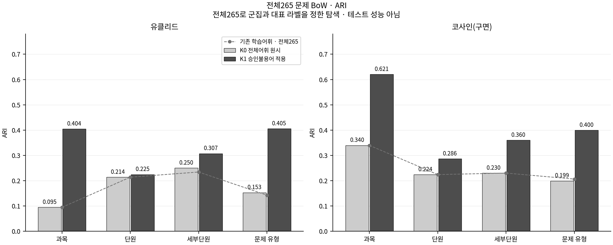
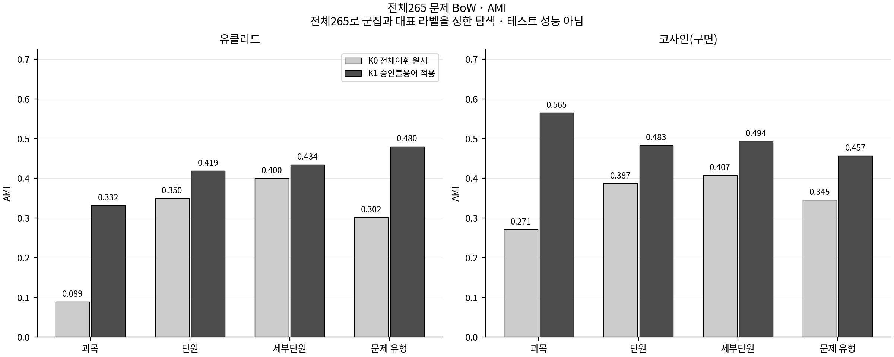
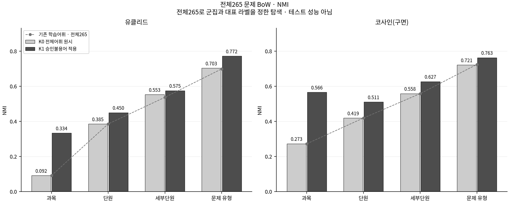
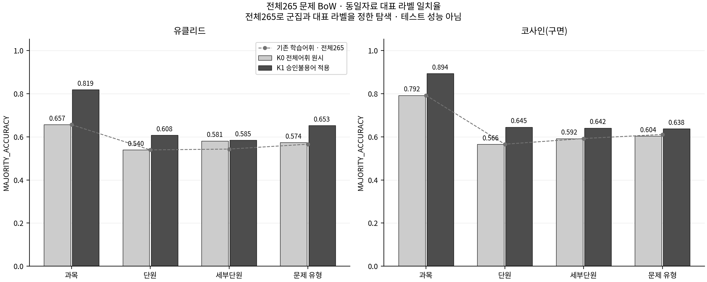
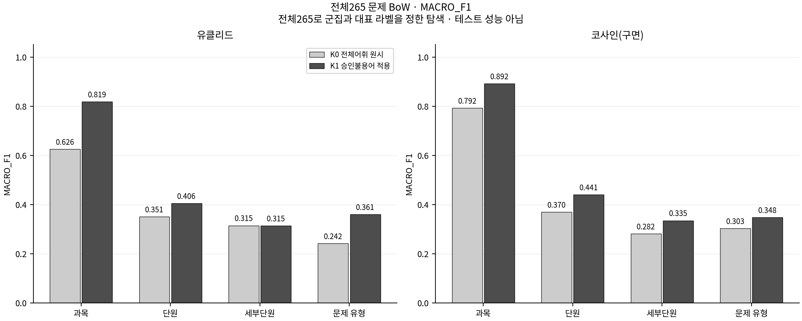
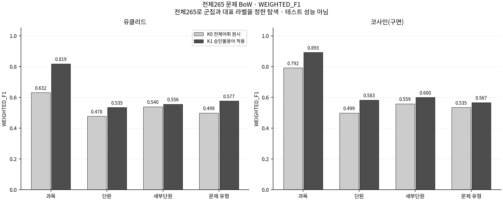

# MathHint 2차 후속 실험 · 전체265 문제 BoW와 불용어 전처리

**이번 범위는 전체265문항의 문제 BoW와 K-means 비교다.** 풀이 BoW 재구성·회귀 학습·Gemini 호출은 수행하지 않는다. 기존 `final_experiment`·`token_analysis`와 사용자 불용어 목록은 보존한다.

처음에는 아래 표·그림을 보고, 관심 있는 분류의 군집 목록과 혼동행렬을 연다. 전체 설명은 [종합 보고서](final_report.md)에서 읽는다.

## 1. 무엇을 바꾸었는가?

기존 학습185문항 전용 어휘에서 빠졌던 표현을 전체265 원문 재토큰화로 복원했다. 같은 재토큰화 결과를 K0 원시 빈도와 K1 사용자 문제 불용어 적용 조건으로 나누었다. 토큰화·K-means 알고리즘·5시드 학습 목적함수 선택 규칙은 기존 구현을 재사용한다.

## 2. 데이터는 어떻게 달라졌는가?

| 항목 | 문제 BoW |
|---|---|
| 원본 문항 | 265문항 (기존185/80 분할은 출처로 보존) |
| 기존 학습 전용 어휘 | 346 |
| K0 전체265 원시 어휘 | 366 |
| 복원된 토큰 종류 | 20 |
| 사용자 등록 불용어 | 96 |
| 실제로 제거한 토큰 종류 | 96 |
| K1 활성 차원 | 270 |
| 전체 등장 횟수: 제거 전 → 후 | 24,179 → 9,676 |
| 제거된 총 등장 횟수 (TF) | 14,503 |

복원된 토큰 사례: `latex:\gamma`, `latex:\log`, `latex:\circ`, `kiwi:곱`, `kiwi:닫힌구간`. 수학 기호가 복원됐다는 사실만으로 군집 성능 향상을 의미하지 않는다.

[어휘 비교와 생성 정책](00_dataset/vocabulary_comparison.md) · [복원 토큰 전체](00_dataset/restored_tokens.csv) · [제거 토큰·TF 전체](00_dataset/stopword_audit.csv) · [남은 토큰 전체](00_dataset/retained_tokens.csv) · [문항별 제거 전·후 TF](00_dataset/question_token_counts.csv)

불용어 제거 후 같은 벡터가 된 문항: `diff_1_007`·`diff_1_011`(같은 실제 유형). 숫자·변수 등 제거한 좌표의 차이가 사라진 정보 손실 사례다. 같은 유형 안의 중복 표현이 생겼다는 사실을 유형 오분류가 발생했다는 주장과 구분한다.

## 3. 군집 구조 일치도는 어떻게 달라졌는가?

**전체265문항 탐색 — 새로운 문항에 대한 일반화 성능이 아님.** 유클리드 결과를 주로 해석하고 코사인(구면)은 비교 자료로 본다.

| 실제 분류 | 거리 | 기존 전체265 ARI | K0 새 원시 ARI | K1 불용어 적용 ARI | K1−K0 |
|---|---|---|---|---|---|
| 과목 | 유클리드 | 0.0948 | 0.0948 | 0.4045 | +0.3096 |
| 과목 | 코사인(구면) | 0.3396 | 0.3396 | 0.6206 | +0.2810 |
| 단원 | 유클리드 | 0.2139 | 0.2139 | 0.2247 | +0.0108 |
| 단원 | 코사인(구면) | 0.2241 | 0.2241 | 0.2864 | +0.0623 |
| 세부단원 | 유클리드 | 0.2343 | 0.2504 | 0.3073 | +0.0569 |
| 세부단원 | 코사인(구면) | 0.2302 | 0.2302 | 0.3604 | +0.1303 |
| 문제 유형 | 유클리드 | 0.1429 | 0.1528 | 0.4055 | +0.2527 |
| 문제 유형 | 코사인(구면) | 0.2063 | 0.1993 | 0.3997 | +0.2005 |

선택된 모델에서 K0 대비 상승한 조건 수는 ARI 8/8, AMI 8/8, NMI 8/8다. 하지만 유클리드 단원 ARI 변화는 +0.0108로, 과목 +0.3096와 유형 +0.2527보다 작았다.

어휘만 복원한 K0는 기존 전체265 결과 대비 ARI가 5조건에서 같고 2조건에서 상승·1조건에서 하락했다. 구면 방식의 유형 ARI는 0.2063→0.1993였다. 표현을 복원하는 것과 군집 일치도가 높아지는 것은 같은 결과가 아니다.



### AMI·NMI

| 실제 분류 | 거리 | K0 AMI | K1 AMI | K0 NMI | K1 NMI |
|---|---|---|---|---|---|
| 과목 | 유클리드 | 0.0889 | 0.3320 | 0.0917 | 0.3339 |
| 과목 | 코사인(구면) | 0.2706 | 0.5649 | 0.2726 | 0.5661 |
| 단원 | 유클리드 | 0.3499 | 0.4189 | 0.3854 | 0.4500 |
| 단원 | 코사인(구면) | 0.3868 | 0.4831 | 0.4192 | 0.5109 |
| 세부단원 | 유클리드 | 0.3999 | 0.4344 | 0.5528 | 0.5749 |
| 세부단원 | 코사인(구면) | 0.4074 | 0.4940 | 0.5581 | 0.6270 |
| 문제 유형 | 유클리드 | 0.3016 | 0.4802 | 0.7031 | 0.7716 |
| 문제 유형 | 코사인(구면) | 0.3453 | 0.4569 | 0.7213 | 0.7630 |





### 군집 대표 라벨 일치율·F1

군집의 최빈 실제 라벨을 같은265문항에서 정한 설명용 지표다. 임의 군집 번호를 실제 분류 번호로 간주하지 않는다.

| 실제 분류 | 거리 | 조건 | 동일265문항 대표 라벨 일치율 | Macro-F1 | Weighted-F1 | 점유/k |
|---|---|---|---|---|---|---|
| 과목 | 유클리드 | K0 | 65.66% | 0.6258 | 0.6319 | 2/2 |
| 과목 | 유클리드 | K1 | 81.89% | 0.8188 | 0.8186 | 2/2 |
| 과목 | 코사인(구면) | K0 | 79.25% | 0.7924 | 0.7924 | 2/2 |
| 과목 | 코사인(구면) | K1 | 89.43% | 0.8920 | 0.8929 | 2/2 |
| 단원 | 유클리드 | K0 | 53.96% | 0.3507 | 0.4778 | 8/8 |
| 단원 | 유클리드 | K1 | 60.75% | 0.4056 | 0.5349 | 8/8 |
| 단원 | 코사인(구면) | K0 | 56.60% | 0.3695 | 0.4987 | 8/8 |
| 단원 | 코사인(구면) | K1 | 64.53% | 0.4411 | 0.5833 | 8/8 |
| 세부단원 | 유클리드 | K0 | 58.11% | 0.3147 | 0.5398 | 25/25 |
| 세부단원 | 유클리드 | K1 | 58.49% | 0.3145 | 0.5558 | 25/25 |
| 세부단원 | 코사인(구면) | K0 | 59.25% | 0.2817 | 0.5588 | 25/25 |
| 세부단원 | 코사인(구면) | K1 | 64.15% | 0.3353 | 0.6003 | 25/25 |
| 문제 유형 | 유클리드 | K0 | 57.36% | 0.2424 | 0.4988 | 70/70 |
| 문제 유형 | 유클리드 | K1 | 65.28% | 0.3608 | 0.5769 | 70/70 |
| 문제 유형 | 코사인(구면) | K0 | 60.38% | 0.3034 | 0.5352 | 70/70 |
| 문제 유형 | 코사인(구면) | K1 | 63.77% | 0.3480 | 0.5668 | 70/70 |







유클리드 세부단원의 Macro-F1은 0.314665→0.314530(-0.000135)로 아주 작게 하락했다. 같은 조건의 ARI·Weighted-F1 상승이 모든 실제 분류를 균등하게 더 잘 구별한다는 뜻은 아니다. 이 미세 차이의 통계적 유의성은 검정하지 않았다.

### 초기화에 따른 변동도 함께 보기

| 실제 분류 | 거리 | K0 시드 ARI 평균 ± 표준편차 | K1 시드 ARI 평균 ± 표준편차 |
|---|---|---|---|
| 과목 | 유클리드 | 0.1026 ± 0.0039 | 0.4762 ± 0.1992 |
| 과목 | 코사인(구면) | 0.3432 ± 0.0072 | 0.6206 ± 0.0000 |
| 단원 | 유클리드 | 0.1811 ± 0.0244 | 0.1960 ± 0.0170 |
| 단원 | 코사인(구면) | 0.2160 ± 0.0259 | 0.2830 ± 0.0402 |
| 세부단원 | 유클리드 | 0.2253 ± 0.0295 | 0.3025 ± 0.0313 |
| 세부단원 | 코사인(구면) | 0.2759 ± 0.0398 | 0.3450 ± 0.0401 |
| 문제 유형 | 유클리드 | 0.1831 ± 0.0240 | 0.2667 ± 0.0706 |
| 문제 유형 | 코사인(구면) | 0.2118 ± 0.0321 | 0.2898 ± 0.0568 |

유클리드 과목 ARI의 시드 표준편차는 K0 0.00388→K1 0.19919로 커졌다. 선택된 모델의 점수 상승과 초기화 안정성 개선은 구분해야 한다. 선택 모델은 학습 목적함수가 최소인 실행이며 ARI가 최대인 실행을 고르지 않았다. 표는 같은265문항의5시드 평균±모집단 표준편차(ddof=0)이고, 독립 데이터 반복·신뢰구간이 아니다.

[5시드 전체 지표·평균·표준편차](01_clustering/seed_summary.csv)

## 4. 군집 문항과 혼동행렬 직접 보기

| 실제 분류 | 유클리드 K0 / K1 | 코사인(구면) K0 / K1 |
|---|---|---|
| 과목 | [K0 군집·혼동행렬](01_clustering/experiments/K0_curriculum_euclidean/README.md) / [K1 군집·혼동행렬](01_clustering/experiments/K1_curriculum_euclidean/README.md) | [K0 군집·혼동행렬](01_clustering/experiments/K0_curriculum_spherical/README.md) / [K1 군집·혼동행렬](01_clustering/experiments/K1_curriculum_spherical/README.md) |
| 단원 | [K0 군집·혼동행렬](01_clustering/experiments/K0_unit_euclidean/README.md) / [K1 군집·혼동행렬](01_clustering/experiments/K1_unit_euclidean/README.md) | [K0 군집·혼동행렬](01_clustering/experiments/K0_unit_spherical/README.md) / [K1 군집·혼동행렬](01_clustering/experiments/K1_unit_spherical/README.md) |
| 세부단원 | [K0 군집·혼동행렬](01_clustering/experiments/K0_subunit_euclidean/README.md) / [K1 군집·혼동행렬](01_clustering/experiments/K1_subunit_euclidean/README.md) | [K0 군집·혼동행렬](01_clustering/experiments/K0_subunit_spherical/README.md) / [K1 군집·혼동행렬](01_clustering/experiments/K1_subunit_spherical/README.md) |
| 문제 유형 | [K0 군집·혼동행렬](01_clustering/experiments/K0_type_euclidean/README.md) / [K1 군집·혼동행렬](01_clustering/experiments/K1_type_euclidean/README.md) | [K0 군집·혼동행렬](01_clustering/experiments/K0_type_spherical/README.md) / [K1 군집·혼동행렬](01_clustering/experiments/K1_type_spherical/README.md) |

각 실험 README에서 혼동행렬 PNG/CSV, 실제분류×군집 교차표, 분류 코드, 군집별 라벨 분포와 모든 문항을 연다. 혼동행렬은 행·열에 같은 순서의 실제 분류를 사용하며 대각선이 일치 문항 수다. 교차표의 열은 군집 번호이므로 서로 다른 그림이다.

[군집화 전체 안내·요약](01_clustering/README.md) · [새16조건 전체 지표](01_clustering/summary.csv) · [기존/새 비교표](02_evaluation/comparison_with_original.md)

문항 ID는 기존 수식 읽기 화면에 연결된다. 이 화면의 옛 Gemini 응답은 이번 군집화의 새 성능 결과가 아니다. GitHub에서 HTML은 소스 보기이므로 저장소 ZIP을 압축 해제한 뒤 기존 `final_experiment/03_gemini/report.html`을 브라우저에서 연다. 로컬 `viewer_assets`도 필요하며 인터넷/API 연결은 필요 없다.

## 5. 해석의 한계

- 전체265문항으로 어휘와 군집 중심을 만들고 같은265문항을 평가했다. 새로운 문항에 대한 테스트 정확도·일반화 성능이 아니다.
- 군집 대표 라벨도 같은265문항의 최빈 실제 라벨이다. 대표 라벨 일치율과 F1은 동일 자료 내 설명용 분류 지표이며, ARI·AMI·NMI는 군집 구조의 일치도다.
- 사용자가 전체265의 토큰 통계·η²를 보고 불용어를 선택했으므로 완전히 미관측인 독립 검증으로 주장할 수 없다. 새 문항으로 추가 검증해야 한다.
- K1과 기존 결과의 차이에는 어휘 재구성과 불용어 적용이 함께 포함된다. 불용어 적용 효과는 같은 전체 어휘에서 출발한 K0↔K1로 구분한다.
- BoW는 순서·분자/분모·밑/지수·논리 관계를 빈도 합으로 잃는다. 실제 분류와 비슷한 군집이 수학적 이해나 풀이 능력을 증명하지 않는다.
- Spherical 방식은 L2 정규화와 중심 갱신·정규화가 함께 다르다. 이번 결과만으로 차이의 원인을 입력 정규화 하나로 확정하지 않는다.
- 다중 시드는 초기화 변동을 관찰하기 위한 것이며 독립 데이터 반복 검증이나 통계적 유의성 검정이 아니다. 유형70개와 희귀 유형 때문에 높은 NMI만으로 분류 품질을 판단하지 않는다.

이번에는 회귀·풀이 예측·Gemini를 평가하지 않았으므로 해당 성능의 개선 여부는 알 수 없다. 후속 비선형·어텐션 표현이나 출력 검증은 가능성으로만 남기며 새 실험은 별도 요청을 따른다.

## 6. 실행·재생성

프로젝트 루트에서 실행한다. 완료된 동일 입력 실험은 해시를 확인한 뒤 재사용한다.

```bash
python -m mathhint_learning.final_experiment_2.cluster_improvement prepare
python -m mathhint_learning.final_experiment_2.cluster_improvement cluster
python -m mathhint_learning.final_experiment_2.cluster_improvement report
python -m mathhint_learning.final_experiment_2.cluster_improvement verify
```

- `prepare`: 원본 문제를 전체265 기준으로 토큰화하고 승인 목록을 적용한 별도 어휘·벡터를 저장한다.
- `cluster`: 새 K0/K1 전체265 군집 모델을 학습한다. 기존 모델을 덮어쓰지 않는다.
- `report`: 저장된 결과만 읽어 표·그림·문서를 만든다. 학습·새 군집 배정·API 호출은 없다.
- `verify`: 저장된 데이터·지표·혼동행렬·원본 보존을 확인한다. 모델을 재학습하지 않는다.

입력·선택 목록·설정이 바뀌면 과거 캐시를 조용히 재사용하지 않는다. 불용어 목록 자체를 자동 수정하지 않는다.

[실험 설정·입력 해시](config.json) · [검증 기록](validation.json) · [기존 결과와의 종합 비교](02_evaluation/README.md)
