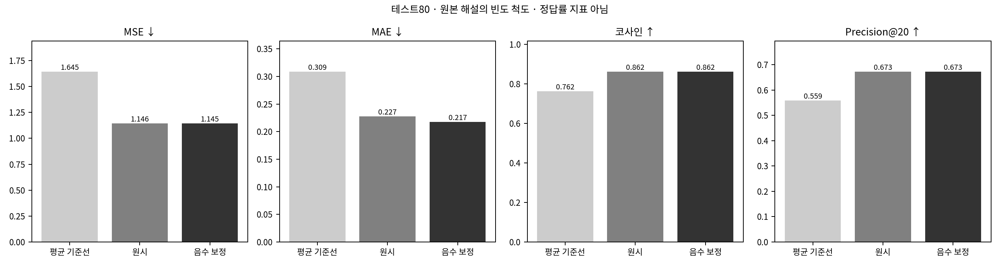
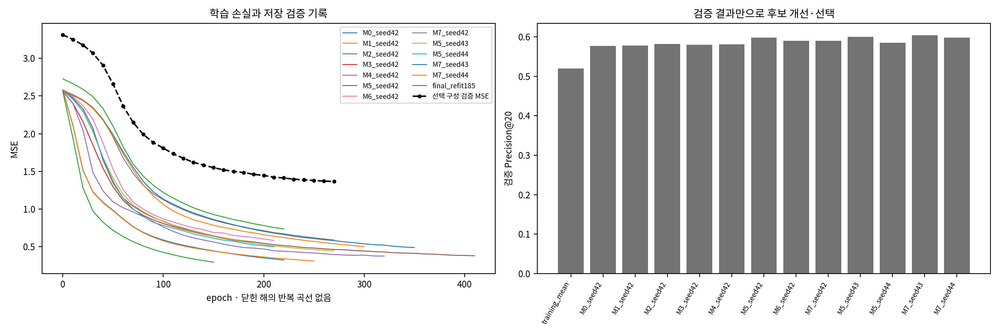
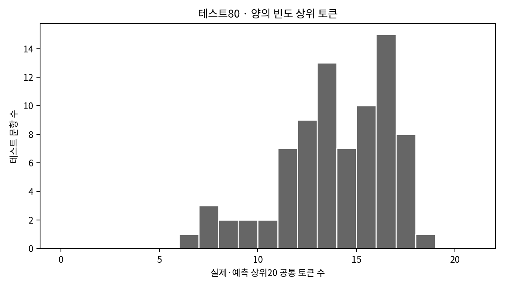
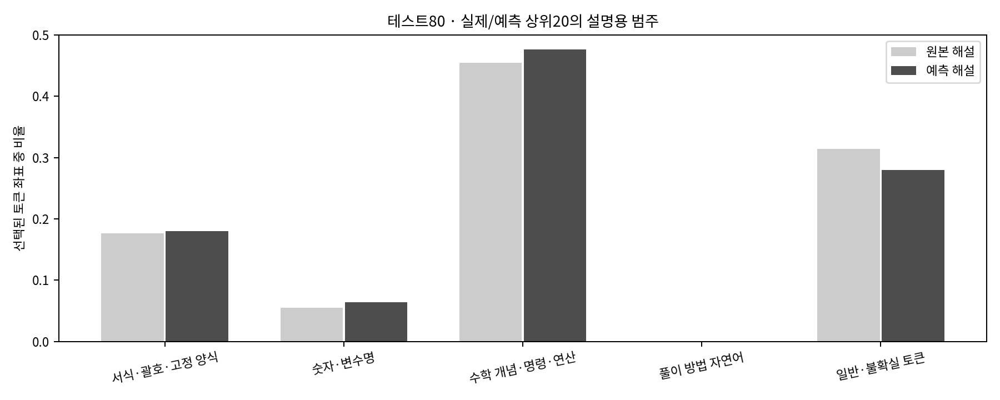
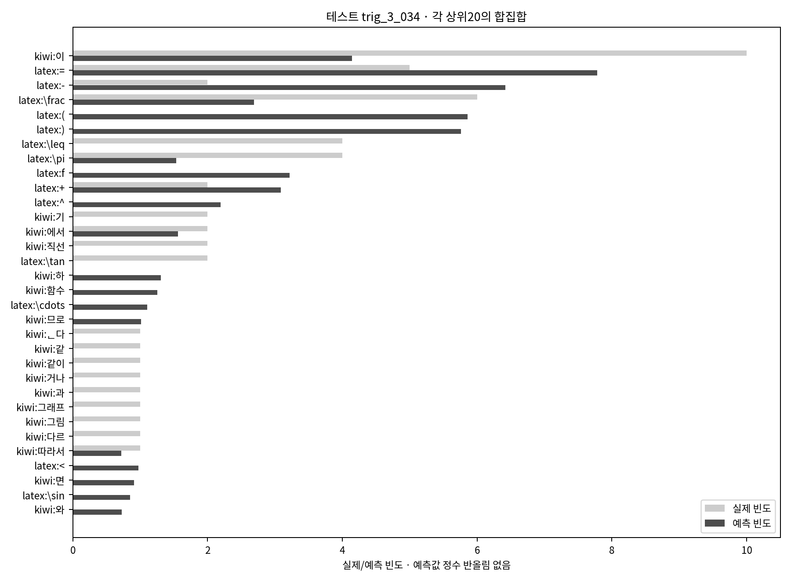
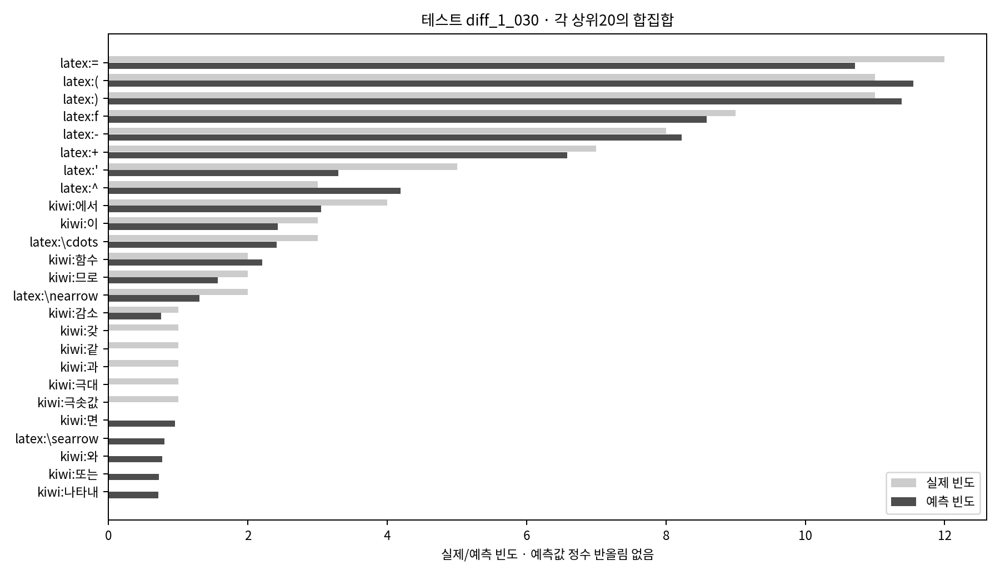

# nn.Sequential 비선형 모델 · 원본 해설 빈도 예측

최종 구조:

```text
Sequential(
  (0): Linear(in_features=270, out_features=32, bias=True)
  (1): ReLU()
  (2): Dropout(p=0.1, inplace=False)
  (3): Linear(in_features=32, out_features=359, bias=True)
)
```

검증 Precision@20을 최대화하고 동률이면 음수 보정 MSE, 사전 후보 순서로 선택했다. 테스트80의 실제 해설은 선택·조기 종료에 사용하지 않았다.

## 구성 선택을 먼저 확인

선택 구성 **M7**: 은닉층 [32], Dropout 0.1, AdamW 학습률 0.0015, Weight Decay 0.001, 손실 `smooth_l1`, 최종 seed42·220epoch다.

초기/개선 후보의 대표seed42 점수로 상위2구성을 고른 뒤, 아래3시드 평균으로 최종 구성을 선택했다. 최종 테스트나 Gemini 정답률로 설정을 바꾸지 않았다.

|상위 구성|검증 P@20 평균|시드 표준편차|검증 보정 MSE 평균|최적 epoch(42/43/44)|
|---|---:|---:|---:|---|
|M5|0.5946|0.0067|1.3489|[310, 170, 140]|
|M7|0.5977|0.0056|1.3858|[220, 270, 210]|

기본 검증표의 점수는 선택 구성의 seed42 최적 체크포인트다. 구성 선택에 쓴3시드 평균과 같은 값으로 해석하지 않는다.

공통 학습·검증 곡선의 MSE는 원래 빈도 척도의 예측 오차다. 최종 모델이 실제로 최적화한 SmoothL1 손실은 학습 기록의 train_objective 열에 별도로 보존했다.

## 검증과 최종 테스트

|범위|방법|MSE ↓|MAE ↓|코사인 ↑|Precision@20 ↑|Recall@20 ↑|공통 토큰 수/20|
|---|---|---:|---:|---:|---:|---:|---:|
|내부 검증37|학습 평균 기준선|1.8378|0.3247|0.7294|0.5203|0.5783|10.4054|
|내부 검증37|원시 예측|1.4133|0.2649|0.8139|0.5905|0.6548|11.8108|
|내부 검증37|음수→0 보정|1.4117|0.2549|0.8147|0.5905|0.6548|11.8108|
|최종 테스트80|학습 평균 기준선|1.6454|0.3089|0.7617|0.5594|0.5904|11.1875|
|최종 테스트80|원시 예측|1.1462|0.2274|0.8615|0.6731|0.7098|13.4625|
|최종 테스트80|음수→0 보정|1.1446|0.2174|0.8622|0.6731|0.7098|13.4625|

테스트 P@20의 평균 기준선 대비 차이: **+0.1138**. 학습185의 보정 MSE 0.7356와 테스트80 MSE 1.1446의 차이를 함께 읽는다. 학습 성능만 좋아진 것을 개선으로 간주하지 않는다.

테스트 원시 출력의 음수 비율은 33.35%다. 실제 빈도는 정수이며 회귀 예측은 반올림하지 않은 실수로 보존한다.





## 개선 과정

|후보|검증 P@20|검증 MSE|설정|
|---|---:|---:|---|
|training_mean|0.5203|1.8378|`fit148 mean; no model weights`|
|M0_seed42|0.5770|1.3153|`은닉[32], Dropout=0.0, lr=0.003, WD=0.0, mse`|
|M1_seed42|0.5784|1.2482|`은닉[32], Dropout=0.1, lr=0.003, WD=0.001, mse`|
|M2_seed42|0.5824|1.4020|`은닉[64], Dropout=0.1, lr=0.003, WD=0.001, mse`|
|M3_seed42|0.5797|1.3730|`은닉[64], Dropout=0.2, lr=0.001, WD=0.01, mse`|
|M4_seed42|0.5811|1.2372|`은닉[32, 16], Dropout=0.1, lr=0.003, WD=0.001, mse`|
|M5_seed42|0.5986|1.2758|`은닉[32], Dropout=0.1, lr=0.003, WD=0.001, smooth_l1`|
|M6_seed42|0.5905|1.5051|`은닉[32], Dropout=0.2, lr=0.003, WD=0.003, smooth_l1`|
|M7_seed42|0.5905|1.4117|`은닉[32], Dropout=0.1, lr=0.0015, WD=0.001, smooth_l1`|
|M5_seed43|0.6000|1.3756|`은닉[32], Dropout=0.1, lr=0.003, WD=0.001, smooth_l1`|
|M5_seed44|0.5851|1.3953|`은닉[32], Dropout=0.1, lr=0.003, WD=0.001, smooth_l1`|
|M7_seed43|0.6041|1.3562|`은닉[32], Dropout=0.1, lr=0.0015, WD=0.001, smooth_l1`|
|M7_seed44|0.5986|1.3894|`은닉[32], Dropout=0.1, lr=0.0015, WD=0.001, smooth_l1`|

[모든 후보 비교](model_comparison.csv) · [모델 선택·중단 규칙](selection.json) · [학습 기록](training_history.csv)

## 문항과 상위 토큰

[테스트80 문항별 오차·실제/예측 토큰](question_comparison.csv) · [상위토큰 범주](top20_category_composition.csv) · [전 문항 예측·모델 출처](model_manifest.json)





범주는 토큰 역할의 검토 보조 분류다. 빈도가 높거나 집합이 많이 겹치는 것이 풀이 전략의 타당성을 입증하지 않는다.

|관찰 사례|문항|코사인|공통 토큰 수|
|---|---|---:|---:|
|낮은 코사인|[trig_3_034](../../../data/processed/problems/trig_3_034.txt)|0.5666|8|
|낮은 코사인|[trig_3_011](../../../data/processed/problems/trig_3_011.txt)|0.6123|9|
|높은 코사인|[diff_1_011](../../../data/processed/problems/diff_1_011.txt)|0.9829|16|
|높은 코사인|[diff_1_030](../../../data/processed/problems/diff_1_030.txt)|0.9882|15|

## 대표 문항의 실제·예측 빈도





전체265의 어휘를 미리 구성한 탐색적 조건이다. 테스트 표현이 어휘와 불용어 검토에 포함됐으므로 완전히 미관측인 일반화 검증이 아니다. 한 문제의 특정 원본 해설을 타깃으로 삼았으며 다른 올바른 풀이의 토큰은 다를 수 있다.

새 Gemini 효과는 이 벡터 지표와 다른 평가 대상이다. 이 문서만으로 풀이 정확도·시스템 계산 효율 향상을 주장하지 않는다.

## 실행 구분

저장소 루트에서 설치 후 실행한다. Python 환경은 프로젝트의 learning·analysis 의존성을 사용한다.

```bash
python -m pip install -e '.[learning,analysis]'
python -m mathhint_learning.final_experiment_2.deep_learning evaluate
python -m mathhint_learning.final_experiment_2.deep_learning train
```

evaluate는 지정된 확정 체크포인트의 예측을 저장 예측과 대조하고 표·그림을 다시 만든다. 재학습이나 API 호출은 없다. train은 이 실험의 검증 탐색·최종 학습 진입점이며, 이미 완료된 동일 데이터·설정은 무결성을 확인해 재사용한다. 완료된 모델을 지워 재학습할 필요는 없다. 데이터나 설정이 다르면 과거 모델로 대신 진행하지 않고 중단한다.

[전체2차 연구](../README.md) · [공통 데이터](../solution_data/README.md)

## 비선형 모델의 선택과 재학습

입력270개는 기존 원시 빈도를 그대로 사용했다. 입력 L2·TF-IDF·어휘 재선정은 없다. Linear→ReLU(필요시Dropout)→Linear의 실제 nn.Sequential 비선형 구조이며, 출력은 원본 해설의 빈도 척도다. 음수는 평가를 구분하고 Gemini 전송에서0으로 보정한다.

초기6구성+규제/학습률 개선2구성을 내부148/37에서만 비교했다. 상위2구성은 시드42~44에서 확인했고 구성선택의 평균 P@20은 **0.5977**, 시드 표준편차는 0.0056다. 위 기본 검증표는 선택 구성의 seed42 최적 검증 체크포인트이며 3시드 평균과 구분한다.

최종185개 재학습은 고정seed42로 220epoch 수행했다. epoch는 선택 구성의3시드 검증 최적epoch 중앙값으로 정했고 최종 테스트로 조기종료하지 않았다. 검증상승이 정체되거나 유한 후보 범위를 끝내면 중단하며 테스트/Gemini 결과로 다시 최적화하지 않는다.

[구성별3시드 검증](configuration_stability.csv) · [모든 후보와 중단 기록](search_state.json)


## 확정한 선형회귀와의 테스트80 비교

|모델|MSE ↓|MAE ↓|코사인 ↑|Precision@20 ↑|
|---|---:|---:|---:|---:|
|선형회귀|1.1121|0.2339|0.8699|0.6725|
|비선형 MLP|1.1446|0.2174|0.8622|0.6731|

P@20 차이는 MLP−선형회귀 **+0.000625**다. MSE·MAE·코사인도 함께 비교하며 한 지표의 작은 차이를 비선형 모델의 전반적 우월성이나 Gemini 풀이 효과로 해석하지 않는다.
