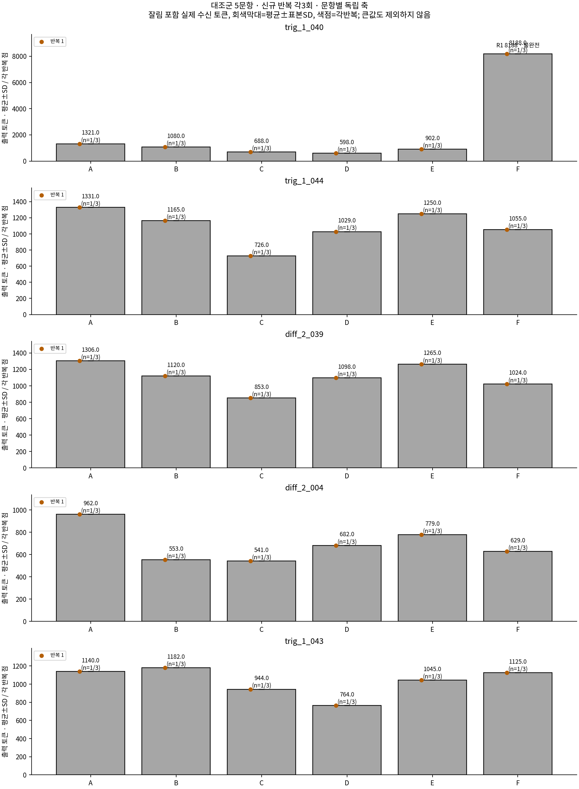
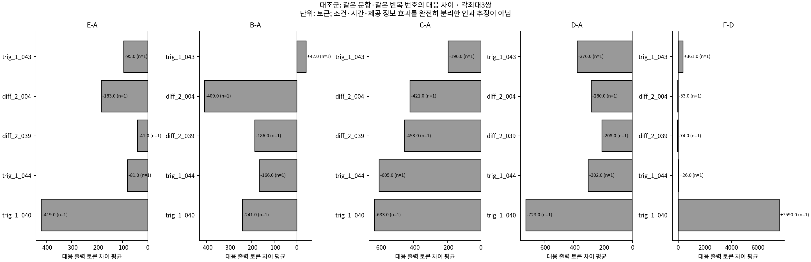
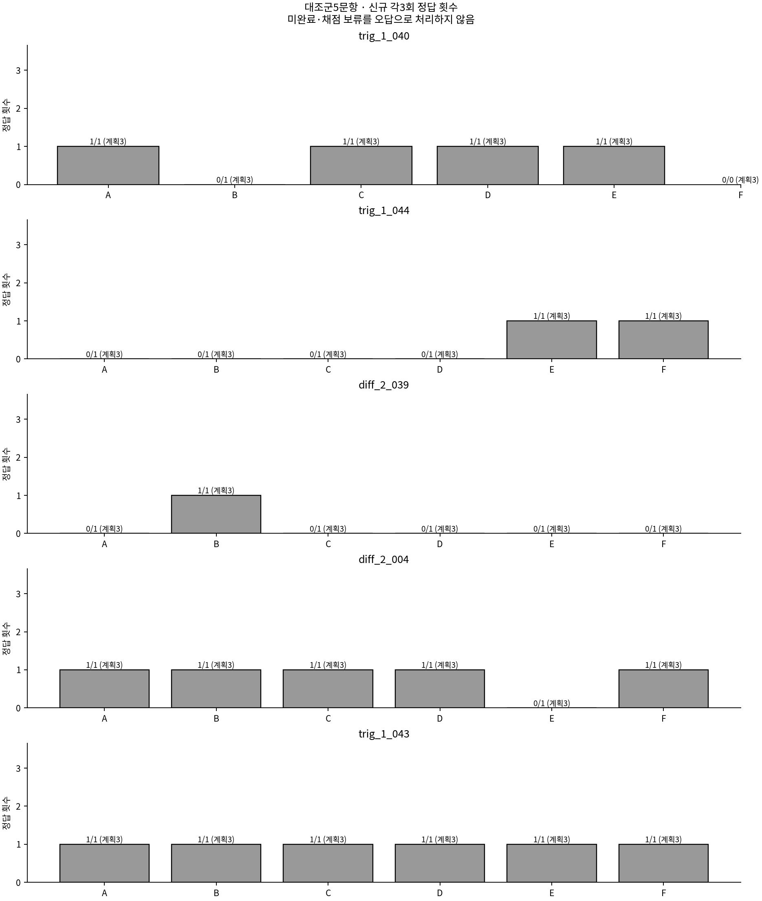

# 출력 토큰 감소 대조군 · 5문항 ×6조건 ×신규3회

A 문제만 / B Ridge / C MLP / D 실제 해설 토큰 / E 지시문만 / F D와 같은 토큰+중립 출처 제목이다. E/F만으로 토큰의 순수 효과를 완전히 분리하지 못한다.

[첫 안내](../README.md) · [수식·반복 비교](../report.html) · [문항·조건 통계 CSV](summary.csv) · [반복별 대응 차이 CSV](paired_differences.csv)

3회 표본 SD는 **ddof=1**이다. 사용량이 제공된 API 수신 응답이0개면 평균·최소·최대·SD는 —, 1개면 SD는 —다. 미제공은 null/—이며0으로 채우지 않는다.
**출력 제한(MAX_TOKENS)·차단·빈 응답도 API 응답을 받은 한 번의 반복이다. 같은 반복을 다시 뽑지 않는다.** 잘린 응답의 실제 토큰은 사용량 평균에 포함하지만, 최종 답이 완성되지 않았다면 채점 보류로 남긴다. 설정된 토큰 상한을 실제 사용량 대신 넣지 않는다.
정답 횟수와 풀이 타당 가능 횟수는 별개다. 검토 보류를 오류로 간주하지 않으며 AI 보조 검토는 사람의 확정이나 형식적 증명이 아니다. 자기 수정 횟수는 일부 중간 오류의 명시적 수정을 뜻하며, 다른 오류가 남아 최종 오답·풀이 부적절과 함께 나타날 수도 있다.
같은 문항·같은 반복 번호를 대응시켰지만 조건 순서가 섞인 탐색적 비교다. 3회 모두 정답이어도 오류 가능성이 사라졌다고 주장하지 않는다.

|조건|신규 수신/계획|정상/불완전|정답/채점 가능|풀이 타당/검토|평균 입력|평균 출력|평균 전체|
|---|---:|---:|---:|---:|---:|---:|---:|
|A 문제만|5/15|5/0|3/5|1/5|159.80|1212.00|1371.80|
|B Ridge 예측 토큰|5/15|5/0|3/5|0/5|408.20|1020.00|1428.20|
|C MLP 예측 토큰|5/15|5/0|3/5|2/5|408.60|750.40|1159.00|
|D 실제 해설 토큰|5/15|5/0|3/5|2/5|372.00|834.20|1206.20|
|E 추가 지시문만|5/15|5/0|3/5|1/5|165.80|1048.20|1214.00|
|F 실제 토큰 · 중립 출처|5/15|4/1|3/4|2/5|365.00|2404.20|2769.20|

### 저장 자료에서 관측한 방향

- **추가 지시문만 붙인 E와 A(E-A)**: 제공된 대응 5/15쌍에서 문항별 평균 출력 차이가 감소한 문항 5개, 증가 0개, 동일 0개다. 문항별 평균 차이 범위는 -419~-41토큰이다.
- **Ridge 힌트 B와 A(B-A)**: 제공된 대응 5/15쌍에서 문항별 평균 출력 차이가 감소한 문항 4개, 증가 1개, 동일 0개다. 문항별 평균 차이 범위는 -409~42토큰이다.
- **MLP 힌트 C와 A(C-A)**: 제공된 대응 5/15쌍에서 문항별 평균 출력 차이가 감소한 문항 5개, 증가 0개, 동일 0개다. 문항별 평균 차이 범위는 -633~-196토큰이다.
- **실제 해설 토큰 D와 A(D-A)**: 제공된 대응 5/15쌍에서 문항별 평균 출력 차이가 감소한 문항 5개, 증가 0개, 동일 0개다. 문항별 평균 차이 범위는 -723~-208토큰이다.
- **중립 출처 F와 D(F-D)**: 제공된 대응 5/15쌍에서 문항별 평균 출력 차이가 감소한 문항 2개, 증가 3개, 동일 0개다. 문항별 평균 차이 범위는 -74~7590토큰이다.

**출력 제한·불완전 응답도 연구 결과에 포함했다.**
- `trig_1_040/F/반복1`: `truncated_response`, 실제 출력 8188·전체 8557토큰. 최종 답 미완성 여부와 풀이 오류는 따로 기록했다.

큰 사용량을 가진 응답은 평균·SD를 크게 바꿀 수 있다. 이를 제외하거나 같은 반복을 다시 생성하지 않았으며 문항별 그림의 개별 반복 점과 최소~최대에서 직접 확인할 수 있다.

E-A의 변화가 관측되어도 모든 차이를 지시문으로 설명할 수 없고, F-D의 변화가 관측되어도 출처 강조의 인과효과라고 확정할 수 없다. D/F는 동일한 토큰·빈도 JSON을 유지했지만 제목이 바뀌며, 표본은 조건당3회뿐이다.

## 문항별 전체 통계

|문항|조건|수신/3|정상/불완전|정답/채점 가능|풀이 타당/검토|출력 평균|최소~최대|표본 SD|
|---|---|---:|---:|---:|---:|---:|---:|---:|
|[trig_1_040](../case_reports/trig_1_040.md)|A|1/3|1/0|1/1|1/1|1321|1321~1321|—|
|[trig_1_040](../case_reports/trig_1_040.md)|B|1/3|1/0|0/1|0/1|1080|1080~1080|—|
|[trig_1_040](../case_reports/trig_1_040.md)|C|1/3|1/0|1/1|1/1|688|688~688|—|
|[trig_1_040](../case_reports/trig_1_040.md)|D|1/3|1/0|1/1|1/1|598|598~598|—|
|[trig_1_040](../case_reports/trig_1_040.md)|E|1/3|1/0|1/1|1/1|902|902~902|—|
|[trig_1_040](../case_reports/trig_1_040.md)|F|1/3|0/1|0/0|0/1|8188|8188~8188|—|
|[trig_1_044](../case_reports/trig_1_044.md)|A|1/3|1/0|0/1|0/1|1331|1331~1331|—|
|[trig_1_044](../case_reports/trig_1_044.md)|B|1/3|1/0|0/1|0/1|1165|1165~1165|—|
|[trig_1_044](../case_reports/trig_1_044.md)|C|1/3|1/0|0/1|0/1|726|726~726|—|
|[trig_1_044](../case_reports/trig_1_044.md)|D|1/3|1/0|0/1|0/1|1029|1029~1029|—|
|[trig_1_044](../case_reports/trig_1_044.md)|E|1/3|1/0|1/1|0/1|1250|1250~1250|—|
|[trig_1_044](../case_reports/trig_1_044.md)|F|1/3|1/0|1/1|0/1|1055|1055~1055|—|
|[diff_2_039](../case_reports/diff_2_039.md)|A|1/3|1/0|0/1|0/1|1306|1306~1306|—|
|[diff_2_039](../case_reports/diff_2_039.md)|B|1/3|1/0|1/1|0/1|1120|1120~1120|—|
|[diff_2_039](../case_reports/diff_2_039.md)|C|1/3|1/0|0/1|0/1|853|853~853|—|
|[diff_2_039](../case_reports/diff_2_039.md)|D|1/3|1/0|0/1|0/1|1098|1098~1098|—|
|[diff_2_039](../case_reports/diff_2_039.md)|E|1/3|1/0|0/1|0/1|1265|1265~1265|—|
|[diff_2_039](../case_reports/diff_2_039.md)|F|1/3|1/0|0/1|0/1|1024|1024~1024|—|
|[diff_2_004](../case_reports/diff_2_004.md)|A|1/3|1/0|1/1|0/1|962|962~962|—|
|[diff_2_004](../case_reports/diff_2_004.md)|B|1/3|1/0|1/1|0/1|553|553~553|—|
|[diff_2_004](../case_reports/diff_2_004.md)|C|1/3|1/0|1/1|1/1|541|541~541|—|
|[diff_2_004](../case_reports/diff_2_004.md)|D|1/3|1/0|1/1|1/1|682|682~682|—|
|[diff_2_004](../case_reports/diff_2_004.md)|E|1/3|1/0|0/1|0/1|779|779~779|—|
|[diff_2_004](../case_reports/diff_2_004.md)|F|1/3|1/0|1/1|1/1|629|629~629|—|
|[trig_1_043](../case_reports/trig_1_043.md)|A|1/3|1/0|1/1|0/1|1140|1140~1140|—|
|[trig_1_043](../case_reports/trig_1_043.md)|B|1/3|1/0|1/1|0/1|1182|1182~1182|—|
|[trig_1_043](../case_reports/trig_1_043.md)|C|1/3|1/0|1/1|0/1|944|944~944|—|
|[trig_1_043](../case_reports/trig_1_043.md)|D|1/3|1/0|1/1|0/1|764|764~764|—|
|[trig_1_043](../case_reports/trig_1_043.md)|E|1/3|1/0|1/1|0/1|1045|1045~1045|—|
|[trig_1_043](../case_reports/trig_1_043.md)|F|1/3|1/0|1/1|1/1|1125|1125~1125|—|
