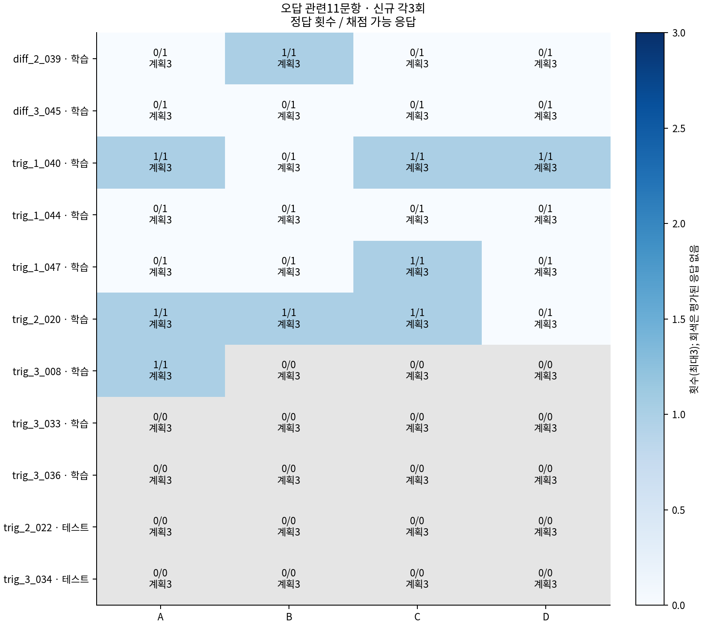
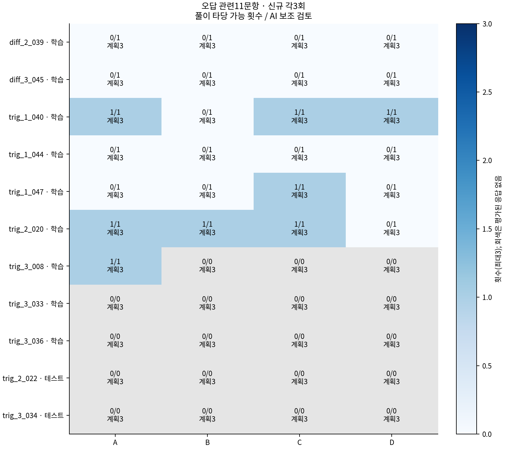
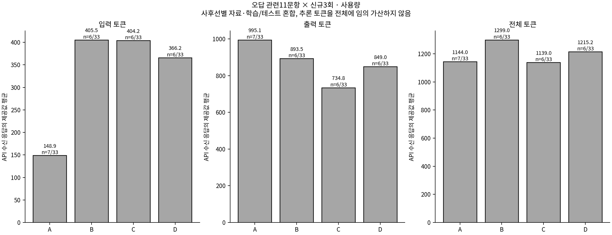

# 기존 오답 관련11문항 · A/B/C/D 신규 각3회

기존 정정표에서 A/B/C/D 중 적어도 하나가 오답인11문항을 다시 확인한 사후선별 집합이다. 이 집합 정답률을 전체265의 일반화 정확도로 해석하지 않는다.

[A와 D 상세](AD_detailed_analysis.md) · [B와 C 상세](BC_detailed_analysis.md) · [신규 통계 CSV](summary.csv) · [과거1회와 비교 CSV](prior_comparison.csv)

[원문·새3회 풀이 전문](../case_reports/README.md) · [수식 화면](../report.html) · [기존11문항 분석](../../gemini_full265/error_analysis_11/README.md)

3회 표본 SD는 **ddof=1**이다. 사용량이 제공된 API 수신 응답이0개면 평균·최소·최대·SD는 —, 1개면 SD는 —다. 미제공은 null/—이며0으로 채우지 않는다.
**출력 제한(MAX_TOKENS)·차단·빈 응답도 API 응답을 받은 한 번의 반복이다. 같은 반복을 다시 뽑지 않는다.** 잘린 응답의 실제 토큰은 사용량 평균에 포함하지만, 최종 답이 완성되지 않았다면 채점 보류로 남긴다. 설정된 토큰 상한을 실제 사용량 대신 넣지 않는다.
정답 횟수와 풀이 타당 가능 횟수는 별개다. 검토 보류를 오류로 간주하지 않으며 AI 보조 검토는 사람의 확정이나 형식적 증명이 아니다. 자기 수정 횟수는 일부 중간 오류의 명시적 수정을 뜻하며, 다른 오류가 남아 최종 오답·풀이 부적절과 함께 나타날 수도 있다.
같은 문항·같은 반복 번호를 대응시켰지만 조건 순서가 섞인 탐색적 비교다. 3회 모두 정답이어도 오류 가능성이 사라졌다고 주장하지 않는다.

|조건|신규 수신/계획|정상/불완전|정답/채점 가능|풀이 타당/검토|평균 입력|평균 출력|평균 전체|
|---|---:|---:|---:|---:|---:|---:|---:|
|A 문제만|7/33|7/0|3/7|3/7|148.86|995.14|1144.00|
|B Ridge 예측 토큰|6/33|6/0|2/6|1/6|405.50|893.50|1299.00|
|C MLP 예측 토큰|6/33|6/0|3/6|3/6|404.17|734.83|1139.00|
|D 실제 해설 토큰|6/33|6/0|1/6|1/6|366.17|849.00|1215.17|

### 동일 문항·반복의 정오 및 풀이 변화

- **A→D**: 양쪽 최종 답을 채점한 6/33쌍에서 오답→정답 0회, 정답→오답 1회였다. 양쪽 풀이를 판단한 6/33쌍에서는 오류 의심→타당 가능 0회, 타당 가능→오류 의심 1회, 양쪽 오류 의심 4회였다.
- **B→C**: 양쪽 최종 답을 채점한 6/33쌍에서 오답→정답 2회, 정답→오답 1회였다. 양쪽 풀이를 판단한 6/33쌍에서는 오류 의심→타당 가능 2회, 타당 가능→오류 의심 0회, 양쪽 오류 의심 3회였다.
- 새 최종 답은 맞지만 구체적인 풀이 오류가 남은 응답은 3회, 기존 오류 재발로 판단한 응답은 17회, 중간 오류를 이후 스스로 수정한 것으로 기록된 응답은 4회다. 미평가 항목을0회 오류로 추정한 것은 아니다.

이 대응 횟수는 같은 11문제를 반복 관측한 설명 통계다. 풀이가 달라져도 수학적으로 타당할 수 있고, 동일 오류를 놓치지 않았는지는 아래 실제 식·계산·반례를 포함한 AI 보조 검토에서 확인해야 한다.

## 문항별 전체 통계

|문항|조건|수신/3|정상/불완전|정답/채점 가능|풀이 타당/검토|출력 평균|최소~최대|표본 SD|
|---|---|---:|---:|---:|---:|---:|---:|---:|
|[diff_2_039](../case_reports/diff_2_039.md)|A|1/3|1/0|0/1|0/1|1306|1306~1306|—|
|[diff_2_039](../case_reports/diff_2_039.md)|B|1/3|1/0|1/1|0/1|1120|1120~1120|—|
|[diff_2_039](../case_reports/diff_2_039.md)|C|1/3|1/0|0/1|0/1|853|853~853|—|
|[diff_2_039](../case_reports/diff_2_039.md)|D|1/3|1/0|0/1|0/1|1098|1098~1098|—|
|[diff_3_045](../case_reports/diff_3_045.md)|A|1/3|1/0|0/1|0/1|589|589~589|—|
|[diff_3_045](../case_reports/diff_3_045.md)|B|1/3|1/0|0/1|0/1|520|520~520|—|
|[diff_3_045](../case_reports/diff_3_045.md)|C|1/3|1/0|0/1|0/1|528|528~528|—|
|[diff_3_045](../case_reports/diff_3_045.md)|D|1/3|1/0|0/1|0/1|540|540~540|—|
|[trig_1_040](../case_reports/trig_1_040.md)|A|1/3|1/0|1/1|1/1|1321|1321~1321|—|
|[trig_1_040](../case_reports/trig_1_040.md)|B|1/3|1/0|0/1|0/1|1080|1080~1080|—|
|[trig_1_040](../case_reports/trig_1_040.md)|C|1/3|1/0|1/1|1/1|688|688~688|—|
|[trig_1_040](../case_reports/trig_1_040.md)|D|1/3|1/0|1/1|1/1|598|598~598|—|
|[trig_1_044](../case_reports/trig_1_044.md)|A|1/3|1/0|0/1|0/1|1331|1331~1331|—|
|[trig_1_044](../case_reports/trig_1_044.md)|B|1/3|1/0|0/1|0/1|1165|1165~1165|—|
|[trig_1_044](../case_reports/trig_1_044.md)|C|1/3|1/0|0/1|0/1|726|726~726|—|
|[trig_1_044](../case_reports/trig_1_044.md)|D|1/3|1/0|0/1|0/1|1029|1029~1029|—|
|[trig_1_047](../case_reports/trig_1_047.md)|A|1/3|1/0|0/1|0/1|858|858~858|—|
|[trig_1_047](../case_reports/trig_1_047.md)|B|1/3|1/0|0/1|0/1|755|755~755|—|
|[trig_1_047](../case_reports/trig_1_047.md)|C|1/3|1/0|1/1|1/1|750|750~750|—|
|[trig_1_047](../case_reports/trig_1_047.md)|D|1/3|1/0|0/1|0/1|814|814~814|—|
|[trig_2_020](../case_reports/trig_2_020.md)|A|1/3|1/0|1/1|1/1|746|746~746|—|
|[trig_2_020](../case_reports/trig_2_020.md)|B|1/3|1/0|1/1|1/1|721|721~721|—|
|[trig_2_020](../case_reports/trig_2_020.md)|C|1/3|1/0|1/1|1/1|864|864~864|—|
|[trig_2_020](../case_reports/trig_2_020.md)|D|1/3|1/0|0/1|0/1|1015|1015~1015|—|
|[trig_3_008](../case_reports/trig_3_008.md)|A|1/3|1/0|1/1|1/1|815|815~815|—|
|[trig_3_008](../case_reports/trig_3_008.md)|B|0/3|0/0|0/0|0/0|—|—~—|—|
|[trig_3_008](../case_reports/trig_3_008.md)|C|0/3|0/0|0/0|0/0|—|—~—|—|
|[trig_3_008](../case_reports/trig_3_008.md)|D|0/3|0/0|0/0|0/0|—|—~—|—|
|[trig_3_033](../case_reports/trig_3_033.md)|A|0/3|0/0|0/0|0/0|—|—~—|—|
|[trig_3_033](../case_reports/trig_3_033.md)|B|0/3|0/0|0/0|0/0|—|—~—|—|
|[trig_3_033](../case_reports/trig_3_033.md)|C|0/3|0/0|0/0|0/0|—|—~—|—|
|[trig_3_033](../case_reports/trig_3_033.md)|D|0/3|0/0|0/0|0/0|—|—~—|—|
|[trig_3_036](../case_reports/trig_3_036.md)|A|0/3|0/0|0/0|0/0|—|—~—|—|
|[trig_3_036](../case_reports/trig_3_036.md)|B|0/3|0/0|0/0|0/0|—|—~—|—|
|[trig_3_036](../case_reports/trig_3_036.md)|C|0/3|0/0|0/0|0/0|—|—~—|—|
|[trig_3_036](../case_reports/trig_3_036.md)|D|0/3|0/0|0/0|0/0|—|—~—|—|
|[trig_2_022](../case_reports/trig_2_022.md)|A|0/3|0/0|0/0|0/0|—|—~—|—|
|[trig_2_022](../case_reports/trig_2_022.md)|B|0/3|0/0|0/0|0/0|—|—~—|—|
|[trig_2_022](../case_reports/trig_2_022.md)|C|0/3|0/0|0/0|0/0|—|—~—|—|
|[trig_2_022](../case_reports/trig_2_022.md)|D|0/3|0/0|0/0|0/0|—|—~—|—|
|[trig_3_034](../case_reports/trig_3_034.md)|A|0/3|0/0|0/0|0/0|—|—~—|—|
|[trig_3_034](../case_reports/trig_3_034.md)|B|0/3|0/0|0/0|0/0|—|—~—|—|
|[trig_3_034](../case_reports/trig_3_034.md)|C|0/3|0/0|0/0|0/0|—|—~—|—|
|[trig_3_034](../case_reports/trig_3_034.md)|D|0/3|0/0|0/0|0/0|—|—~—|—|
