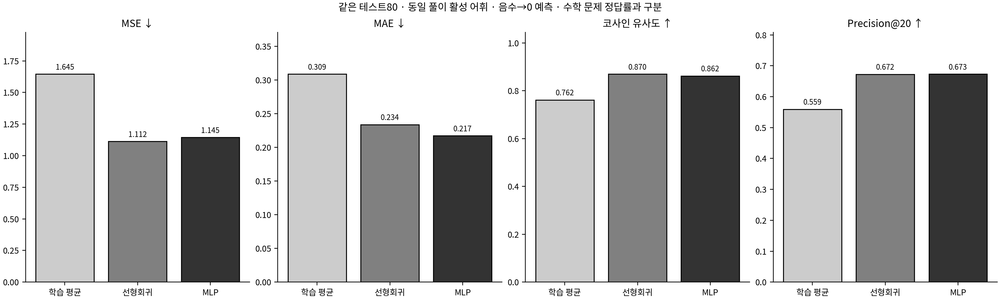

# MathHint: 외부 해설 토큰 예측과 LLM 풀이 비교

## 1. 연구 질문과 실험 설계

외부 선형/비선형 모델이 예측한 풀이 토큰이 Gemini의 정답과 사용량에 어떤 차이를 만드는지 조사했다. 해설 빈도 예측의 성능과 실제 수학 풀이 성능을 분리해 분석했다. 개선을 전제로 모델이나 정답을 수정하지 않았다.

## 2. 데이터와 내부 검증

기존 문제270은 재토큰화 없이 재사용했다. 풀이 462→359차원, 원시 빈도 59,408→27,949회다. 원래185/80을 유지했고 학습185 안의148/37로 두 모델을 선택했다. 데이터 변환의 추정값도 내부 학습 자료에서만 계산했다.

## 3. 선형회귀의 개선

### 선형 모델

최종 구조: `Linear(in_features=270, out_features=359, bias=True)`

선택 설정: `{'alpha': 100.0, 'candidate_id': 'ridge_scaled_100', 'family': 'ridge', 'stage': 'coarse', 'standardize': True}`

[전체 후보·개선 이유·중단·손실곡선](regression/README.md). 검증 P@20과 오차를 기준으로 설정을 확정했으며 테스트와 API 결과는 후보 선택에 쓰지 않았다.

### 비선형 MLP

최종 구조: `Sequential(
  (0): Linear(in_features=270, out_features=32, bias=True)
  (1): ReLU()
  (2): Dropout(p=0.1, inplace=False)
  (3): Linear(in_features=32, out_features=359, bias=True)
)`

선택 설정: `{'candidate_id': 'M7', 'family': 'sequential_mlp', 'hidden_dims': [32], 'dropout': 0.1, 'weight_decay': 0.001, 'learning_rate': 0.0015, 'loss': 'smooth_l1', 'max_epochs': 1000, 'stage': 'refinement', 'seed': 42, 'epochs': 220}`

[전체 후보·개선 이유·중단·손실곡선](deep_learning/README.md). 검증 P@20과 오차를 기준으로 설정을 확정했으며 테스트와 API 결과는 후보 선택에 쓰지 않았다.

## 4. 동일 타깃 공간에서 모델은 얼마나 예측했는가?

## 같은 기준으로 두 예측 모델 비교

내부 검증37 · 기준선은 fit148 평균

|모델|MSE ↓|MAE ↓|코사인 ↑|Precision@20 ↑|Recall@20 ↑|공통 토큰 수/20|
|---|---|---|---|---|---|---|
|학습 평균 기준선|1.8378|0.3247|0.7294|0.5203|0.5783|10.4054|
|선형회귀|1.3850|0.2689|0.8219|0.6000|0.6672|12.0000|
|nn.Sequential MLP|1.4117|0.2549|0.8147|0.5905|0.6548|11.8108|

MLP 검증 행은 대표 seed42의 값이다. 구성 선택에 사용한3시드 평균과는 구분하며 자세한 값은 딥러닝 README에 있다.

최종 테스트80 · 기준선은 학습185 평균

|모델|MSE ↓|MAE ↓|코사인 ↑|Precision@20 ↑|Recall@20 ↑|공통 토큰 수/20|
|---|---|---|---|---|---|---|
|학습 평균 기준선|1.6454|0.3089|0.7617|0.5594|0.5904|11.1875|
|선형회귀|1.1121|0.2339|0.8699|0.6725|0.7105|13.4500|
|nn.Sequential MLP|1.1446|0.2174|0.8622|0.6731|0.7098|13.4625|

테스트80의 음수 보정 P@20은 선형 0.6725, MLP 0.6731다. MLP−선형 차이는 +0.0006다. 이는 이 고정 테스트의 관찰이며 비선형 모델의 일반적인 우월성을 보장하지 않는다.

### 예측 지표가 보여 주는 차이

- 선형회귀: 평균 기준선 대비 P@20 차이 +0.113125, 문항당 공통 토큰 차이 +2.2625개, MSE 차이 -0.5333다. 이는 문제에 따라 달라지는 예측과 고정 평균 벡터의 이 저장 테스트 비교다.
- nn.Sequential MLP: 평균 기준선 대비 P@20 차이 +0.113750, 문항당 공통 토큰 차이 +2.2750개, MSE 차이 -0.5008다. 이는 문제에 따라 달라지는 예측과 고정 평균 벡터의 이 저장 테스트 비교다.

MLP−선형 차이는 MSE +0.032491, MAE -0.016523, 코사인 -0.007629, P@20 +0.000625다. MSE·MAE는 작을수록, 코사인·P@20은 클수록 좋으므로 지표마다 방향을 함께 읽어야 한다.
이 테스트에서 더 좋은 값은 MSE: 선형, MAE: MLP, 코사인: 선형, P@20: MLP다.
공통 80문항의 상위20 일치 수를 합산한 차이는 MLP−선형 +1.00개다. 서로 다른 고유 토큰의 수나 수학 문제 정답 수를 뜻하지 않는다.

P@20은 토큰 집합의 겹침을 분모20으로 나눈 값이며 코사인도 수학 정답률이 아니다. 이 차이에서 Gemini 정답 변화나 비선형 모델의 일반적 우월성을 도출하지 않는다.

## 5. Gemini 입력과 실행

A는 원문만, B는 선형 예측, C는 비선형 예측, D는 실제 해설 상위20개다. D는 이전 연구 C에 해당하는 오라클이다. 모든 문제 원문·DEFAULT_SYSTEM·gemini-3.1-flash-lite·temperature0·minimal·8192 설정을 통제했다. 힌트는 양수/음수보정·반올림전순위·어휘순동점·셋째자리표시·0표시제외 JSON과 마지막 지시문을 공유한다. 실제 모델 사용 가능 여부·인증·확인 가능한 제한은 [사전점검과 실행 상태](gemini_comparison/README.md)에 기록한다.

## Gemini 네 조건의 실제 풀이

현재 실행 상태: **interrupted**. 완료하지 않은 응답을 오답이나0토큰으로 집계하지 않는다.

|조건|성공/80|채점 가능|원본 기준 정답|정답률|평균 입력|평균 출력|평균 전체|
|---|---|---|---|---|---|---|---|
|A 문제만|80|80|78|97.50%|150.6|497.1|647.8|
|B 선형회귀 예측 토큰|49|49|48|97.96%|402.5|459.3|861.8|
|C 딥러닝 예측 토큰|48|48|47|97.92%|403.9|445.1|849.0|
|D 실제 해설 토큰|49|49|48|97.96%|360.9|435.2|796.0|

평균 토큰은 실제 제공된 성공 응답 값에 대한 평균이며 미제공은 —다. 추론 토큰을 전체 토큰에 다시 더하지 않는다. 원본 정답 기준과 trig_1_010의 AI 보조 기준은 분리한다.

### 실제 풀이 효과와 사용량을 구분해 읽기

- B: 성공 49/80, 원본 정답표 기준 48/49채점 가능. 미완료 30·실패 1·채점 불가 0.
- C: 성공 48/80, 원본 정답표 기준 47/48채점 가능. 미완료 30·실패 2·채점 불가 0.
- D: 성공 49/80, 원본 정답표 기준 48/49채점 가능. 미완료 30·실패 1·채점 불가 0.

|대응 조건|공통 채점 수|앞만 정답|뒤만 정답|정확 McNemar p|Holm 보정 p|
|---|---|---|---|---|---|
|A-B|49|0|0|1.0000|1.0000|
|A-C|48|0|0|1.0000|1.0000|
|A-D|49|0|0|1.0000|1.0000|
|B-C|48|0|0|1.0000|1.0000|
|B-D|48|0|0|1.0000|1.0000|
|C-D|48|0|0|1.0000|1.0000|

정오답 변화가 적으면 검정력이 낮다. 유의하지 않다는 사실은 효과가 없다는 증명이 아니며, 반복 생성하지 않은 작은 표본과 시점이 다른 과거 A 재사용이라는 한계가 있다.

|전체 토큰 차이|사용량 제공 공통 문항|차이 합계|문항당 평균 차이|
|---|---|---|---|
|B−A|49|10618|216.69|
|C−A|48|9690|201.88|
|D−A|49|7179|146.51|
|C−B|48|-701|-14.60|

토큰 차이는 두 응답이 모두 성공하고 실제 total이 제공된 공통 문항만 사용했다. 음수는 뒤 조건보다 적은 토큰, 양수는 많은 토큰이다. 미완료 집합의 서로 다른 합계를 직접 비교하지 않는다.

### 정답 변화와 토큰 변화는 같은 결론인가?

- A→B: 원본 기준 공통 채점 n=49/80 (제외 31), A 48/49→B 48/49 (B−A +0.00%p). 오답→정답 0개, 정답→오답 0개. A 미완료 0·실패 0 / B 미완료 30·실패 1.
  같은 문항의 B−A 평균 사용량 차이: 입력 +248.49토큰(n=49), 출력 -31.80토큰(n=49), 전체 +216.69토큰(n=49).
- A→C: 원본 기준 공통 채점 n=48/80 (제외 32), A 47/48→C 47/48 (C−A +0.00%p). 오답→정답 0개, 정답→오답 0개. A 미완료 0·실패 0 / C 미완료 30·실패 2.
  같은 문항의 C−A 평균 사용량 차이: 입력 +249.21토큰(n=48), 출력 -47.33토큰(n=48), 전체 +201.88토큰(n=48).
- A→D: 원본 기준 공통 채점 n=49/80 (제외 31), A 48/49→D 48/49 (D−A +0.00%p). 오답→정답 0개, 정답→오답 0개. A 미완료 0·실패 0 / D 미완료 30·실패 1.
  같은 문항의 D−A 평균 사용량 차이: 입력 +206.69토큰(n=49), 출력 -60.18토큰(n=49), 전체 +146.51토큰(n=49).
- B→C: 원본 기준 공통 채점 n=48/80 (제외 32), B 47/48→C 47/48 (C−B +0.00%p). 오답→정답 0개, 정답→오답 0개. B 미완료 30·실패 1 / C 미완료 30·실패 2.
  같은 문항의 C−B 평균 사용량 차이: 입력 +0.71토큰(n=48), 출력 -15.31토큰(n=48), 전체 -14.60토큰(n=48).

원본 기준과 별도로 계산한 AI 보조 정답표 기준은 A 79/80 (98.75%); B 49/49 (100.00%); C 48/48 (100.00%); D 49/49 (100.00%)다. 보조 기준은 원본 점수를 대체하지 않으며 사람의 정답표 확정 판정이 아니다.

입력 힌트가 늘어난 조건에서도 출력과 전체 토큰의 방향은 별도로 확인한다. 각 토큰 항목은 성공하고 해당 값이 제공된 공통 문항만 사용하므로 n이 채점 집합과 다를 수 있다. 전체 토큰 감소와 정답 증가를 같은 효과로 취급하지 않는다. 표본이 진행 중이면 관측된 일부 문항의 차이이며, 완료 후에도 단일 생성·과거 A 재사용·탐색적 설계의 제한이 남는다.

## 6. 어떤 문항에서 도움이 되거나 방해됐는가?

[문항별 네 조건 비교](gemini_comparison/question_comparison.csv), [오류·특이 사례](gemini_comparison/case_reports/README.md), [원본·생성 풀이를 함께 읽는 화면](gemini_comparison/report.html)에서 실제 답 변화와 토큰 차이를 확인한다. 최종 답이 맞아도 풀이를 자동으로 타당하다고 판정하지 않았다. 검토 보류는 실제 오류 확정과 다르다.

저장 성공 응답에서 답을 판독한 조건이 두 개 이상인 50문항 중 동등 답 표기를 정규화한 최종 답 변화는 0문항이다. 네 조건 중 실패·미완료가 남은 문항은 32/80다. 사례는 정답 변화·정답표 충돌·답과 추론의 불일치를 읽기 위한 선별이며 전체 빈도를 대표하지 않는다.

- **trig_1_010**: A ②(원본 오답), B ②(원본 오답), C ②(원본 오답), D ②(원본 오답). [네 풀이](gemini_comparison/report.html#trig_1_010) · [사례·원문 근거](gemini_comparison/case_reports/trig_1_010.md).
  원본 정답 ④ / AI 보조 대안 ②; 보조 기준에서 A 정답, B 정답, C 정답, D 정답. 이 충돌을 힌트에 의한 정답 개선으로 세지 않는다.
- **diff_1_005**: A ⑤(원본 정답), B ⑤(원본 정답), C ⑤(원본 정답), D ⑤(원본 정답). [네 풀이](gemini_comparison/report.html#diff_1_005) · [사례·원문 근거](gemini_comparison/case_reports/diff_1_005.md).
  B의 AI 보조 검토 상태 `suspected_error`: 최종 선택 ⑤(합 11)는 정확하고 후반부에서는 a=8과 a=3을 모두 올바르게 구했다. 그러나 앞부분에서 유한한 극한을 위해 f(x) 자체가 반드시 (x-a)²을 인수로 가져야 한다고 단정한 것은 오류이다. 분자에는 별도의 (x-3) 인수가 있으므로 a=3, f(x)=(x-3)(x+2)일 때 f는 (x-3)²을 인수로 갖지 않아도 주어진 극한이 5가 된다. 후반부의 올바른 경우 분류가 이 잘못된 필요조건을 명시적으로 철회하지 않은 채 이어진다. (사람 확정: False).
- **trig_2_022**: A ①(원본 오답), B 미완료, C 미완료, D 미완료. [네 풀이](gemini_comparison/report.html#trig_2_022) · [사례·원문 근거](gemini_comparison/case_reports/trig_2_022.md).
  A의 AI 보조 검토 상태 `suspected_error`: sin x(2sin x-1)=0까지의 변형은 맞지만 0<x<2π에서 sin x=0인 해가 없다는 판정은 틀리다. 반례 x=π는 구간 내부이며 원래 식에 대입하면 2cos²π-sin(2π)-2=0이다. 해는 π/6,5π/6,π의 세 개이고 합은 2π(③)이므로 응답의 π(①)도 틀리다. (사람 확정: False).

최종 답 자동채점과 위 AI 보조 풀이 검토는 별개다. 오류 의심은 형식증명이나 사람의 확정 판정이 아니며, 검토 보류를 타당 판정으로 바꾸지 않았다. [전체 풀이 검토 상태](gemini_comparison/review/status.csv)에서 오류 단계·실제 인용·검토 주체를 확인할 수 있다.

## 7. 결론의 범위와 후속 과제

- 전체265 문제·원본 풀이의 어휘를 사전에 사용했다. 가중치와 모델 선택은 원래 학습185 내부에서만 수행했지만 완전히 독립적인 미관측 일반화 평가가 아니다.
- 검증 P@20을 먼저 고정하고 내부148/37에서 유한 후보를 개선했다. 최종 설정을 확정한 뒤185개로 재학습하고 테스트80 예측을 만들었다. API 정답률을 보고 모델을 다시 바꾸지 않는다.
- 특정 원본 해설의 토큰 빈도는 가능한 여러 올바른 풀이 중 하나의 표현이다. 빈도 오차와 수학적 풀이의 옳고 그름은 다른 평가다.
- 학습185에서 빈도가0인 풀이 토큰25개는 전체 어휘에 있어도 학습 사례가 없다. 문제의 동일 BoW가 train/test에 걸친 diff_1_007·diff_1_011도 원래 분할대로 남겨 해석에 제한이 있다.
- BoW는 수식의 순서·분자/분모·변수 역할·논리 연결을 보존하지 못한다. 층을 늘리는 것만으로 소실된 수식 구조가 복원되지 않는다.
- 원본 답 정오답과 풀이 과정 타당성을 분리했다. 구체적 오류 단계·근거로 충분히 확인하지 못한 생성 풀이는 검토 보류로 남기며 사람의 확정 판정으로 표시하지 않는다.
- API 원문·사용량·미완료 상태·실제 요청을 보존한다. 과거의 정확히 같은 요청 재사용과 새 응답의 실행 시점 차이도 구분한다.
- API가 미완료라면 완료된 ID 순서의 집합은 무작위 하위표본이 아니다. 공통 완료 문항끼리의 대응 비교도 테스트80 전체의 효과를 대신하지 않는다.
- 예측 모델의 연산 비용을 측정하지 않았으므로 Gemini 토큰 절감만으로 시스템 전체 계산 효율성이 개선됐다고 주장하지 않는다.

모델 P@20이 좋아진 사실만으로 Gemini 정답률·효율성 개선을 주장하지 않는다. 실제 API 대응 결과와 사용량을 따로 평가한다. 어텐션 기반 표현이나 출력 제약·형식 검증은 향후 방향이며 새로운 미관측 문제에서 재검증해야 한다.

[공통 데이터](solution_data/README.md) · [선형 결과](regression/README.md) · [비선형 결과](deep_learning/README.md) · [API 결과](gemini_comparison/README.md) · [전체 검증](validation.json)
