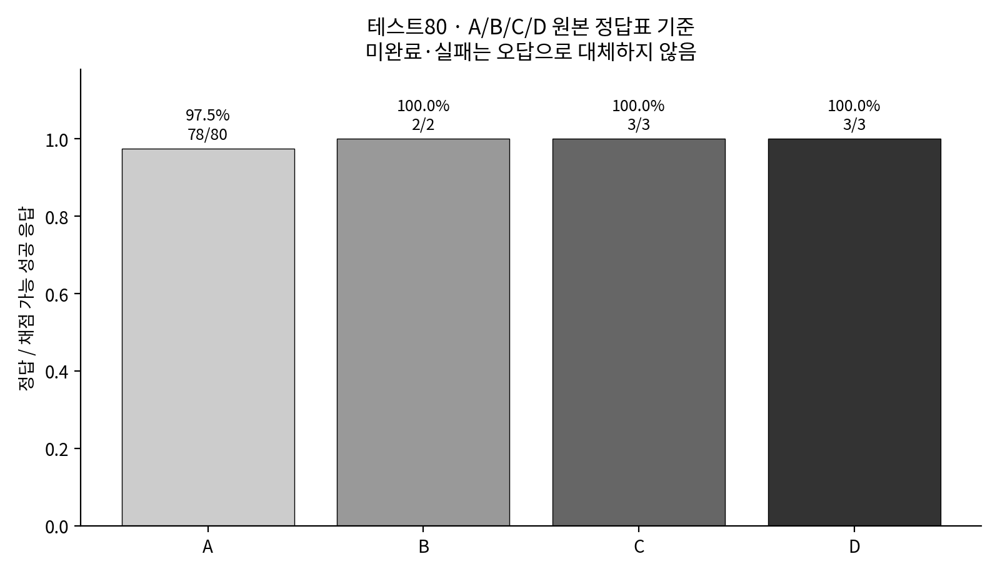
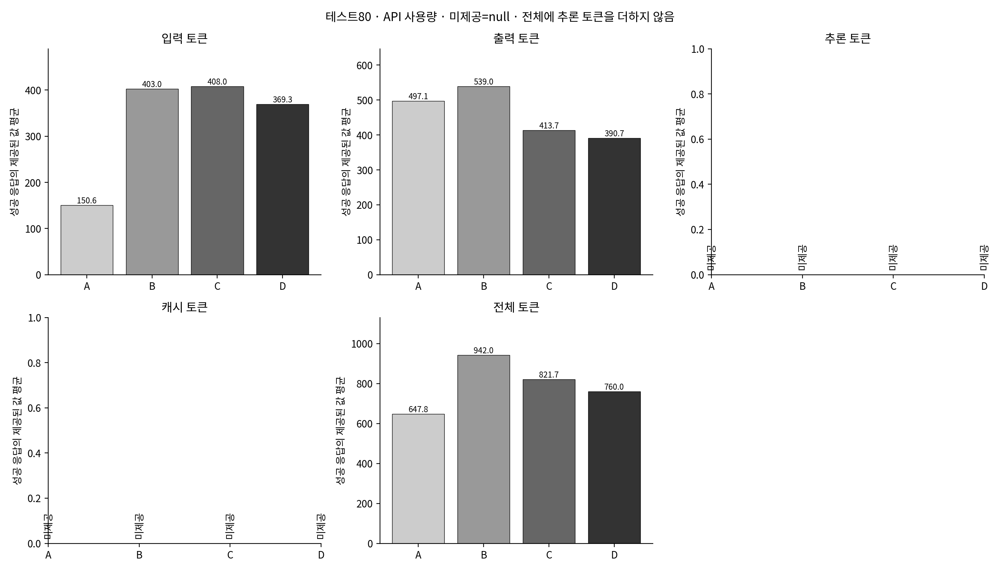
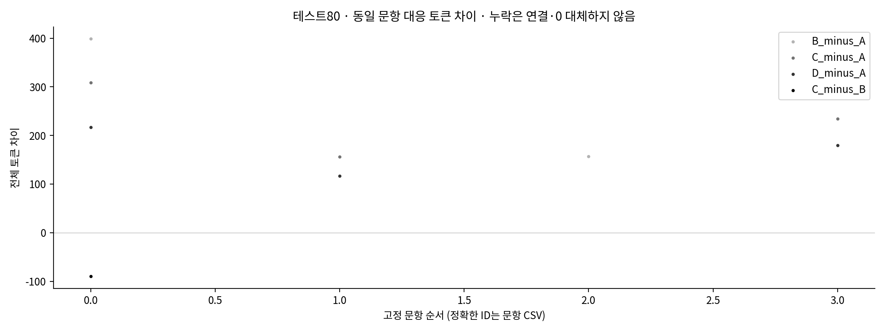

# Gemini A/B/C/D · 문제 풀이 성능과 토큰 사용량

A 문제만 · B 선형회귀 예측 상위20 · C 딥러닝 예측 상위20 · D 실제 해설 상위20. 이전 실험의 C 오라클이 이번 D다.

먼저 [수식이 표시되는 문항 화면](report.html), [모든 문항 비교](question_comparison.csv), [풀이·오류 사례](case_reports/README.md)를 본다.

## 테스트80문항

정답률 분모는 **채점 가능한 성공 응답**이다. 미완료·실패·채점 불가를 오답 또는0토큰으로 바꾸지 않는다.

|조건|성공/계획|채점 가능|정답|정답률|평균 입력|평균 출력|평균 전체|
|---|---:|---:|---:|---:|---:|---:|---:|
|A 문제만|80/80|80|78|97.50%|150.64|497.11|647.75|
|B 선형회귀 예측 토큰|2/80|2|2|100.00%|403.00|539.00|942.00|
|C 딥러닝 예측 토큰|3/80|3|3|100.00%|408.00|413.67|821.67|
|D 실제 해설 토큰|3/80|3|3|100.00%|369.33|390.67|760.00|







[이 범위의 문항별 CSV](question_comparison_test.csv)

## 실행·재사용 상태

현재 실행 상태: `interrupted`.

성공 88 / 미완료 232 요청. 중단·미완료 사유: 중단 파일을 확인하여 새 요청을 보내지 않았습니다.

요청 모델 `gemini-3.1-flash-lite` · temperature `0.0` · thinking `minimal` · 최대 출력 `8192`.

정확한 실제 요청 설정과 모델·데이터·예측 해시는 [설정](config.json), [요청 감사](prompt_audit/), [실행 기록](execution_runs/)에서 확인한다. 재사용 응답은 원래 실행 시각·출처와 새 호출을 구분했다. 같은 모델 이름이어도 서로 다른 시기의 서비스 내부 가중치가 동일하다고 확인한 것은 아니다.

기존은5초/2작업자였고 이번 저장 정책은 요청 시작 간격 `10.0`초 / `1`작업자다. 로컬 제한은 RPM `6`, 시간당 `360`, 일일 `320`이며 공급자의 확정 한도와 구분한다. 공급자 제한 확인 여부: `False`. 현재 확인 가능한 공급자 제한: `{"requests_per_minute": null, "requests_per_hour": null, "requests_per_day": null, "tokens_per_minute": null, "remaining_daily_requests": null}`.

확인할 수 없는 TPM·일일 잔여 요청 수는 추정하지 않는다. 잔여 예산이 확인되지 않으면 학습185문항 확장을 실행하지 않는다. [사전 점검](preflight.json) 및 [정확한 재개 상태](state.json)를 확인한다.

[정확한 응답·채점 수](summary.csv) · [모든 사용량·합계·제공 수](token_summary.csv) · [6쌍 대응 비교](paired_comparison.csv) · [재개 상태](state.json)

입력·출력·추론·캐시·전체 사용량은 API 필드를 그대로 집계한다. 미제공 값은 null/—이며 평균 분모는 해당 값이 제공된 성공 응답 수다. 추론 토큰이나 캐시 토큰을 전체 토큰에 더하지 않는다. 성공 응답의 집계이므로 사용량이 제공되지 않은 실패·재시도의 총 과금 비용을 측정한 것으로 주장하지 않는다. 모델 자체 계산량을 측정하지 않았으므로 시스템 전체 계산 효율 개선을 주장하지 않는다.

## 정답표와 풀이 검토

trig_1_010은 원본④와 원본 해설의9/5·②가 충돌한 기존 근거가 있다. 원본 답을 수정하지 않고 원본 기준을 주 점수로 삼았다. 보조 대안 기준의 점수는 summary.csv의 `accuracy_ai_supplemental`에 분리했으며 사람의 확정 답안표라고 주장하지 않는다.

응답별 검토 상태 320행을 [검토 표](review/status.csv)에 저장했다. 상태 개수: `{"AI_assisted_reviewed": 83, "suspected_error": 5, "not_generated": 232}`.

답이 맞다는 사실은 풀이의 타당성을 보장하지 않는다. 새 풀이를 충분히 검증하지 못한 경우 보류로 남겼다. 과거 AI 검토는 완전히 같은 A 응답에만 연결하며 새 B/C/D로 옮기지 않는다. 추가 검토 API 호출은0회다.

[사례별 원본·네 풀이 전체](case_reports/README.md) · [검토 기준과 한계](review/README.md)

## 대응 비교의 해석

A↔B/A↔C/A↔D/B↔C/B↔D/C↔D에서 양쪽 모두 성공·채점 가능한 문항만 대응시켰다. McNemar의 정확 이항 p값과 split별6검정 Holm 보정값을 기록했다. 정오답 변화 문항이 적으면 검정력이 낮으며, 유의하지 않다고 효과가 없다고 확정할 수 없다. 같은 자료에서 여러 결과를 관찰한 탐색 연구이며 가설 확증으로 과장하지 않는다.

## 화면을 여는 방법

GitHub의 HTML 파일 페이지는 실행 화면이 아니다. **저장소 전체 ZIP을 압축 해제**한 뒤 `results/final_experiment_2/gemini_comparison/report.html`을 브라우저에서 연다. 같은 폴더의 `viewer_assets/`와 기존 `mathhint_analysis/viewer_assets/vendor/`의 Markdown·KaTeX·폰트가 함께 필요하다. HTML 하나만 내려받으면 수식이 표시되지 않는다. 인터넷·서버·로그인·추가 Gemini 요청 없이 작동한다. 임의 HTML은 실행하지 않으며 수식 실패는 원문과 실패 표시로 남긴다.

## 재개·보고서 재생성

```bash
python -m mathhint_solver.final_experiment_2.gemini_comparison generate
python -m mathhint_solver.final_experiment_2.gemini_comparison report
python -m mathhint_solver.final_experiment_2.gemini_comparison verify
```

generate는 같은 요청의 성공 기록을 건너뛰고 미완료만 처리한다. report/verify는 모델 학습이나 새 API 호출을 시작하지 않는다. 실행 환경이 종료된 뒤 스스로 계속 실행되거나 별도 예약이 설정됐다고 가정하지 않는다.

## 응답의 실행 시기와 보고 모델 버전

요청 모델 ID와 API 응답의 model_version은 별개다. 미제공 버전을 추정하지 않는다. 원래 시각을 유지한 재사용과 신규 호출을 구분한다.

|범위|조건|재사용 / 신규 성공|API 보고 모델 버전|성공 응답 시작 시각 범위|
|---|---|---:|---|---|
|test|A|80 / 0|gemini-3.1-flash-lite (80)|2026-11-07T13:18:24.150027+00:00 ~ 2026-11-07T17:09:46.406069+00:00|
|test|B|0 / 2|gemini-3.1-flash-lite (2)|2026-11-10T19:14:56.960450+00:00 ~ 2026-11-10T19:19:35.378738+00:00|
|test|C|0 / 3|gemini-3.1-flash-lite (3)|2026-11-10T19:15:06.752390+00:00 ~ 2026-11-10T19:22:01.760172+00:00|
|test|D|0 / 3|gemini-3.1-flash-lite (3)|2026-11-10T19:15:13.183686+00:00 ~ 2026-11-10T19:23:19.272483+00:00|
