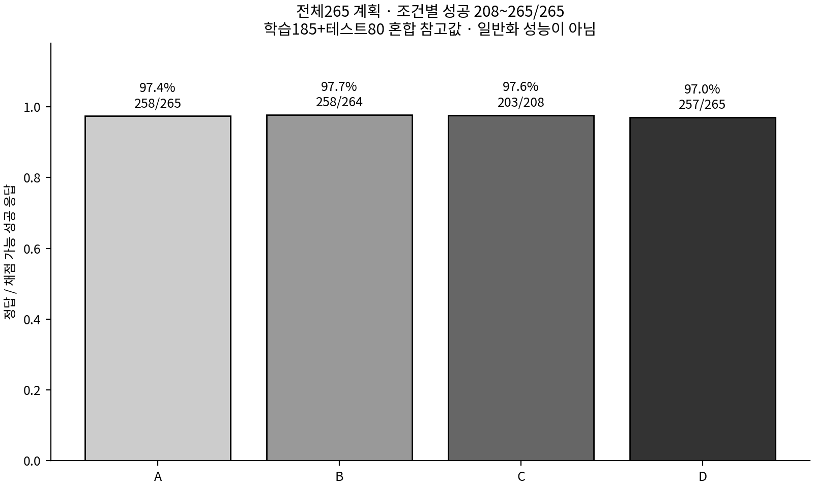
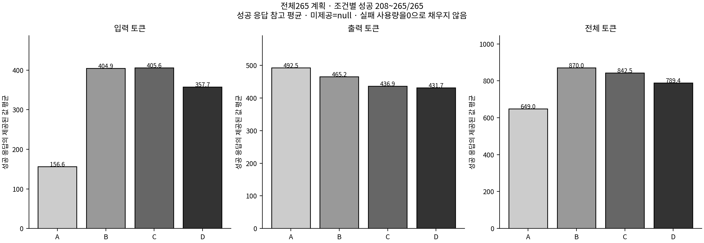
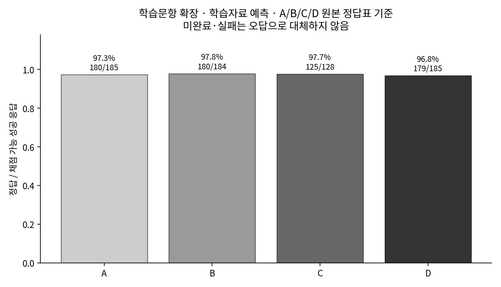
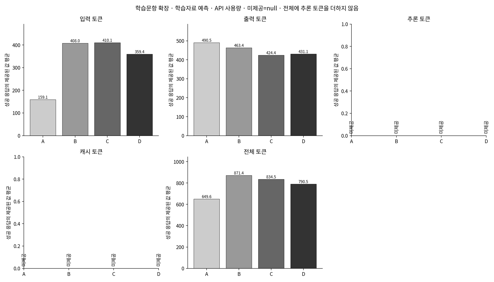
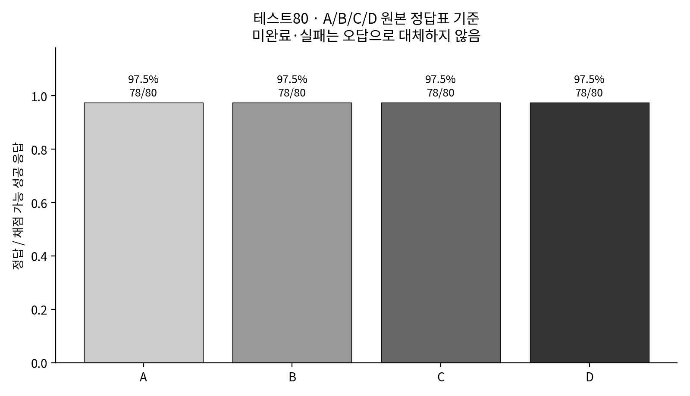
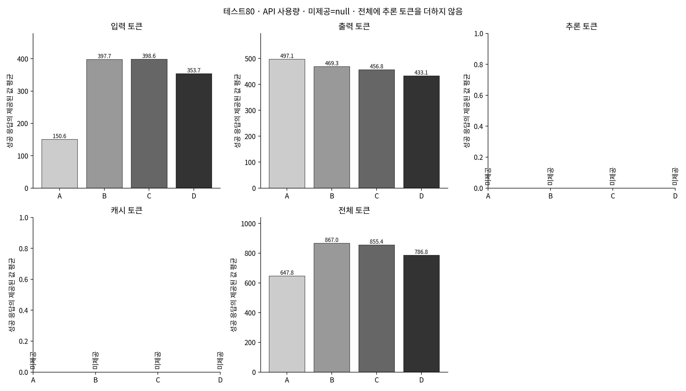

# 전체265문항 Gemini A/B/C/D 비교

A 문제만 · B 확정 선형회귀 예측 토큰 · C 확정 MLP 예측 토큰 · D 실제 원본 해설 토큰(오라클).

## 현재 실행 상태

**부분 완료 · 전체 실험 미완료**

성공 **1003/1060** (기존80 재사용 320 + 신규 683), 미완료 **57**(마지막 실패 0 + 미실행 57)다. 기존80 결과는 그대로 보존했으며, 미완료 조건의 전체265 효과를 확정하지 않는다.

현재 요청 우선순서: **A → B → D → C**. 각 조건의 미완료 전체 문항을 먼저 실행하고, 같은 조건 안에서는 기존 문항 순서를 유지한다. 조건 의미는 A 문제만 / B 선형회귀 / C 딥러닝(MLP) / D 실제 해설(오라클)로 유지한다.

|조건|성공/계획|미완료|
|---|---:|---:|
|A 문제만|265/265|0|
|B 선형회귀 예측 토큰|265/265|0|
|D 실제 해설 토큰|265/265|0|
|C 딥러닝 예측 토큰|208/265|57|

[과거429 관측 기록](state.json)은 보존한다. 이 과거 기록만으로 현재도 할당량에 차단됐다고 판단하지 않으며, 현재 실행 상태와 새 응답을 기준으로 확인한다.

기존 [테스트80 결과](../gemini_comparison/README.md)는 보존했다. 동일한320개 요청의 성공 응답·사용량·검토 기록을 출처 해시로 재사용하고 학습185×4조건을 추가한다. 모델 재학습·어휘 변경·문제 원문 변경은 없다.

**전체265는 학습185와 테스트80의 혼합 참고 결과다. 학습185의 B/C는 해당 모델이 학습했던 문항의 인샘플 예측이며 새로운 문제의 일반화 성능이 아니다.** 테스트80은 기존 평가로 별도 표시한다. D는 정답 해설 정보가 있는 진단 조건이다.

먼저 [수식 비교 화면](report.html), [문항265개 비교 CSV](question_comparison.csv), [풀이·오류 사례](case_reports/README.md)를 연다.

## 핵심 비교 · A 기준

전체265는 학습185 + 테스트80의 혼합 참고값이며, 학습 문항의 B/C는 인샘플 예측이므로 일반화 성능이 아니다.
다음은 A와 해당 조건의 전체 문항에 성공·채점·전체 토큰 사용량이 모두 갖춰진 대응 비교이며, 다른 조건의 완료를 기다려 섞지 않는다. A 토큰 분모가 없는 값은 —다.

|A 대비 조건|공통 채점/전체|개선 / 악화 / 순변화(문항)|사용량 공통/전체|평균 전체토큰 차이|전체토큰 변화율|
|---|---:|---:|---:|---:|---:|
|D|265/265|2 / 3 / -1|265/265|+140.38|+21.63%|

**아래 미완료 비교의 완료 집합은 조건 우선순위·ID 실행 순서·실패에 영향을 받아 무작위 하위표본이 아니며, 해당 조건의 전체 효과를 확정할 수 없어 공통 비교 분모만 표시한다.**

|미완료 A 대비 조건|공통 채점/전체|사용량 공통/전체|
|---|---:|---:|
|B|264/265|265/265|
|C|208/265|208/265|

주 점수는 원본 정답표 기준이며, 원본 키 충돌의 AI 보조 대안 점수는 별도 CSV 열로 분리해 섞지 않는다.

## API 성공과 채점 가능 응답의 차이

아래는 API 성공 응답이지만 저장된 정오 판정이 없는 항목이다. **채점 가능한 응답의 분모가 다르면 조건별 정답률을 단순 비교해 개선이라고 판정하지 않는다.** 기존 정오 판정과 정정 점수는 그대로 보존하며, 채점 불가를 오답으로 바꾸거나 값이 없는 항목을0으로 채우지 않는다. 풀이의 수학적 타당성은 별도 검토한다.

|조건|API 성공|채점 가능|채점 불가|직접 확인할 문항|
|---|---:|---:|---:|---|
|B 선형회귀 예측 토큰|265|264|1|[trig_1_044](report.html#trig_1_044) ([사례](case_reports/trig_1_044.md))|

## 전체265 · 혼합 참고 결과

|조건|성공/계획|채점 가능|정답|정답률|평균 입력|평균 출력|평균 전체|
|---|---:|---:|---:|---:|---:|---:|---:|
|A 문제만|265/265|265|258|97.36%|156.56|492.48|649.04|
|B 선형회귀 예측 토큰|265/265|264|258|97.73%|404.88|465.17|870.05|
|C 딥러닝 예측 토큰|208/265|208|203|97.60%|405.64|436.86|842.50|
|D 실제 해설 토큰|265/265|265|257|96.98%|357.71|431.72|789.43|





## 학습185 · 인샘플 예측

|조건|성공/계획|채점 가능|정답|정답률|평균 입력|평균 출력|평균 전체|
|---|---:|---:|---:|---:|---:|---:|---:|
|A 문제만|185/185|185|180|97.30%|159.12|490.48|649.60|
|B 선형회귀 예측 토큰|185/185|184|180|97.83%|407.98|463.39|871.37|
|C 딥러닝 예측 토큰|128/185|128|125|97.66%|410.07|424.39|834.46|
|D 실제 해설 토큰|185/185|185|179|96.76%|359.42|431.12|790.55|





[이 범위의 문항별 CSV](question_comparison_train.csv) · [토큰 차이 그림](figures/token_differences_train.png)

## 기존 테스트80 · 저장 성공 응답 재사용

|조건|성공/계획|채점 가능|정답|정답률|평균 입력|평균 출력|평균 전체|
|---|---:|---:|---:|---:|---:|---:|---:|
|A 문제만|80/80|80|78|97.50%|150.64|497.11|647.75|
|B 선형회귀 예측 토큰|80/80|80|78|97.50%|397.71|469.27|866.99|
|C 딥러닝 예측 토큰|80/80|80|78|97.50%|398.56|456.80|855.36|
|D 실제 해설 토큰|80/80|80|78|97.50%|353.74|433.10|786.84|





[이 범위의 문항별 CSV](question_comparison_test.csv) · [토큰 차이 그림](figures/token_differences_test.png)

## 실행·재사용·재개

상태: **partial_complete** · 성공 1003/1060 · 미완료 57. 이번 실행의 신규 요청 예산에 도달했습니다.

무료 API라도 공급자 요청·토큰 한도는 존재한다. 상단의 실제429 관측값은 공급자 할당량 전체를 확인했다는 뜻은 아니다. 로컬 실행 상한(예: RPD1400)은 공급자 한도가 아니며, 실제429/503·Retry-After/RetryInfo와 구분해 기록한다.

모델은 `gemini-3.1-flash-lite`, temperature0, thinking minimal, max output8192이며 A/B/C/D 문제 원문과 기본 시스템 지시가 동일하다. B/C/D는 동일한 양수·음수보정·상위20·반올림전순위·어휘순동점·소수3자리 규칙을 사용한다.

[설정](config.json) · [실제 요청 감사](prompt_audit/) · [응답 원문](responses.jsonl) · [실행 상태/미완료 목록](state.json) · [실행 이력](execution_runs/) · [기존 자료 보존 해시](preservation_manifest.json) · [검증](validation.json)

```bash
python -m mathhint_solver.final_experiment_2.gemini_full265 preflight
python -m mathhint_solver.final_experiment_2.gemini_full265 generate
python -m mathhint_solver.final_experiment_2.gemini_full265 report
python -m mathhint_solver.final_experiment_2.gemini_full265 verify
```

report/verify는 저장 자료만 읽어 학습이나 API 호출을 시작하지 않는다. generate는 동일 성공 요청을 건너뛰고 미완료만 재개한다. 중단 파일이 있다면 state.json의 정확한 재개 명령을 따른다. 예약 자동 재개는 별도로 설정하지 않았다.

## 집계와 해석

정답률 분모는 채점 가능한 성공 응답이다. 실패·미완료·채점 불가를 오답으로 대체하지 않는다. 토큰의 평균 분모는 해당 필드가 실제 제공된 성공 응답 수이고 미제공은 null/—다. 추론·캐시 토큰을 전체 토큰에 더하지 않는다. 전체265 평균은 문항·제공 수를 기준으로 합쳐 계산하며185와80의 평균을 단순 평균하지 않는다.

[전체/분할 핵심 수치](summary.csv) · [사용량 합계·제공 수](token_summary.csv) · [6쌍 대응 비교](paired_comparison.csv)

대응 검정은 각 범위에서 양쪽 성공·채점 가능한 같은 문항만 사용하고 범위별6쌍에 Holm 보정을 적용한다. 세 범위는 서로 겹치는 탐색 요약이며 독립 표본이 아니다. 작은 정오답 변화의 검정력 한계, 과거80 재사용과 새185의 실행 시점 차이를 함께 고려한다.

부분 결과의 완료 집합은 조건 우선순위·ID 실행 순서·제한에 영향을 받아 무작위 하위표본이 아니다. 미완료 조건의 전체265 효과를 확정하지 않는다. 예측 모델 연산비용과 사용량이 제공되지 않은 실패·재시도 비용을 측정하지 않았으므로 시스템 전체 효율 향상을 주장하지 않는다.

## 정답표·풀이 검토

trig_1_010의 원본④와 해설 계산9/5·②의 기존 충돌을 보존한다. 원본 기준 점수를 주 결과로 표시하고 AI 보조 대안 기준은 CSV 별도 열에 둔다. 원본 정답을 자동 수정하지 않는다.

총 1060개 조건의 검토 상태를 [검토 CSV](review/status.csv)에 기록했다. 상태 개수: `{'AI_assisted_reviewed': 941, 'suspected_error': 62, 'not_generated': 57}`. 과거320개 검토는 응답SHA와 실제 인용이 일치하는 경우에만 재사용했다. 새185의 생성 풀이를 직접 검증하지 않았다면 검토 보류이며, 정답이 맞았다는 이유로 풀이 타당성을 확정하지 않는다. 별도 외부 검토 API 호출은 없다.

[선별 사례 135문항](case_reports/README.md) · [모든 응답 검토 상태](review/status.csv)

## 화면을 여는 방법

GitHub의 HTML 파일 페이지는 실행 화면이 아니다. 저장소 ZIP 전체를 압축 해제한 뒤 `results/final_experiment_2/gemini_full265/report.html`을 브라우저로 연다. 같은 폴더의 viewer_assets와 기존 mathhint_analysis/viewer_assets/vendor의 로컬 수식·Markdown·폰트가 함께 필요하다. HTML 하나만 내려받으면 충분하지 않다. 외부 렌더링 서버·로그인·추가 API 없이 읽는다.

[2차 연구 목차](../README.md) · [변경하지 않은 기존80 결과](../gemini_comparison/README.md)


## 원본 정답표 보존과 검증된 정정 점수

원본 정답표 기준 수치는 역사적 기록으로 보존한다. trig_1_010의 확인된 오류(④→②)를 반영한 [정정 점수표](key_corrected/README.md)를 문항별·전체265/학습185/테스트80별로 별도 제공한다. 미완료를 오답 처리하지 않으며 API 호출 없이 재생성된다.
[정정 규칙](../../../data/curation/answer_key_corrections.json) · [검토 기록](../../../docs/answer_key_audit_2026-11-11.md)
