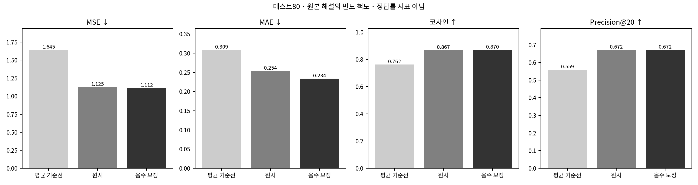
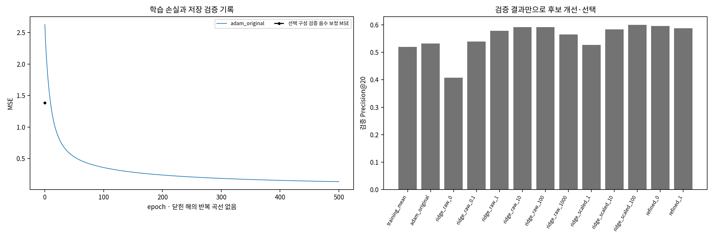
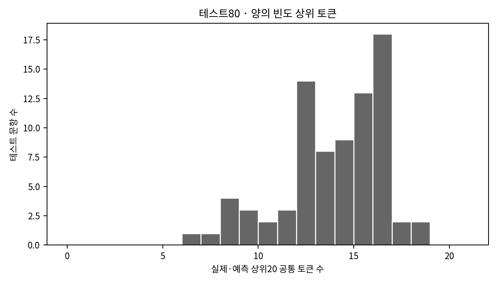
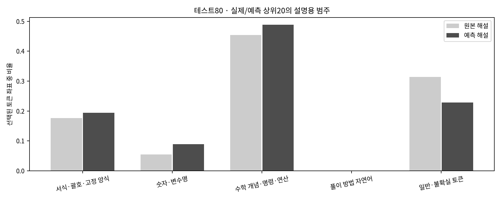
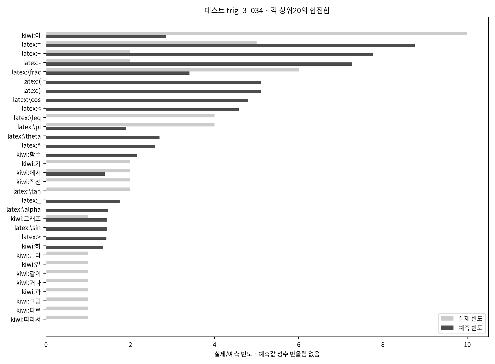
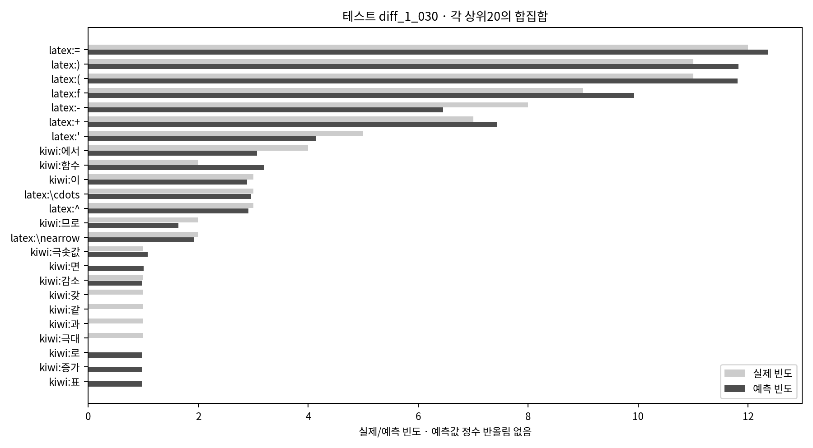

# 선형회귀 · 원본 해설 빈도 예측

최종 구조:

```text
Linear(in_features=270, out_features=359, bias=True)
```

검증 Precision@20을 최대화하고 동률이면 음수 보정 MSE, 사전 후보 순서로 선택했다. 테스트80의 실제 해설은 선택·조기 종료에 사용하지 않았다.

## 검증과 최종 테스트

|범위|방법|MSE ↓|MAE ↓|코사인 ↑|Precision@20 ↑|Recall@20 ↑|공통 토큰 수/20|
|---|---|---:|---:|---:|---:|---:|---:|
|내부 검증37|학습 평균 기준선|1.8378|0.3247|0.7294|0.5203|0.5783|10.4054|
|내부 검증37|원시 예측|1.4018|0.2892|0.8157|0.6000|0.6672|12.0000|
|내부 검증37|음수→0 보정|1.3850|0.2689|0.8219|0.6000|0.6672|12.0000|
|최종 테스트80|학습 평균 기준선|1.6454|0.3089|0.7617|0.5594|0.5904|11.1875|
|최종 테스트80|원시 예측|1.1249|0.2536|0.8671|0.6725|0.7105|13.4500|
|최종 테스트80|음수→0 보정|1.1121|0.2339|0.8699|0.6725|0.7105|13.4500|

최종 계열은 **Ridge(α=100)**다. 초기 nn.Linear/Adam500에폭, 원시 좌표 Ridge, fit148에서만 구한 표준편차로 푸는 Ridge를 비교하고 검증 최적 α의 근방2개를 추가했다. 표준화는 정보가 사라지는 문항별 L2 정규화가 아니며, 풀어진 계수를 다시 원시 입력의 선형 가중치·절편으로 변환했다. 최종185 리핏에서도185만으로 평균·스케일을 추정했다.

Ridge는 닫힌 해를 계산하므로 최종 모델에 반복 학습 에폭이 없다. 아래 손실 곡선은 초기 Adam 후보의 경과와 저장된 후보별 검증 비교이며, 닫힌 해의 epoch0을 가짜 반복 곡선으로 표시하지 않는다.

테스트 P@20의 평균 기준선 대비 차이: **+0.1131**. 학습185의 보정 MSE 0.2748와 테스트80 MSE 1.1121의 차이를 함께 읽는다. 학습 성능만 좋아진 것을 개선으로 간주하지 않는다.

테스트 원시 출력의 음수 비율은 35.58%다. 실제 빈도는 정수이며 회귀 예측은 반올림하지 않은 실수로 보존한다.





## 개선 과정

|후보|검증 P@20|검증 MSE|설정|
|---|---:|---:|---|
|training_mean|0.5203|1.8378|`fit148 mean`|
|adam_original|0.5324|1.4991|`{"candidate_id": "adam_original", "epochs": 500, "family": "adam_linear", "learning_rate": 0.01, "seed": 42, "stage": "initial"}`|
|ridge_raw_0|0.4081|47.6256|`{"alpha": 0.0, "candidate_id": "ridge_raw_0", "family": "ridge", "stage": "coarse", "standardize": false}`|
|ridge_raw_0.1|0.5392|1.6679|`{"alpha": 0.1, "candidate_id": "ridge_raw_0.1", "family": "ridge", "stage": "coarse", "standardize": false}`|
|ridge_raw_1|0.5784|1.2181|`{"alpha": 1.0, "candidate_id": "ridge_raw_1", "family": "ridge", "stage": "coarse", "standardize": false}`|
|ridge_raw_10|0.5919|1.2019|`{"alpha": 10.0, "candidate_id": "ridge_raw_10", "family": "ridge", "stage": "coarse", "standardize": false}`|
|ridge_raw_100|0.5919|1.2555|`{"alpha": 100.0, "candidate_id": "ridge_raw_100", "family": "ridge", "stage": "coarse", "standardize": false}`|
|ridge_raw_1000|0.5649|1.4453|`{"alpha": 1000.0, "candidate_id": "ridge_raw_1000", "family": "ridge", "stage": "coarse", "standardize": false}`|
|ridge_scaled_1|0.5270|2.0487|`{"alpha": 1.0, "candidate_id": "ridge_scaled_1", "family": "ridge", "stage": "coarse", "standardize": true}`|
|ridge_scaled_10|0.5838|1.6273|`{"alpha": 10.0, "candidate_id": "ridge_scaled_10", "family": "ridge", "stage": "coarse", "standardize": true}`|
|ridge_scaled_100|0.6000|1.3850|`{"alpha": 100.0, "candidate_id": "ridge_scaled_100", "family": "ridge", "stage": "coarse", "standardize": true}`|
|refined_0|0.5959|1.4879|`{"alpha": 31.622776601683793, "candidate_id": "refined_0", "family": "ridge", "stage": "refinement", "standardize": true}`|
|refined_1|0.5878|1.3679|`{"alpha": 316.22776601683796, "candidate_id": "refined_1", "family": "ridge", "stage": "refinement", "standardize": true}`|

[모든 후보 비교](model_comparison.csv) · [모델 선택·중단 규칙](selection.json) · [학습 기록](training_history.csv)

## 문항과 상위 토큰

[테스트80 문항별 오차·실제/예측 토큰](question_comparison.csv) · [상위토큰 범주](top20_category_composition.csv) · [전 문항 예측·모델 출처](model_manifest.json)





범주는 토큰 역할의 검토 보조 분류다. 빈도가 높거나 집합이 많이 겹치는 것이 풀이 전략의 타당성을 입증하지 않는다.

|관찰 사례|문항|코사인|공통 토큰 수|
|---|---|---:|---:|
|낮은 코사인|[trig_3_034 읽기 화면](../gemini_comparison/report.html#trig_3_034) · [원문](../../../data/processed/problems/trig_3_034.txt)|0.5122|8|
|낮은 코사인|[diff_3_022 읽기 화면](../gemini_comparison/report.html#diff_3_022) · [원문](../../../data/processed/problems/diff_3_022.txt)|0.5748|11|
|높은 코사인|[diff_2_020 읽기 화면](../gemini_comparison/report.html#diff_2_020) · [원문](../../../data/processed/problems/diff_2_020.txt)|0.9842|18|
|높은 코사인|[diff_1_030 읽기 화면](../gemini_comparison/report.html#diff_1_030) · [원문](../../../data/processed/problems/diff_1_030.txt)|0.9888|16|

## 대표 문항의 실제·예측 빈도





전체265의 어휘를 미리 구성한 탐색적 조건이다. 테스트 표현이 어휘와 불용어 검토에 포함됐으므로 완전히 미관측인 일반화 검증이 아니다. 한 문제의 특정 원본 해설을 타깃으로 삼았으며 다른 올바른 풀이의 토큰은 다를 수 있다.

새 Gemini 효과는 이 벡터 지표와 다른 평가 대상이다. 이 문서만으로 풀이 정확도·시스템 계산 효율 향상을 주장하지 않는다.

## 실행 구분

저장소 루트에서 설치 후 실행한다. Python 환경은 프로젝트의 learning·analysis 의존성을 사용한다.

```bash
python -m pip install -e '.[learning,analysis]'
python -m mathhint_learning.final_experiment_2.regression evaluate
python -m mathhint_learning.final_experiment_2.regression train
```

evaluate는 지정된 확정 체크포인트의 예측을 저장 예측과 대조하고 표·그림을 다시 만든다. 재학습이나 API 호출은 없다. train은 이 실험의 검증 탐색·최종 학습 진입점이며, 이미 완료된 동일 데이터·설정은 무결성을 확인해 재사용한다. 완료된 모델을 지워 재학습할 필요는 없다. 데이터나 설정이 다르면 과거 모델로 대신 진행하지 않고 중단한다.

[전체2차 연구](../README.md) · [공통 데이터](../solution_data/README.md)
