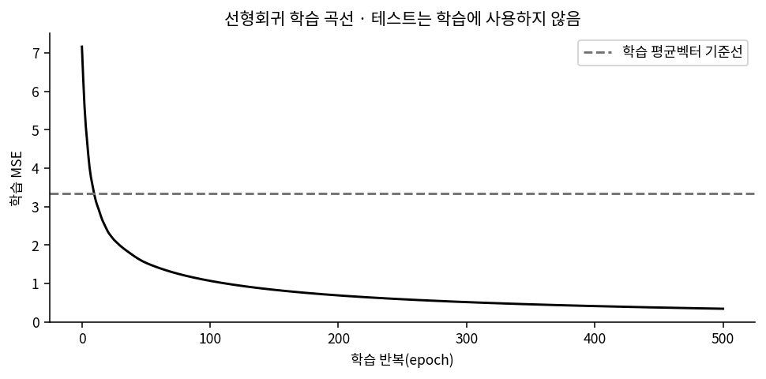
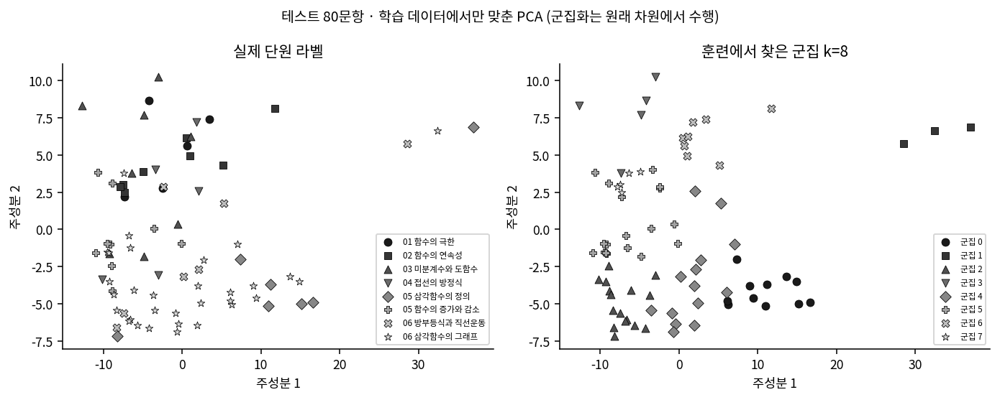

# 회귀·군집화·Gemini 비교 결과

**처음 나눈 학습 185문항·테스트 80문항을 그대로 사용했다.** 문제 벡터는 346차원, 원본 해설 벡터는 431차원이다. 테스트 정답·해설·유형을 학습이나 Gemini 입력에 넣지 않았다.

[3쪽 핵심 요약 PDF](3쪽_핵심요약.pdf) · [상세 보고서 PDF](상세_보고서.pdf) · [상세 수치 JSON](integrated_summary.json)

## 1. 회귀 모델 자체 성능

선형층·Adam·500회·학습률 0.01·시드 42. 아래는 테스트 80문항의 해설 벡터 예측 성능이다.

| 예측 방식 | MSE ↓ | MAE ↓ | 코사인 유사도 ↑ |
|---|---:|---:|---:|
| 학습 해설의 평균 벡터 | 3.5594 | 0.4843 | 0.7986 |
| 회귀 원시 예측 | 3.3570 | 0.6229 | 0.8200 |
| 회귀 예측의 음수를 0으로 조정 | 3.0125 | 0.4856 | 0.8480 |

MSE와 코사인 유사도는 개선됐지만 MAE는 개선되지 않았다. 벡터 예측과 Gemini의 답변 정답률은 별도 평가다.

[테스트 성능 그림](01_회귀모델/테스트_성능.png) · [문항별 예측 벡터](01_회귀모델/regression_predictions.json)

## 2. 군집화와 실제 단원·유형

학습 데이터로 중심을 만들고 테스트 80문항을 배정했다. 5회 초기화 중 학습 군집 내 거리 합이 최소인 결과를 선택했다. 산점도의 PCA도 학습 데이터에서만 맞췄고 실제 군집은 원래 346차원에서 계산했다.

| 군집 수 | 비교 라벨 | ARI | NMI | 학습 다수 라벨 기반 테스트 정확도 |
|---:|---|---:|---:|---:|
| 2 | 미분·삼각함수 | 0.0967 | 0.1039 | 66.25% |
| 8 | 단원 | 0.1479 | 0.4010 | 52.50% |
| 70 | 세부 유형 | 0.1670 | 0.7804 | 36.25% |

학습 유형은 70개, 테스트 유형은 42개다. 많은 작은 군집에서는 NMI가 높아질 수 있어 ARI도 함께 봐야 한다. 현재 원시 빈도·유클리드 거리 설정에서 유형이 완전히 구분되지는 않았다.

[유형별 군집 분포](02_군집화/유형별_군집분포.png) · [문항별 군집 번호](02_군집화/cluster_assignments.csv)

## 3. Gemini 답변 정확도·토큰 사용량

`gemini-3.1-flash-lite` · 추론 `minimal` · temperature 0 · 최대 출력 8192토큰. 두 조건 모두 같은 문제와 정답 표기 지시를 사용했다. 가이드에는 회귀 예측 빈도가 높은 상위 20개 토큰만 추가했다.

| 테스트 80문항 | 기본 풀이 | 회귀 토큰 가이드 |
|---|---:|---:|
| 원본 정답표 기준 | 78/80 · 97.50% | 77/80 · 96.25% |
| 정답표 충돌 1건의 수학 검토 보조 점수 | 79/80 · 98.75% | 78/80 · 97.50% |
| 평균 입력 토큰 | 150.6 | 395.0 |
| 평균 출력 토큰 | 497.1 | 462.7 |
| 평균 전체 토큰 | 647.8 | 857.7 |
| 전체 토큰 합 | 51,820 | 68,615 |

이 실행에서는 정답률 개선 없이 전체 토큰이 **32.41% 증가**했다. 가이드로 1문항이 개선되고 2문항은 오답으로 바뀌었다. 80문항에 방식별 1회 생성한 결과이며, 통계적으로 성능 우열을 확정할 근거는 부족하다.

`trig_1_010`은 원본 정답 표기 ④와 원본 해설의 계산 9/5(보기 ②)가 충돌한다. 원본 점수와 근거를 둔 보조 점수를 분리했다. [원본 정답표 충돌 근거](03_Gemini비교/원본정답표_오류근거.json)는 AI 보조 수학 검토이며 사람이 인증한 새 정답표는 아니다.

- [80문항 비교표 CSV](03_Gemini비교/80문항_비교표.csv): 두 방식의 정오답과 사용량을 한 행씩 비교.
- [입력·출력 전문 CSV](03_Gemini비교/입력출력_정답_토큰_전체.csv): 실제 입력·출력·원본 정답·사용량.
- [문항별 원본 파일](03_Gemini비교/문항별_원본): ID별 입력·출력·정답해설·JSON.
- [원본 응답 JSONL 160개](03_Gemini비교/원본응답_160개.jsonl), [실험 설정](03_Gemini비교/실험설정.json).

기본 응답 77개는 동일한 입력·모델·설정임을 검증해 재사용했다. 기존 응답의 시각과 사용량을 그대로 보존했으며, 이번 새 API 실행은 기본 응답 3개와 가이드 응답 80개다. 위 토큰 비교에는 재사용한 성공 응답의 사용량도 포함한다. 추론·캐시 토큰은 API 미제공이므로 0으로 추정하지 않았다.

### 풀이 적절성 검토

| AI 보조 수학 검토 | 적절 | 부적절 | 불확실 |
|---|---:|---:|---:|
| 기본 풀이 | 76 | 4 | 0 |
| 회귀 토큰 가이드 | 71 | 7 | 2 |

논리·설명 충분성·수학적 일관성을 검토한 제안이다. 검토자는 생성 방식을 알고 있었고 사람의 확정 판정이나 블라인드 평가가 아니다. 교과 범위는 별도 항목으로 대부분 판단을 보류했다. [검토 요약](03_Gemini비교/풀이검토_요약.json)에서 분모와 검토 범위를 확인할 수 있다.

## 파일을 보는 방법과 재현 정보

- GitHub에서는 이 README와 PNG·CSV·PDF부터 확인한다.
- [한눈에 보기 HTML](결과_한눈에.html)과 [문항별 비교 HTML](03_Gemini비교/문항별_입력출력_비교.html)은 내려받아 브라우저에서 연다. 문항별 HTML의 수식 렌더링에는 인터넷 연결을 사용할 수 있다.
- `models/`에는 실제 회귀·K-means 체크포인트 4개를 보존했다.
- `provenance/`에는 실행 기록, 검증 결과, 당시 생성 소스와 해시를 보존했다. 정리한 현재 실행 코드는 저장소 루트에 있다. 과거 소스 해시와 현재 코드 해시가 달라도 당시 기록을 수정하지 않는다.
- `provenance/full_vector_exploration/`은 재사용 대조군의 원본이 들어 있는 이전 전체 벡터 탐색 실험이다. 위의 상위 20토큰 결과와 합쳐 집계하지 않았다.
- 원본 데이터 커밋: `0fca4aa`. 학습·비교 기능과 코드 정리 커밋: `0b79452`. 기록된 PyTorch 버전은 `2.15.0+cpu`다.
- 원본 JSON의 `/workspace/...` 경로는 당시 실행 위치의 기록이다. 내려받은 환경의 실행 경로로 그대로 사용할 필요는 없다.
- `manifest.json`은 이 폴더 파일들의 상대 경로와 SHA-256이다. `코드검사_결과.txt`는 실험 당시 검사 기록이고, `provenance/project_cleanup_verification.json`은 코드 정리 후 153개 검사 기록이다.
