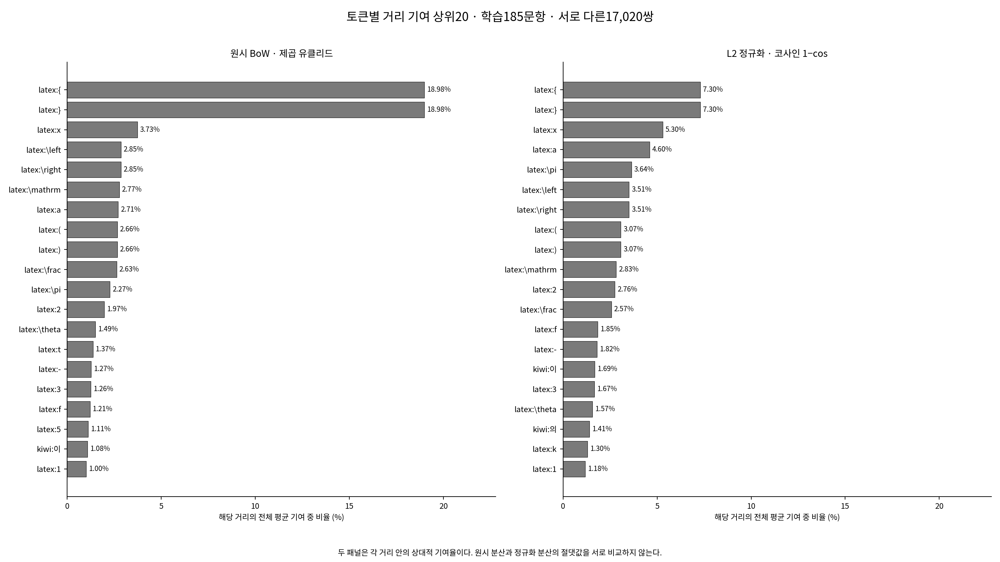
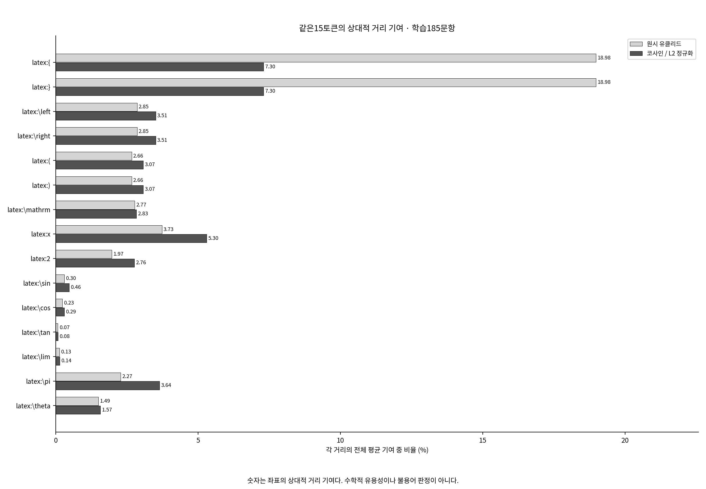
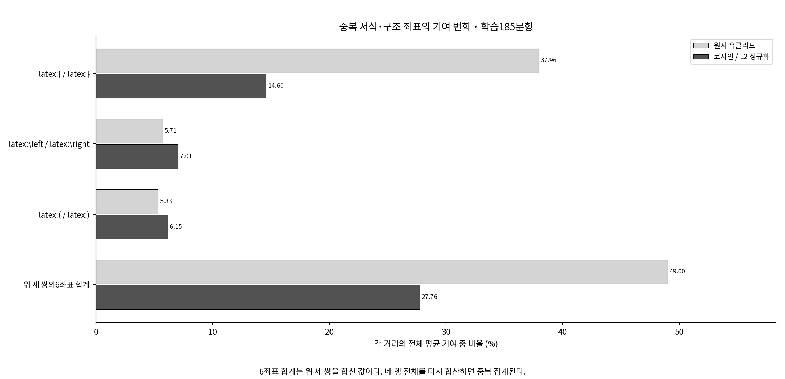
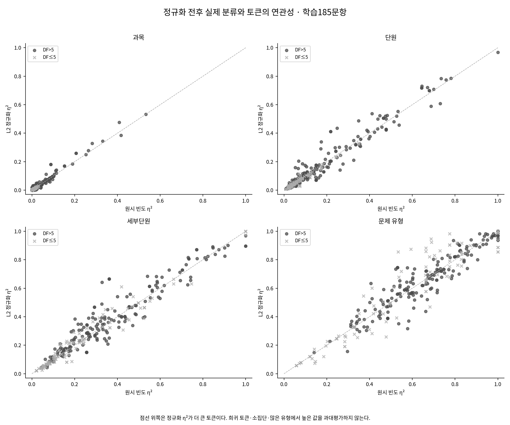
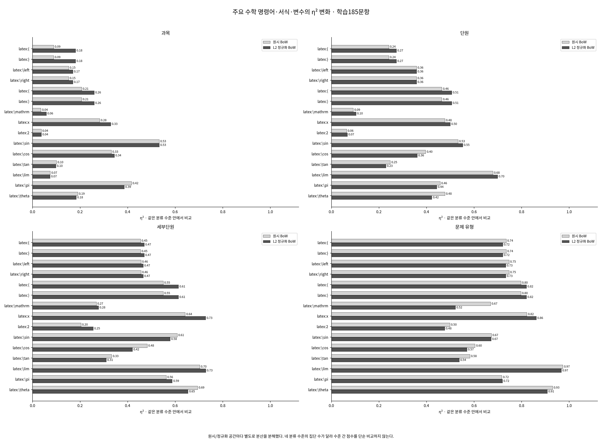
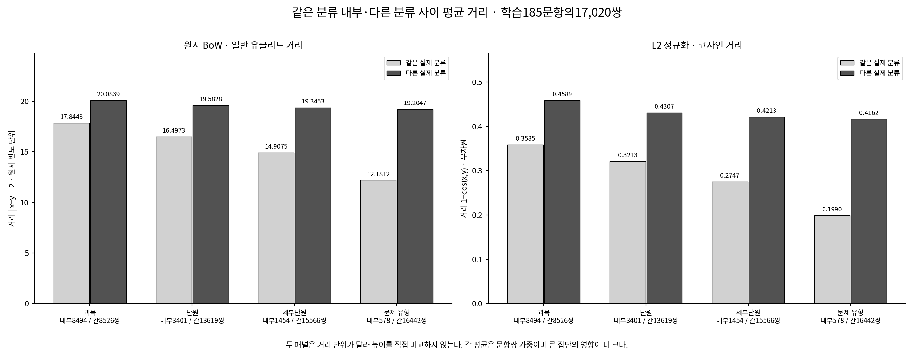
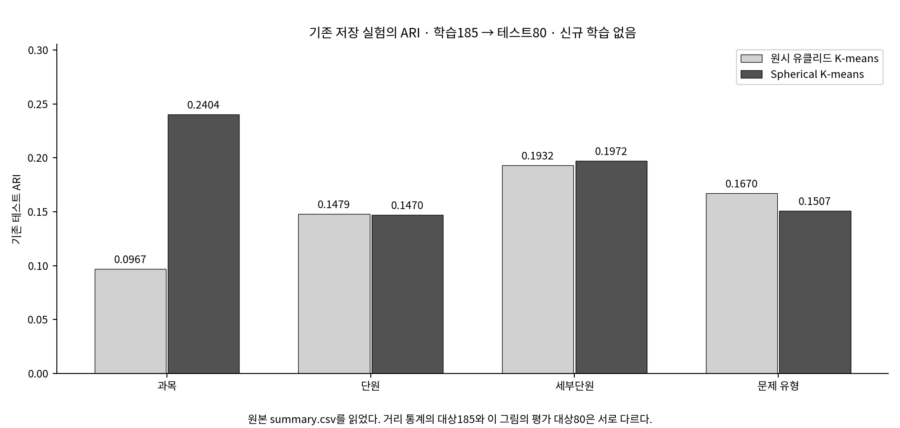

# 유클리드·코사인: 토큰 영향과 실제 분류의 관계

**학습185문항·고정346차원·서로 다른17,020쌍의 통계만 추가했다.** 기존 모델의 재학습·새 군집 배정·불용어 선정/적용·회귀/신경망·Gemini 호출은 없다.

## 1. 코사인 관점이 필요한 이유

원시 유클리드는 문항의 토큰 사용 규모와 방향 차이를 함께 반영한다. 코사인은 각 문항을 L2 노름으로 나누어 방향을 비교한다. 이때 각 토큰은 같은 상수로 나뉘는 것이 아니라 문항마다 다른 크기로 나뉘므로, 토큰별 상대적 거리 기여와 라벨 연관성도 달라질 수 있다.

중괄호·좌우 표시·소괄호 **6좌표의 기여는 49.00% → 27.76%**, 변화는 **-21.24%p**다. 제시됐던 근삿값을 정답으로 넣지 않고 기존 벡터에서 계산한 결과다.

## 2. 계산 정의와 비교 단위

학습 문항의 i<k인 모든 쌍을 한 번씩 사용했다: 185×184/2=17,020쌍. 원시 좌표 차이 제곱의 평균을 토큰 j의 제곱 유클리드 기여로 정했다. 코사인 기여는 L2 정규화 좌표 차이 제곱의 절반을 같은 쌍에서 평균했다.

- 제곱 유클리드: d_E²(x,y)=Σ_j(x_j−y_j)².
- 영벡터가 아닌 문항에서 z=x/||x||₂이고 d_cos(x,y)=1−cos(x,y)=½Σ_j(z_j−w_j)².
- 토큰 기여율=100×해당 좌표의 평균 기여/모든 좌표의 평균 기여 합. 두 방식 각각346좌표의 합은100%다.
- 모집단 분산 V의 분모는185다. 모든 서로 다른 쌍의 평균 좌표 제곱차는 2n/(n−1)×V이므로, 두 방식 각각 기여율은 해당 표현의 V_j/ΣV와 같다.
- CSV contribution 열은% 단위, contribution_difference는 코사인−유클리드의 퍼센트포인트(%p)다. 순위1이 가장 크며 동률은 기존 어휘 인덱스 순서다. rank_change=유클리드 순위−코사인 순위이며 양수는 순위 상승이다.
- 원시 분산과 정규화 분산의 척도는 다르다. 절댓값 감소를 중요도 감소로 해석하지 않고, 각 거리 안의 상대 기여율을 비교한다.
- 현재 학습185문항에는 영벡터가 없다. 영벡터가 발견되면 코사인의 위 항등식이 적용되지 않으므로 임의 거리·토큰 기여를 넣지 않고 명확히 중단하도록 했다.

코사인 기여도는 **현재346좌표로 정규화한 표현의 가법적 거리 분해**다. 토큰을 실제 제거한 뒤 다시 정규화하면 남은 모든 좌표의 분모가 바뀐다. 낮은 기여가 삭제해도 안전하다는 뜻도, 높은 기여가 제거 후 코사인 거리가 정확히 그만큼 줄어든다는 뜻도 아니다.

[전체346좌표와 순위](token_distance_contributions.csv) · [좌표 묶음](requested_token_groups.csv) · [검증](validation.json)

## 3. 어떤 토큰의 상대적 영향이 달라졌는가?

|토큰|유클리드 기여|코사인 기여|C−E (%p)|순위 E→C|의미|
|---|---:|---:|---:|---:|---|
|`latex:{`|18.98%|7.30%|-11.68|1→1|LaTeX 명령어 인수·부분식의 묶음을 여는 기호|
|`latex:}`|18.98%|7.30%|-11.68|2→2|LaTeX 명령어 인수·부분식의 묶음을 닫는 기호|
|`latex:\left`|2.85%|3.51%|+0.65|4→6|왼쪽 구분 기호의 크기 조절|
|`latex:\right`|2.85%|3.51%|+0.65|5→7|오른쪽 구분 기호의 크기 조절|
|`latex:(`|2.66%|3.07%|+0.41|8→8|소괄호·함수 인수·순서쌍 등의 시작|
|`latex:)`|2.66%|3.07%|+0.41|9→9|소괄호·함수 인수·순서쌍 등의 끝|
|`latex:\mathrm`|2.77%|2.83%|+0.06|6→10|인수의 로마체 글꼴 지정|
|`latex:x`|3.73%|5.30%|+1.57|3→3|단일 영문자 이름|
|`latex:2`|1.97%|2.76%|+0.79|12→11|분리된 수치 리터럴|
|`latex:\sin`|0.30%|0.46%|+0.16|44→41|사인 함수|
|`latex:\cos`|0.23%|0.29%|+0.07|54→59|코사인 함수|
|`latex:\tan`|0.07%|0.08%|+0.01|106→122|탄젠트 함수|
|`latex:\lim`|0.13%|0.14%|+0.01|74→96|극한을 나타내는 명령어|
|`latex:\pi`|2.27%|3.64%|+1.37|11→5|원주율 기호|
|`latex:\theta`|1.49%|1.57%|+0.07|13→17|그리스 문자 이름|

|좌표 묶음|유클리드 기여|코사인 기여|C−E (%p)|
|---|---:|---:|---:|
|중괄호 두 좌표|37.96%|14.60%|-23.37|
|좌우 크기 표시 두 좌표|5.71%|7.01%|+1.31|
|소괄호 두 좌표|5.33%|6.15%|+0.82|
|중괄호·좌우 표시·소괄호 6좌표|49.00%|27.76%|-21.24|

6좌표 합계 행은 앞의 세 쌍을 합친 값이므로 네 행 전체를 다시 합치지 않는다. 같은 패턴을 두 좌표가 공유하면 거리에서 반복 가중된다. 코사인에서도 이 그룹의 비중은 남아 있으며 수식 복잡도나 분류별 표기 방식과 관련될 수 있다.

합계 감소를 가장 크게 만든 묶음은 **중괄호 두 좌표**이며 변화는 -23.37%p다.
반대로 좌우 크기 표시 두 좌표(+1.31%p), 소괄호 두 좌표(+0.82%p)는 증가했다. 따라서 모든 서식·괄호 토큰의 영향이 줄었다고 설명할 수 없다.
비율과 순위도 별개다. `latex:\cos`는 기여율이 0.23%→0.29%로 늘었지만, 다른 토큰의 증가가 더 커 순위는 54→59로 내려갔다.

|변화 방향|토큰|C−E (%p)|설명용 역할|
|---|---|---:|---|
|증가|`latex:a`|+1.89|LaTeX 변수명|
|증가|`latex:x`|+1.57|LaTeX 변수명|
|증가|`latex:\pi`|+1.37|LaTeX 수학 명령어|
|증가|`latex:2`|+0.79|LaTeX 숫자|
|증가|`latex:^`|+0.67|괄호·수식 구조 기호|
|감소|`latex:{`|-11.68|괄호·수식 구조 기호|
|감소|`latex:}`|-11.68|괄호·수식 구조 기호|
|감소|`latex:t`|-0.45|LaTeX 변수명|
|감소|`latex:P`|-0.16|LaTeX 변수명|
|감소|`latex:\sqrt`|-0.11|LaTeX 수학 명령어|

설명용 범주별 상대 기여도도 함께 본다. 수학 명령·개념이 상대적으로 강조되더라도 이것만으로 실제 분류 성능이 개선됐다고 결론내리지 않는다. 변수·숫자·서식도 조건과 구조의 흔적을 담을 수 있다.

|기존 설명용 범주|유클리드 기여|코사인 기여|C−E (%p)|
|---|---:|---:|---:|
|LaTeX 변수명|15.64%|20.88%|+5.25|
|LaTeX 수학 명령어|6.42%|7.87%|+1.44|
|LaTeX 숫자|7.57%|10.80%|+3.23|
|괄호·수식 구조 기호|46.83%|26.04%|-20.79|
|분류 불확실·검토 필요|4.88%|8.27%|+3.39|
|수학 개념 자연어|2.69%|4.54%|+1.85|
|연산·관계 기호|3.62%|5.73%|+2.10|
|일반 조사·어미·연결어|3.70%|5.93%|+2.24|
|표시용 LaTeX 명령어|8.65%|9.95%|+1.30|
|풀이 방법 자연어|0.00%|0.00%|-0.00|

함께 증가한 범주에는 분류 불확실·검토 필요(+3.39%p), 일반 조사·어미·연결어(+2.24%p)도 있다. 정규화가 수학적 의미가 있는 토큰만 선택적으로 강조했다고 판단할 수 없다.

## 4. 정규화 전후 η²는 어떻게 달라졌는가?

같은 계층 경로와 학습185문항으로 원시·정규화 공간을 각각 분산 분해했다. 각 공간에서 전체 분산=집단 간 분산+집단 내 분산이며 η²=집단 간/전체다. 전체 분산0인 좌표의 η²와 그 변화량은 정의되지 않음으로 남겼다.

과목은 curriculum, 단원은 curriculum/unit, 세부단원은 curriculum/unit/subunit, 유형은 curriculum/unit/subunit/type 경로를 사용했다. 자료군을 뜻하는 subject를 과목 라벨로 사용하지 않았으며 이름이 같은 하위 분류도 상위 경로가 다르면 구분했다.

[모든1384좌표·수준의 분산 분해/η²/조정η²/DF](normalized_eta_comparison.csv)

|분류|η² 증가가 큰 예 (변화량·DF)|η² 감소가 큰 예 (변화량·DF)|
|---|---|---|
|과목|`latex:{` (+0.092, DF=181), `latex:}` (+0.092, DF=181), `latex:\frac` (+0.068, DF=110)|`latex:\pi` (-0.031, DF=76), `kiwi:방정식` (-0.027, DF=30), `kiwi:최댓값` (-0.024, DF=18)|
|단원|`kiwi:(` (+0.194, DF=35), `kiwi:)` (+0.194, DF=35), `kiwi:단` (+0.187, DF=34)|`kiwi:전체` (-0.124, DF=19), `kiwi:값` (-0.120, DF=130), `latex:\geq` (-0.115, DF=13)|
|세부단원|`kiwi:구간` (+0.314, DF=9), `kiwi:닫히` (+0.304, DF=8), `latex:[` (+0.304, DF=8)|`kiwi:각각` (-0.146, DF=10), `latex:22` (-0.135, DF=2), `kiwi:를` (-0.132, DF=20)|
|문제 유형|`kiwi:개` (+0.322, DF=2), `latex:30` (+0.281, DF=4), `latex:26` (+0.259, DF=3)|`kiwi:그래프` (-0.261, DF=8), `kiwi:각각` (-0.225, DF=10), `kiwi:수인` (-0.220, DF=3)|

[η² 증가·감소가 큰 토큰 각10개 그림](figures/eta_change_extremes.png)

높은 η²는 문항 표본 안의 연관성이며 유용성 판정이 아니다. 유형70개에185문항으로 희귀 유형·단일 문항 집단이 많다. 조정η²=1−(1−η²)(n−1)/(n−g), 집단 크기와 DF를 함께 제공하며 음수 보조 지표도 그대로 보존한다. 분류 수준 간 점수의 단순 우열 비교를 피한다.

## 5. 같은 분류의 문제는 더 가까운가?

|분류|거리|내부 / 간 문항쌍|내부 평균|간 평균|간−내부|간/내부|
|---|---|---:|---:|---:|---:|---:|
|과목|유클리드|8494 / 8526|17.8443|20.0839|2.2396|1.1255|
|과목|코사인|8494 / 8526|0.3585|0.4589|0.1003|1.2798|
|단원|유클리드|3401 / 13619|16.4973|19.5828|3.0855|1.1870|
|단원|코사인|3401 / 13619|0.3213|0.4307|0.1094|1.3405|
|세부단원|유클리드|1454 / 15566|14.9075|19.3453|4.4379|1.2977|
|세부단원|코사인|1454 / 15566|0.2747|0.4213|0.1466|1.5336|
|문제 유형|유클리드|578 / 16442|12.1812|19.2047|7.0235|1.5766|
|문제 유형|코사인|578 / 16442|0.1990|0.4162|0.2172|2.0916|

이 표의 유클리드는 일반 거리 ||x−y||₂다. 앞의 토큰 기여도는 **제곱거리**를 분해했으므로 두 평균을 혼동하지 않는다. 코사인은1−cos이며 두 거리의 절댓값을 직접 비교하지 않는다. 간/내부 비율도 평균적인 집계이고 군집 성능 점수가 아니다. 비율은 단위를 없애지만 제곱 같은 비선형 변환에는 불변이 아니므로 비율 크기만으로 두 거리의 우열을 정하지 않는다.

|분류|집단 수|내부쌍 없는1문항 집단|같은 분류 쌍|다른 분류 쌍|
|---|---:|---:|---:|---:|
|과목|2|0|8494|8526|
|단원|8|0|3401|13619|
|세부단원|25|6|1454|15566|
|문제 유형|70|43|578|16442|

문항쌍 기준 평균에서는 큰 집단이 더 많은 내부쌍을 만든다. 내부쌍이 없는 집단이나 분모0은0으로 대체하지 않았다. 클래스별·동일 가중 macro 결과와 중앙값은 아래 자료에서 함께 확인한다. 17,020쌍은185문항을 반복 사용하므로 독립표본17,020개가 아니며 유의성 검정을 수행하지 않았다.

[평균·중앙값·차이·비율·macro](within_between_distances.csv) · [분류별 내부/다른 분류 비교](class_pair_distances.csv) · [17,020문항쌍](document_pair_distances.csv)

## 6. 기존 K-means 결과와 연결

|분류|유클리드 ARI|구면 ARI|구면−유클리드 ARI|유클리드 NMI|구면 NMI|
|---|---:|---:|---:|---:|---:|
|과목|0.096741|0.240409|+0.143668|0.103918|0.189496|
|단원|0.147941|0.146974|-0.000967|0.401007|0.423195|
|세부단원|0.193247|0.197151|+0.003904|0.593365|0.636467|
|문제 유형|0.167027|0.150731|-0.016295|0.780388|0.789955|

이 표는 기존 학습185→테스트80 실험의 summary.csv를 읽어 온 값이다. 이번에 새로운 ARI·NMI를 계산하거나 군집을 재학습하지 않았다. 거리 분석은학습185, 이 성능표는 테스트80이라는 대상 차이를 유지한다.

[군집별 길이·L2 노름과 해석의 상세 근거](clustering_context.md) · [원래 실험 결과](../../final_experiment/01_clustering/README.md)

## 7. 확인된 사실과 아직 검증하지 못한 원인

확인한 것은 토큰별 상대 기여와 η², 실제 분류 내부·간 거리, 이미 저장된 군집의 길이 분포 사이의 관계다. 평균적으로 같은 분류끼리 더 가깝더라도 실제 K-means의 테스트 ARI가 더 높다는 보장은 없다.

원시 유클리드 K-means와 Spherical K-means는 입력 정규화뿐 아니라 군집 중심 갱신·정규화도 다르다. 거리 통계만으로 원인을 L2 정규화 하나로 확정할 수 없다. 정규화 유클리드 K-means를 새로 학습하는 분리 실험은 이번에 수행하지 않았다.

불용어 선정·제거·회귀/신경망·Gemini 실험도 하지 않았다. 기존 분석과 두 사용자 선택 파일은 그대로 보존하고, 다음 실험은 사용자의 후속 결정을 기다린다.

## 자료·실행 안내

`python -m mathhint_analysis.token_analysis.distance_comparison analyze`는 기존 자료로 이 통계를 생성하고, `report`는 저장 표로 문서·그림만 재생성하며, `verify`는 무결성과 계산을 대조한다. 어떤 명령에도 모델 학습·API 실행 기능이 없다.

[기존 토큰 분석](../README.md) · [검증 기록](validation.json) · [설정·입력 출처](config.json)
