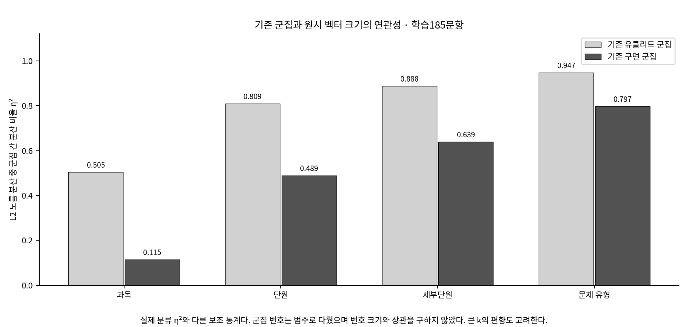

# 거리 통계와 기존 K-means 결과의 연결

이번 통계는 학습185문항의 표현을 분석한다. 아래 ARI·NMI는 기존 모델이 별도 테스트80문항에서 얻은 값이며 이번 분석의 새 성능 실험이 아니다.

|분류|유클리드 ARI|구면 ARI|구면−유클리드 ARI|유클리드 NMI|구면 NMI|
|---|---:|---:|---:|---:|---:|
|과목|0.096741|0.240409|+0.143668|0.103918|0.189496|
|단원|0.147941|0.146974|-0.000967|0.401007|0.423195|
|세부단원|0.193247|0.197151|+0.003904|0.593365|0.636467|
|문제 유형|0.167027|0.150731|-0.016295|0.780388|0.789955|

- 과목: 구면−유클리드 ARI 차이 **+0.143668**.
- 단원: 구면−유클리드 ARI 차이 **-0.000967**.
- 세부단원: 구면−유클리드 ARI 차이 **+0.003904**.
- 문제 유형: 구면−유클리드 ARI 차이 **-0.016295**.

과목에서 구면 방식의 ARI 차이가 가장 크다. 단원과 세부단원의 수치 차이는 작고, 문제 유형에서는 유클리드가 더 높다. 반복 분할이나 유의성 검정을 하지 않았으므로 작은 차이를 통계적으로 확정적인 우열로 해석하지 않는다.

## 내부·간 거리의 방향과 성능을 구별

|분류|거리|내부 / 간 문항쌍|내부 평균|간 평균|간−내부|간/내부|
|---|---|---:|---:|---:|---:|---:|
|과목|유클리드|8494 / 8526|17.8443|20.0839|2.2396|1.1255|
|과목|코사인|8494 / 8526|0.3585|0.4589|0.1003|1.2798|
|단원|유클리드|3401 / 13619|16.4973|19.5828|3.0855|1.1870|
|단원|코사인|3401 / 13619|0.3213|0.4307|0.1094|1.3405|
|세부단원|유클리드|1454 / 15566|14.9075|19.3453|4.4379|1.2977|
|세부단원|코사인|1454 / 15566|0.2747|0.4213|0.1466|1.5336|
|문제 유형|유클리드|578 / 16442|12.1812|19.2047|7.0235|1.5766|
|문제 유형|코사인|578 / 16442|0.1990|0.4162|0.2172|2.0916|

전체 문항쌍을 가중한 평균은 큰 집단에 더 큰 가중치를 준다. 아래 macro는 비교 가능한 같은 클래스 집합을 동일 가중으로 읽기 위한 보조 집계다.

|분류|거리|전체 내부 / 간 쌍 (가중치 아님)|내부 평균|간 평균|간−내부|간/내부|
|---|---|---:|---:|---:|---:|---:|
|과목|유클리드|8494 / 8526|17.8557|20.0839|2.2282|1.1248|
|과목|코사인|8494 / 8526|0.3548|0.4589|0.1041|1.2933|
|단원|유클리드|3401 / 13619|16.1023|19.7124|3.6101|1.2242|
|단원|코사인|3401 / 13619|0.2868|0.4292|0.1424|1.4965|
|세부단원|유클리드|1454 / 15566|14.7873|19.4249|4.6376|1.3136|
|세부단원|코사인|1454 / 15566|0.2724|0.4269|0.1544|1.5670|
|문제 유형|유클리드|578 / 16442|12.8803|19.3310|6.4506|1.5008|
|문제 유형|코사인|578 / 16442|0.2042|0.4028|0.1986|1.9725|

클래스별 다른 분류 거리는 해당 클래스 대 나머지(one-vs-rest)다. 클래스별 between_pairs를 합하면 교차쌍을 두 번 세므로 전체17,020쌍 검증에는 pooled 표를 사용한다. 내부쌍이 없는 singleton은 클래스별 내부 통계와 comparable macro에서 제외하고 개수를 원표에 남긴다.

거리 분리의 평균·비율은 실제 라벨 구조를 관찰하는 값이다. 코사인은 정규화 유클리드 제곱거리의 절반이므로, 비율의 차이에도 비선형 거리 변환이 관여한다. 비율이 높아도 거리 방식의 우열이나 기존 테스트 ARI와의 인과 관계가 입증된 것은 아니다. 군집화는 개별 거리 평균이 아니라 여러 중심에 대한 최적화다.

## 문항 길이·벡터 크기와 저장된 군집

원래 token_count와 고정 BoW L1 노름, L2 노름을 문항·실제 분류·기존 학습 군집별로 읽었다. 원래 학습 문항의 어휘 밖 토큰은 없으므로 token_count와 L1은 같은 값이며 서로 독립적인 두 증거가 아니다. API 사용량과도 다른 수치다.

|거리|거리와 L2 노름 차이 절댓값의 Pearson 상관|거리와 L1 차이 절댓값의 Pearson 상관|
|---|---:|---:|
|일반 유클리드|0.7884|0.6433|
|코사인1−cos|0.1104|0.0141|

[문항쌍별 길이 차이와 거리의 관계](length_distance_association.csv). 이 상관도 반복 문항쌍의 기술 통계이며 p값·인과관계로 해석하지 않는다.

제곱 유클리드 거리의 대수적 항등식도 별도로 확인했다: d_E²=(||x||−||y||)²+2||x||||y||×d_cos.
첫 노름 차이 제곱항의 전체 평균 제곱거리 비중은 30.27%다. 이는 같은 원시 거리를 항으로 나눈 수치이며, 토큰을 없앴을 때의 효과나 군집화 성능 차이의 인과적 기여율을 추정한 것이 아니다.

[분류별 길이·노름](class_norm_summary.csv) · [기존 군집별 분포](cluster_norm_summary.csv) · [군집-노름 연관성](cluster_norm_association.csv)

|분류|유클리드 군집의 L2 노름 η²|구면 군집의 L2 노름 η²|
|---|---:|---:|
|과목|0.5048|0.1153|
|단원|0.8095|0.4891|
|세부단원|0.8878|0.6387|
|문제 유형|0.9474|0.7971|

이 η²는 군집을 집단으로 두었을 때 원시 L2 노름의 분산을 얼마나 나누는지 나타낸다. 실제 교육과정 라벨에 대한 토큰 η²와 다른 통계다. 임의의 군집 번호를 연속 숫자로 보고 상관을 계산하지 않았다. 큰 k·적은 문항의 집단에서는 이 보조 통계도 커질 수 있다.

## 가능한 설명과 미확인 부분

- 관찰: 정규화는 중복 좌표의 상대적 비중과 일부 개념·연산·변수 좌표의 비중을 바꿨다. 토큰별·설명용 범주별 수치를 함께 읽는다.
- 해석 후보: 원시 유클리드가 절대 토큰 사용 규모와 서식 반복량의 영향을 더 받을 수 있다. 정규화 후에도 서식 좌표가 사라지지 않고 일부 분류와의 연관성이 높아질 수 있다.
- 미확인: 원인 전체를 정규화로 설명할 수 없다. Spherical K-means의 단위 중심 갱신, 초기 중심이 미치는 영향, 목적함수 차이, 학습185와 테스트80의 차이가 함께 있다.
- 미실행: 원인 분리를 위한 정규화 유클리드 K-means·불용어 제거·새로운 성능/유의성 실험은 하지 않았다. Pearson 등의 보조 관계가 저장돼 있더라도 반복 문항쌍을 독립 표본으로 간주한 인과·유의성 결론을 내리지 않는다.

[거리·토큰 분석 처음으로](README.md) · [원래 군집화 결과](../../final_experiment/01_clustering/README.md)
