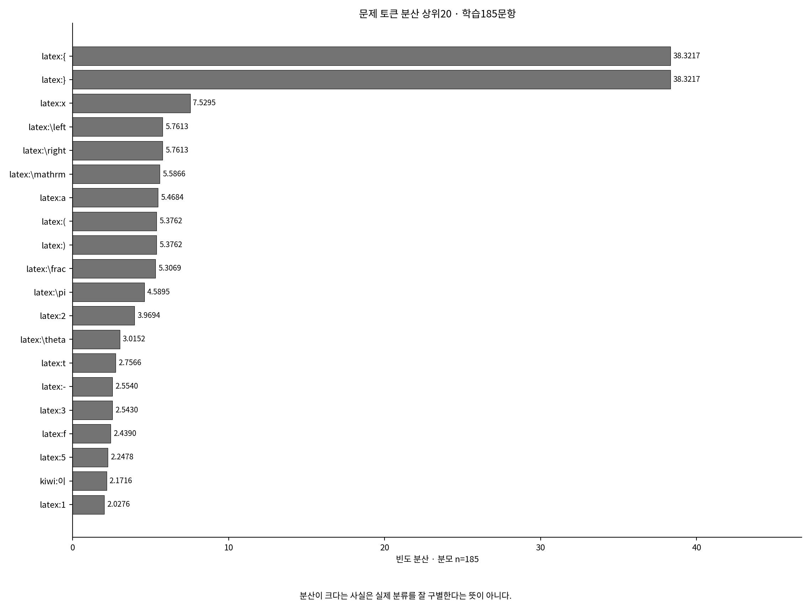

# MathHint 후속 연구 1단계 · 사용자의 토큰 검토 자료

<!-- approved-stopwords:start -->

## 사용자 승인 불용어 목록 등록

사용자가 검토 목록의 **②번**을 승인한 뒤 전체265문항 누락 검증에서 발견한 풀이 숫자6개를 추가 승인하여 [문제96개](stopwords/problem_stopwords.json)·[풀이103개](stopwords/solution_stopwords.json)를 등록했다. 기본 후보+A·B·C·D와 일반 영문 이름을 포함하고, 혼용 문자 `a`, `x`, `v`도 해당 어휘에서 제외 대상으로 선택했다. 함수명 `f`, `g`, `h`, `Q`, `R`은 보존한다.

추가한 풀이 토큰은 `latex:22`, `latex:29`, `latex:44`, `latex:62`, `latex:80`, `latex:96`이다. **앞으로의 BoW는 문제와 원본 풀이 모두 전체265문항을 기준**으로 한다. 학습185문항의 고정 어휘뿐 아니라 전체 원문에서 확인된 토큰까지 검토하며, 기존346·431차원 어휘·벡터와 과거 통계·실험 결과는 그대로 보존한다.

현재는 **목록만 등록**했다. 아래의 기존 통계와 원문·벡터·모델·API 결과에는 불용어를 적용하지 않았다. 향후 목록을 추가·삭제·변경하기 전에도 전체 대상 토큰을 먼저 보여 주고 명시적 확인을 받는다. 후속 벡터 가공·모델 실험은 별도 요청을 기다린다.

<!-- approved-stopwords:end -->


<!-- full-dataset-eta:start -->

## 문제·풀이 모두: 학습+테스트 전체265문항 η²

**[전체265문항 η² 안내](05_full_dataset_eta/README.md)** — 기존 학습185문항 전용 문제 표와 구분한 새 탐색 자료다. 원시·L2 정규화 η²를 과목·단원·세부단원·유형별로 읽는다.

|영역|고정 어휘|전체265 η² 순위표|
|---|---:|---|
|문제|346개|[문제 전체 순위](05_full_dataset_eta/01_problem_tokens/README.md)|
|원본 풀이·해설|431개|[풀이 전체 순위](05_full_dataset_eta/02_solution_tokens/README.md)|

학습185+테스트80을 합쳤으며 어휘와 인덱스는 그대로다. 풀이 토큰은 원본 해설을 뜻하고, Gemini 생성 응답을 뜻하지 않는다. 기존 학습 전용 표·모델·결과는 보존했다.

<!-- full-dataset-eta:end -->


<!-- eta-rankings:start -->

## η² 기준 전체 346개 토큰 순위표

[순위표 안내](01_problem_tokens/eta_rankings/README.md)에서 원시·정규화 η², 학습 DF와 의미를 함께 읽을 수 있다. 각 문서는 상위30개와 펼쳐 보는 전체346개를 제공한다.

|분류|원시 η² 내림차순|L2 정규화 η² 내림차순|
|---|---|---|
|과목|[원시 순위](01_problem_tokens/eta_rankings/curriculum.md#raw-ranking)|[정규화 순위](01_problem_tokens/eta_rankings/curriculum.md#normalized-ranking)|
|단원|[원시 순위](01_problem_tokens/eta_rankings/unit.md#raw-ranking)|[정규화 순위](01_problem_tokens/eta_rankings/unit.md#normalized-ranking)|
|세부단원|[원시 순위](01_problem_tokens/eta_rankings/subunit.md#raw-ranking)|[정규화 순위](01_problem_tokens/eta_rankings/subunit.md#normalized-ranking)|
|문제 유형|[원시 순위](01_problem_tokens/eta_rankings/type.md#raw-ranking)|[정규화 순위](01_problem_tokens/eta_rankings/type.md#normalized-ranking)|

<!-- eta-rankings:end -->


<!-- distance-comparison:start -->

**추가 분석: [유클리드와 코사인 거리의 토큰 영향 비교](04_distance_comparison/README.md)**

학습185문항·17,020쌍에서 거리 기여도·L2 정규화 전후 η²·분류 내부/간 거리를 비교했다. 기존 통계와 그림은 보존했고, 모델 재학습이나 불용어 적용은 하지 않았다.

<!-- distance-comparison:end -->

**아래 통계는 불용어 선정·적용 전의 원본 토큰 분석 결과다. 군집화 재실험·모델 학습·Gemini 호출은 수행하지 않았다.** 문제346·해설431개의 고정 어휘와 기존185/80 분할을 그대로 읽었다.

## 먼저 확인할 주요 관찰

- 어휘 종류: 문제 Kiwi224·LaTeX122, 해설 Kiwi296·LaTeX135.
- 문제의 학습 분산 상위: `latex:{`, `latex:}`, `latex:x`, `latex:\left`, `latex:\right`, `latex:\mathrm`.
- 중괄호·좌우 표시·소괄호 6좌표의 학습 문항쌍 제곱거리 기여 합: **49.00%**. 높은 기여는 수학적 중요도와 같지 않다.
- `latex:{`의 학습 분산은 38.3217, 과목 η²는 0.0885다. `latex:\sin`은 분산 0.6055, 과목 η² 0.5327다. 큰 거리 기여와 특정 분류의 구별 능력은 같은 순위를 보이지 않는다.
- 실제 분류와의 연관성 η²는 학습185에서 계산했다. 분산이 크거나 η²가 높다는 이유로 토큰을 자동 제거하지 않았다.

|분류 수준|학습 집단 수|1문항 집단 수|η² 상위3 토큰|
|---|---:|---:|---|
|과목|2|0|`latex:\sin` (0.5327, DF=73), `latex:\pi` (0.4165, DF=76), `latex:\frac` (0.4085, DF=110)|
|단원|8|0|`kiwi:연속` (1.0000, DF=18), `latex:.` (0.7805, DF=18), `latex:&` (0.7572, DF=18)|
|세부단원|25|6|`kiwi:연속` (1.0000, DF=18), `kiwi:수직선` (1.0000, DF=8), `kiwi:움직이` (1.0000, DF=8)|
|문제 유형|70|43|`kiwi:연속` (1.0000, DF=18), `latex:.` (1.0000, DF=18), `kiwi:방향` (1.0000, DF=9)|

## 기존 Gemini B·C 상위토큰의 실제 구성

|실제 전송 좌표의 설명용 범주|B 예측 해설|C 실제 해설|
|---|---:|---:|
|서식·구조·고정 양식|503/1600 (31.44%)|534/1600 (33.38%)|
|숫자·변수|539/1600 (33.69%)|477/1600 (29.81%)|
|수학 개념·명령·연산|436/1600 (27.25%)|409/1600 (25.56%)|
|풀이 방법 자연어|0/1600 (0.00%)|0/1600 (0.00%)|
|그 밖의 일반·불확실 토큰|122/1600 (7.62%)|180/1600 (11.25%)|

각 비율은 조건별80문항에 실제 전송된 좌표 수를 분모로 삼는다. 빈도 값 가중치나 API 사용량이 아니다. 특정 원본 해설과 토큰이 다르더라도 다른 올바른 풀이가 존재할 수 있다. ‘풀이 방법 자연어’의0은 현재 설명용 사전에 해당하는 명시적 자연어가 없다는 뜻이며, 수학 명령·연산의 단서나 실제 힌트 효과가0이라는 뜻은 아니다.

## 학습 어휘 밖의 테스트 표현

|영역|제외된 등장 횟수 / 테스트 전체 토큰 수|제외 토큰 등장 비율|제외 토큰 종류|
|---|---:|---:|---:|
|문제|29/7056|0.41%|20|
|해설|48/18210|0.26%|31|

제외 횟수가 적어도 수학적 조건을 담은 표현이 빠질 수 있다. [OOV의 실제 문자열과 의미](03_oov_analysis/README.md)를 확인한다. 어휘를 확장하지 않았다.

## 읽는 순서

|순서|바로 볼 자료|
|---|---|
|1 문제 표현의 통계|[문제 토큰 안내·그림](01_problem_tokens/README.md) · [전체346목록](01_problem_tokens/all_tokens.csv)|
|2 분류 연관성과 중복성|[분산·η² 표](01_problem_tokens/variance_by_classification.csv) · [동일/유사 좌표](01_problem_tokens/redundancy_analysis.csv)|
|3 해설 힌트의 구성|[해설 토큰·B/C 분석](02_solution_tokens/README.md) · [전체431목록](02_solution_tokens/all_tokens.csv)|
|4 제외된 테스트 토큰|[문자열·횟수·손실 가능성](03_oov_analysis/README.md)|
|5 전체 해석과 정의|[토큰화·분산 정의·한계 보고서](token_analysis_report.md) · [검증 기록](validation.json)|

## 사용자가 직접 선택할 파일

- [문제 불용어 목록](stopwords/problem_stopwords.json)
- [해설 불용어 목록](stopwords/solution_stopwords.json)

**두 목록은 프로그램이 자동으로 채우지 않는다.** 범주·분산·η²는 선택 근거이며 제거/유지의 확정 판정이 아니다. 사용자의 목록 확정과 명시적 요청 전에는 후속 단계를 구현하거나 실행하지 않는다.

## 그림과 실행



[분산과 η² 산점도](01_problem_tokens/figures/variance_eta_scatter.png) · [중복 거리 기여](01_problem_tokens/figures/redundant_distance_contribution.png) · [Kiwi/LaTeX 구성](01_problem_tokens/figures/source_distribution.png) · [B/C 범주 비교](02_solution_tokens/figures/top20_category_composition.png)

문서는 GitHub에서 읽고 PNG 링크는 눌러 확대한다. CSV는 UTF-8 BOM으로 저장되어 Excel에서 한글을 읽을 수 있다. 원래 토큰의 kiwi:/latex: 접두사와 백슬래시를 그대로 표시한다.

```bash
python -m mathhint_analysis.token_analysis analyze  # 기존 자료로 통계 생성
python -m mathhint_analysis.token_analysis report   # 저장 CSV로 문서·그림만 재생성
python -m mathhint_analysis.token_analysis verify   # 분석·원본 보존 검증
```

기존 final_experiment는 불변 비교 근거로 보존했다. 이번에는 모델 성능 개선이 아니라 사용자 검토용 근거를 게시한 뒤 중단한다.
